# do-kit

**Building blocks for Cloudflare Durable Objects.** The smallest set of layers that lets you pick what fits your app: each adds one capability on top of the one below, and stops there. Use the lowest layer that does the job:

Everything is exported from `@leostera/do-kit`. Each layer also has its own path, if you want to import only that layer.

| Layer | Also at | What it gives you |
|---|---|---|
| **Sharded object** (`ShardedObject`) | `@leostera/do-kit/sharded` | One object that splits itself into shards as it gets busy. Transactions within a shard, routing that follows splits. |
| **Sharded table** (`ShardedTable`) | `@leostera/do-kit/table` | Typed rows on a sharded object: indexes in every shard, conditional writes on a version per row, counts, and sorted listings across shards with a cursor that survives splits. With no indexes, a key-value store. |
| **Indexed table** (`IndexedTable`) | `@leostera/do-kit/indexed` (phase 1, [RFD0003](docs/rfds/RFD0003-indexed-table.md)) | Global indexes on shards of their own: lookups by another column, unique constraints, and listings within a partition that read one index shard per page. A write returns once its index entries are written. Not benchmarked yet. |
| Events, cached reads | coming | Change feeds and watches, and reads cached in every data center. |

To try one, run an [example](examples): small apps for each layer, each started with `bun dev` or `npm run dev`, with a page that shows its shards splitting live.

## Sharded objects: Durable Objects that split themselves when they get busy

A Durable Object is a great home for state, but it is one object: one thread, 10 GB of storage. When a hot account, document or room outgrows it, you are left sharding by hand. A `ShardedObject` lets you write the object as if it were one, and splits it for you. When a shard stays busy, it hands half of its keys to a new object, and your Workers follow the split without you changing a line.

A split moves that half with a single storage snapshot, so it takes seconds, not minutes, and the object keeps serving while it happens.

## What it buys you over one Durable Object

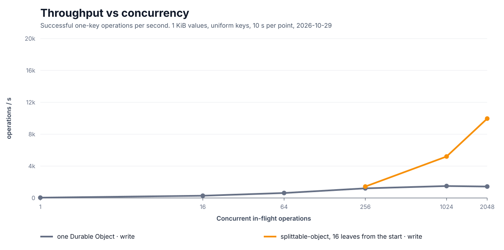

At 2,048 writes in flight, a single Durable Object is past its limit. It completes 2,068 writes/s and refuses 23,263 calls in 10 seconds. The same object split into 16 shards completes **9,800 writes/s and refuses none**. Reads tell the same story: 1,611 reads/s with 31,785 failed calls, against **14,947 reads/s with none**.

| 1 KiB values, uniform keys | One Durable Object | Sharded object, 16 shards |
|---|---|---|
| **Throughput**, 1,024 in flight | 2,064 writes/s | **5,527 writes/s** |
| **Throughput**, 2,048 in flight | 2,068 writes/s, 23,263 calls refused in 10 s | **9,800 writes/s, none refused** |
| **Reads**, 1,024 in flight | 1,753 reads/s, median 597 ms | **7,445 reads/s, median 79 ms** |
| **Reads**, 2,048 in flight | 1,611 reads/s, 31,785 calls failed in 10 s | **14,947 reads/s, none failed** |
| **Data written**, 2,048 in flight | 2.0 MiB/s | **9.6 MiB/s** |
| **Median latency**, 1,024 in flight | 386 ms | **110 ms** |
| **p99 latency**, 2,048 in flight | 1,357 ms | **705 ms** |
| **Storage ceiling** | 10 GB | **160 GB** (10 GB per shard) |

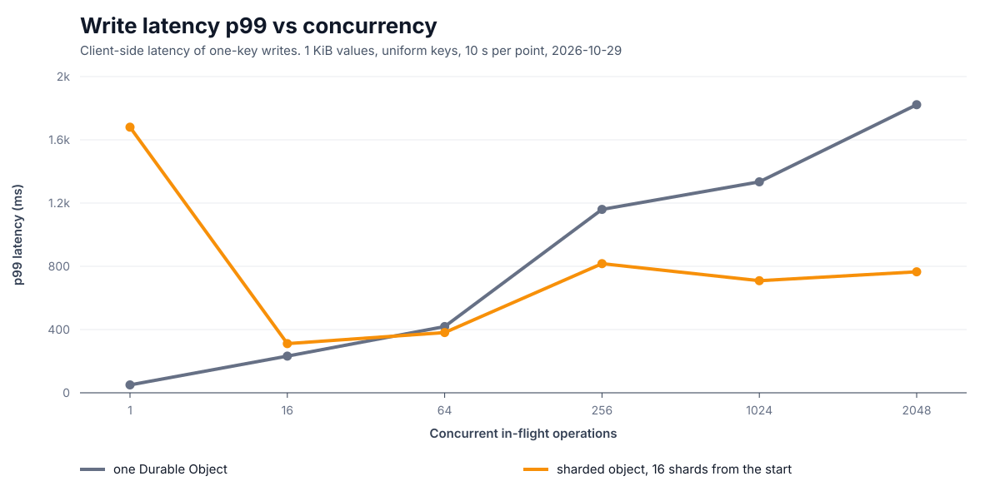

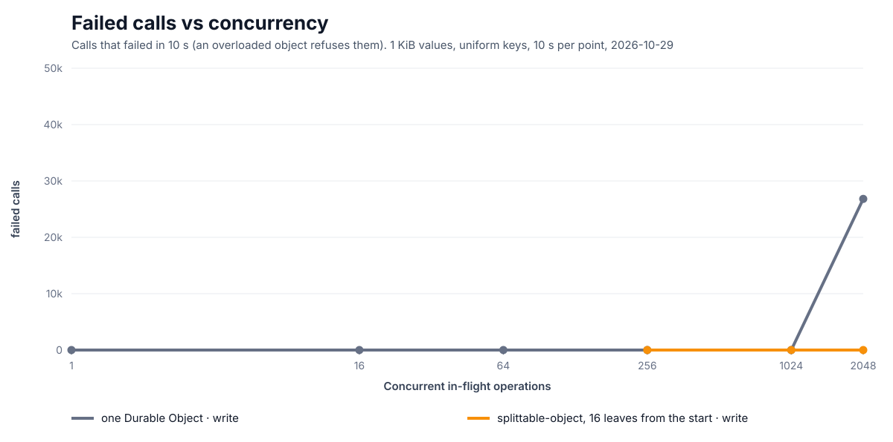

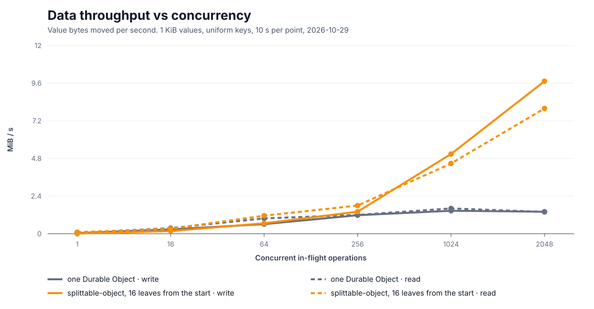

These were measured on Cloudflare's network, with up to 128 load-driver Durable Objects in several regions. Each point is 10 s of one-key reads or writes. The 16-shard object was presplit, so these numbers show the capacity that splitting gives, not the cost of the splits along the way. That cost is next. More latency graphs ([p50](docs/bench/latency-p50.svg), [p95](docs/bench/latency-p95.svg), [max](docs/bench/latency-max.svg)) and the method are in [docs/performance.md](docs/performance.md).

### A control plane: a handful of hot objects

Ten configuration objects, a few far more popular than the rest (Zipf), read 95% of the time.

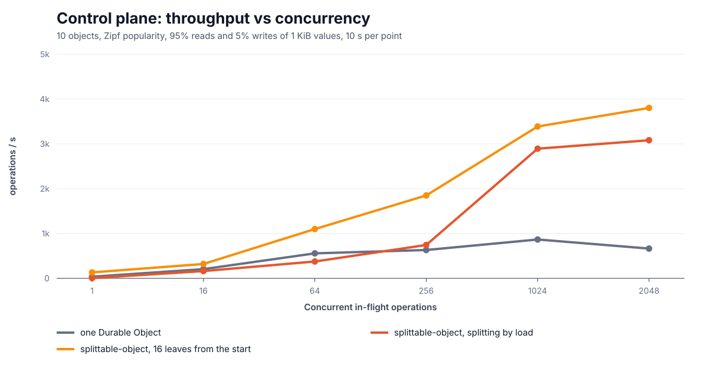

| In flight | One Durable Object | Sharded object, splitting by load | Sharded object, 16 shards |
|---|---|---|---|
| 256 | 1,142/s, p99 939 ms | 1,668/s | 1,904/s, p99 632 ms |
| 1,024 | 1,527/s, p99 1,392 ms | 2,388/s | 3,547/s, p99 881 ms |
| 2,048 | 1,713/s, 27,650 calls failed | 4,656/s, 9,655 calls failed | 4,522/s, 10,516 calls failed |

With only ten keys, splitting still spreads them over several objects. It cannot split a single key, though, and the most popular object takes about a third of all calls, so throughput levels off near 4,700/s: the most one object can serve of that one key. At 2,048 in flight, that object is overloaded and refuses calls even with 16 shards. Splitting by load also kept splitting past the number of keys (to 29 shards for 10 keys), which cannot help. If one object is your bottleneck, look at the [control plane graphs](docs/performance.md#a-control-plane-a-handful-of-hot-objects).

## Splits take seconds

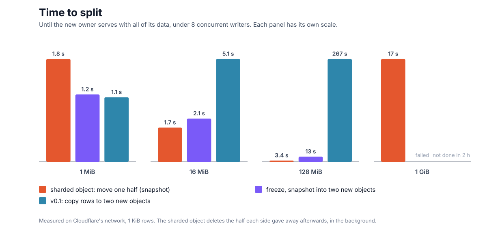

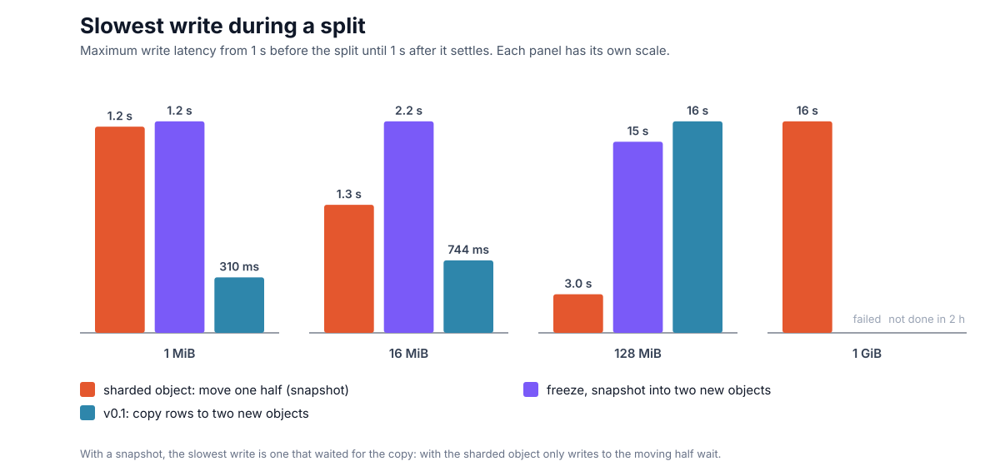

When load splits an object, it pays for it once. Here an object seeded with 1 MiB to 1 GiB of 1 KiB rows, split once while 8 writers kept writing to random keys. No write failed in any run.

| Data in the object | Sharded object | Freeze, snapshot into two new objects | v0.1: copy rows to two new objects |
|---|---|---|---|
| 1 MiB | 1.8 s | 1.2 s | 1.1 s |
| 16 MiB | **1.7 s** | 2.1 s | 5.1 s |
| 128 MiB | **3.4 s**, slowest write 3.0 s | 13.4 s, every write blocked for it | 267 s, write p95 2.2 s throughout |
| 1 GiB | **16.9 s**, write p99 265 ms | the split failed (earlier version) | did not finish in 2 hours (earlier version) |

The times are until the new object serves with all of its data. The two older designs were not run again at 1 GiB: those two cells are from an earlier version. See [what was measured and how](docs/performance.md).

## What it costs

Splitting does not change what you pay per call: each write is one request to one shard, as it would be to one object.

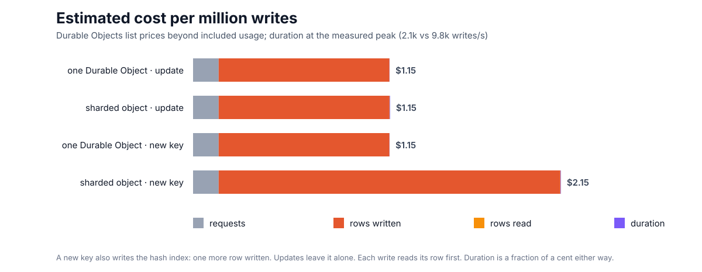

| Per million writes (Workers Paid list prices) | One Durable Object | Sharded object |
|---|---|---|
| Update an existing key | $1.15 | $1.15 |
| Write a new key | $1.15 | $2.15 |

The difference is the index on each key's hash, which makes a new key cost one more row written ($1.00 per million rows). Duration is billed per object while it is busy, so 16 busy shards cost more than one object, but at $12.50 per million GB-s that comes to $0.0010 against $0.0025 per million writes.

A split costs the rows it deletes: each side deletes the half it gave away, at two rows written per row (table and index). The snapshot is made by the storage layer and is not billed as rows written. For 1 KiB rows that is about $0.03 to split 16 MiB, $0.26 for 128 MiB and $2.10 for 1 GiB, and an object usually splits long before it holds that much.

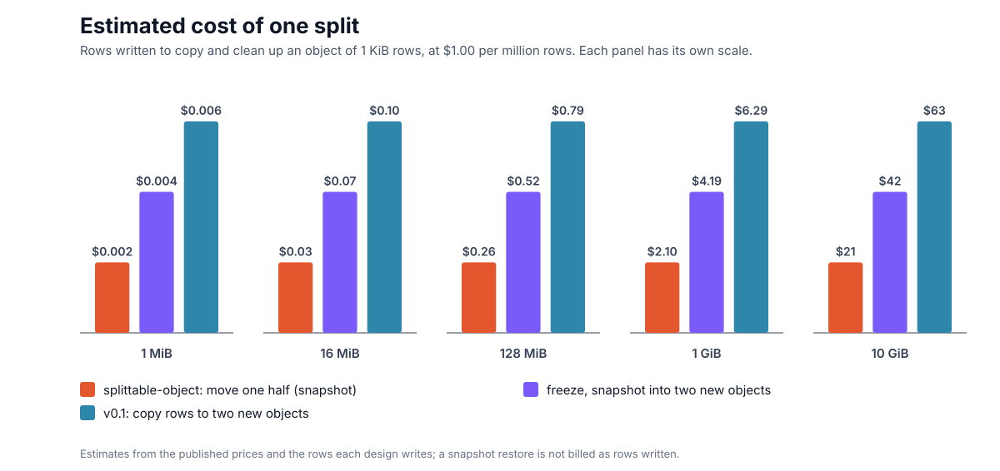

These are estimates from the [published prices](https://developers.cloudflare.com/durable-objects/platform/pricing/) and the row counts of the code, not from an invoice. Included monthly usage is not subtracted.

## Why it is fast

- **Only half moves.** A shard lives in the object named by its bits without trailing zeros, so when `01` splits, `010` stays where it is and only `011` goes to a new object. That means one copy, not two, and no object is left behind as a router.
- **One snapshot, not a row stream.** The new object restores from `ctx.storage.snapshot()`, a point-in-time copy of the whole database made by the storage layer. It still takes longer for a bigger database, but far less than a row-by-row copy: 5.7 s against 235 s at 128 MiB.
- **Most traffic never notices.** While the copy is made, reads go on, and so do writes to the half that stays. Only writes to the half that moves wait, and then they are sent to the new owner.
- **Cleanup stays out of the way.** Each side deletes the half it gave away in small batches in the background. Those rows are invisible from the moment of the switch.

## What you get

- **One object to write.** You write methods that read and update keys, and the base class runs them on whichever shard owns those keys.
- **Splits under load, by itself.** A shard splits when its call rate stays above a threshold. There are no shard counts to choose up front.
- **Clients that find their way.** Workers learn about splits lazily, and share what they learn in the isolate and the colo cache. A stale map costs one extra hop, never a wrong answer, because splits are final.
- **Correctness you can check.** The split protocol is an executable [Feynman](https://github.com/leostera/feynman) model, [`specs/snapshot-split.ts`](specs/snapshot-split.ts). It checks that no acknowledged write is lost or applied twice, that two objects never serve the same key, and that no read is stale, across lost messages and restarts.

## When it helps, and when it does not

**It helps** when one logical object holds many independent keys and outgrows one Durable Object: too many writes per second, or too much data for 10 GB. Each shard is a full Durable Object with its own thread and storage limit.

**It does not help:**
- **One hot key.** A key always lives on one shard, so the most popular key caps what a shard can serve. The split policy does not yet know this, and keeps splitting a shard that is hot because of one key.
- **Cross-key transactions.** `update` is transactional within one shard, and `callOneShard` refuses (before applying anything) when keys span shards. Nothing spans shards.
- **Small loads.** Below what one object can take, a plain Durable Object is simpler and as fast.

## Sharded tables: rows, indexes and listings

Most things built on a sharded object end up as a table: a directory, a control plane, records listed newest first. `ShardedTable` is that table. Declare the columns and indexes, and every shard keeps them for its own rows.

```ts
import { defineTable, ShardedTable, table } from "@leostera/do-kit";

type Order = { id: string; customer: string; total: number; createdAt: number; shippedAt: number | null; cancelled: boolean };
const orders = defineTable<Order>({
  primaryKey: "id", // also what routes a row to its shard
  columns: { id: "text", customer: "text", total: "integer", createdAt: "integer", shippedAt: "integer", cancelled: "boolean" },
  indexes: { byCreated: ["createdAt"], byShipped: ["shippedAt"] },
  counts: { byCancelled: "cancelled" }, // rows per value of a column, kept with every write
});

export class Orders extends ShardedTable<Env, Order> {
  protected table = orders;
  protected nodes() { return this.env.ORDERS; }
}

// In a Worker
const t = table(env.ORDERS, "shop-42", orders);
await t.put({ id: "o_1001", customer: "ada", total: 4200, createdAt: Date.now(), shippedAt: null, cancelled: false }, { ifVersion: 0 }); // only if new
const page = await t.list({ index: "byCreated", direction: "desc", where: [{ column: "cancelled", op: "=", value: false }], limit: 50 });
const next = await t.list({ index: "byCreated", direction: "desc", where: [{ column: "cancelled", op: "=", value: false }], limit: 50, cursor: page.cursor });
```

- **Writes** (`put`, `patch`, `delete`, and batches) are conditional on a version per row: `ifVersion: 0` means "only if absent". Each is one transaction with its index entries, fenced against splits. A key never has the same version twice: a row written again after a delete starts above the versions of the rows its shard deleted, so a write conditional on a version read before the delete fails. That costs a delete one more row written.
- **Listings** merge one page from every shard. The cursor holds only a sort position, so it survives splits. No row is skipped or returned twice across pages while shards split and clean up; that is model-checked in [`specs/table-listing.ts`](specs/table-listing.ts) and tested against a reference sort. `where` takes `=`, `!=`, `<`, `<=`, `>`, `>=`, `isNull`, `notNull`, `prefix` and `contains` (ignoring case).
- **Counts** are kept per hash prefix with every write, so `count()` is cheap and exact at any depth up to 16. Declare `counts` groups to also count rows per value of a column: `countBy("byCancelled")` returns `[{ value: false, count: 812 }, { value: true, count: 40 }]`, just as cheaply. A listing takes `withCount: true` (or a group's name) and returns `total` (and `counts`) from the same calls to the shards, so a page with its total costs one fan-out, not two. Counts don't take `where`: counting arbitrary conditions would read every row of every shard.
- **Schema changes:** add columns and indexes in the schema; each shard applies them the first time it runs the new code.
- Custom transactional methods use `getRow`, `putRow`, `patchRow` and `deleteRow` inside `transact`.

### What a table buys you, measured

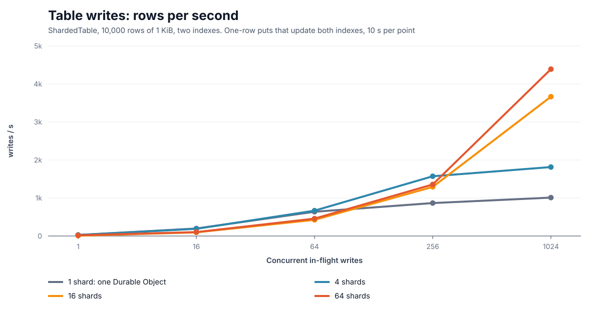

10,000 rows of 1 KiB with two indexes, on 1 shard (one Durable Object running the same SQL) and on 4, 16 and 64 shards from the start:

| 1,024 in flight | 1 shard | 4 shards | 16 shards | 64 shards |
|---|---|---|---|---|
| **Writes** | 1,226/s, median 688 ms | 2,109/s | 5,125/s | **5,174/s, median 124 ms** |
| **Reads by key** | 1,745/s, median 561 ms | 4,333/s | **5,555/s, median 127 ms** | not measured* |
| **List pages** (50 rows) | 578/s | 564/s | 169/s, shed load | 369/s |

\* The 64-shard read runs at 256 and 1,024 in flight never answered: a Durable Object used up its CPU time until the runtime reset it. Other runs on 0.4.0 hit the same thing at times (in the 4,096-shard benchmark too), and the cause is not known yet.

**Listings do not scale with shards.** Every page asks every shard for its share, so each shard serves every page: listing throughput stays near what one object serves (about 560–580 pages/s here), and a page waits for its slowest shard. At 64 in flight, a page's median is 61 ms on 1 shard, 126 ms on 4, 193 ms on 16 and 456 ms on 64. Keep list-heavy tables to 16 shards or fewer. Listings that must scale further need an index stored by sort order rather than by key, which is the next layer.

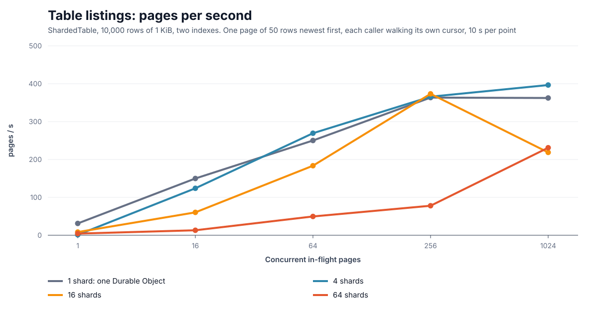

More in [docs/performance.md](docs/performance.md#sharded-tables) and the design in [RFD0002](docs/rfds/RFD0002-sharded-table.md).

## Indexed tables: global indexes

A sharded table answers "the row with this key" in one call. Anything else, such as "which user has this email?", asks every shard, and nothing stops two rows on different shards from having the same email. `IndexedTable` adds **global indexes**: they live on shards of their own, routed by the indexed values, so a lookup is one call and a unique index is enforced across the whole table.

```ts
import { defineTable, GlobalIndex, IndexedTable, indexedTable } from "@leostera/do-kit";

type User = { id: string; email: string; name: string; team: string; createdAt: number };
const users = defineTable<User>({
  primaryKey: "id",
  columns: { id: "text", email: "text", name: "text", team: "text", createdAt: "integer" },
  globalIndexes: {
    byEmail: { columns: ["email"], unique: true },
    byTeam: { columns: ["team", "createdAt"], partition: 1 }, // one team per index shard, sorted by createdAt
  },
});

export class Users extends IndexedTable<Env, User> {
  protected table = users;
  protected nodes() { return this.env.USERS; }
  protected indexNodes() { return this.env.USER_INDEXES; }
}

export class UserIndexes extends GlobalIndex<Env> {
  protected nodes() { return this.env.USER_INDEXES; }
  protected rowNodes() { return this.env.USERS; }
}

// In a Worker
const t = indexedTable(env.USERS, env.USER_INDEXES, "workspace-42", users);
await t.put({ id: "u_1", email: "ada@example.com", name: "Ada", team: "core", createdAt: Date.now() }, { ifVersion: 0 });
// { ok: true, version: 1 }
await t.lookup("byEmail", ["ada@example.com"]); // { row: { id: "u_1", ... }, version: 1 }
await t.put({ id: "u_2", email: "ada@example.com", name: "Ada L.", team: "web", createdAt: Date.now() });
// { ok: false, version: 0, conflict: "byEmail" }: nothing was written
await t.list({ index: "byTeam", partition: ["core"], direction: "desc", limit: 50 }); // one index shard per page
```

- **A write returns once every index has it.** A write reserves its unique values, writes the row and its index changes (an outbox) in one transaction, and delivers them before it returns. If delivery takes longer than `indexWaitMs` (5 s), the client throws `IndexPending`: the row is written, and the row shard's alarm goes on delivering.
- **Unique values are reserved with fencing tokens.** A reservation left behind by a writer that never wrote is resolved by asking the row's shard, which fences the token so that writer's write cannot land later. The protocol is model-checked in [`specs/indexed-write.ts`](specs/indexed-write.ts): at most one row has a value, a write that returned is found, and the indexes converge to the rows, across lost calls, timeouts and late deliveries.
- **The rows stay the truth.** Index entries carry a copy of the row, so a lookup or page needs no second call. Every write rewrites its entries, so each global index costs one more write per row write, and a write with a unique index makes one more call before it.
- Rows and index shards split by load, independently. Per-shard `indexes` and `counts` work as in `ShardedTable`. Custom methods that write rows use `indexedTransact`.
- Not built yet: sorted listings across the whole table (range-partitioned indexes, phase 2), and adding a global index to a table that already has rows.

## Install

```sh
npm install @leostera/do-kit
```

You need SQLite-backed Durable Objects, `nodejs_compat`, and, for snapshot splits, the `durable_object_snapshots` compatibility flag. Without that flag, or in local development (where workerd has no snapshots), splits copy rows over RPC instead. That copy is slower, but it works the same way.

## Quick start

```ts
import { ShardedObject, sharded, type UpdateResult } from "@leostera/do-kit";

interface Env {
  COUNTERS: DurableObjectNamespace<Counter>;
}

export class Counter extends ShardedObject<Env, number> {
  protected nodes() {
    return this.env.COUNTERS;
  }

  async add(keys: readonly string[], amounts: readonly number[]) {
    return this.update(keys, (current): UpdateResult<number, number[]> => {
      const writes = new Map<string, number>();
      const result = keys.map((key, i) => {
        const value = (current.get(key) ?? 0) + amounts[i]!;
        writes.set(key, value);
        return value;
      });
      return { writes, result };
    });
  }

  async get(keys: readonly string[], _payloads: null) {
    const values = await this.read(keys);
    return keys.map((key) => values.get(key) ?? null);
  }
}

// In a Worker:
const counters = sharded(env.COUNTERS, "account-123");
const shards = await counters.call(["apples", "pears"], "add", [2, 1]);
```

A method called through `client.call` takes its `keys` first and their `payloads` second (`null` when it needs none), then any other arguments. The client groups keys by shard and returns one `ShardResult` per shard, with the `positions` of its keys in your list.

- **All-or-nothing updates:** `callOneShard` runs a method on one shard, or throws `SpansShards` before applying anything.
- **Waiting:** a call waits up to 30 s for a shard that is not serving yet (`sharded(ns, name, { notReadyWaitMs })` to change it). A write held by a split in progress waits until that split finishes or gives up (`splitTimeoutMs`), however long that is.
- **Jurisdictions:** pass `env.X.jurisdiction("eu")` to `sharded` and every shard of the object stays in that jurisdiction, including the ones splits create.
- **Stub options:** `sharded(ns, name, { stubOptions: { version: { cohort } } })` passes options to every stub of the object's shards, including the stubs shards make for each other when they split.
- **Scans:** `client.scan("method")` calls a method on every shard. It can enumerate that shard's rows with `this.allRows()`. There is one result per shard, not a global snapshot.

## Split policy

```ts
protected override splitPolicy: SplitPolicy = {
  callsPerSecond: 400, // a shard splits above this, sustained over windowSeconds
  windowSeconds: 5,
  maxDepth: 12,        // at most 2^12 shards
  keysPerCall: 25,     // a call weighs 1 + keys / keysPerCall
  initialDepth: 0,     // presplit an empty object on its first call, for uniformly distributed keys (16 shards: about 1.5–3 s)
  copy: "auto",        // "native" snapshots, "logical" row copy, or auto-detect
  splitTimeoutMs: 60_000,
  holdWaitMs: 2_000,   // a write to the half being copied waits this long, then the client backs off and retries until the split ends
};
```

The default threshold is about half of what one object handles on the edge, which leaves headroom for real work and for the split itself. Tune it with your own workload.

## Writing a subclass

- `nodes()` returns the namespace that every shard of the class lives in.
- Routed methods take `(keys, payloads, ...args)` and use `read` and `update` for keyed state. The `decide` callback of `update` runs synchronously inside a transaction, so it cannot do I/O.
- A split copies **every table**, yours too. Two hooks decide what happens to your rows for keys a shard no longer owns:
  - `afterClone(owns)` runs in the new object as it claims the copy, inside that transaction. Drop work it must not repeat here, such as its share of an outbox the original keeps delivering.
  - `cleanupForeign(owns, limit)` runs in paced batches from the alarm, on both shards after a split, until it returns 0. Delete up to `limit` rows for keys you no longer own and return how many you deleted. The default deletes nothing, so an original that delivers an outbox keeps its rows.
- **Write your own tables only inside `update` or `transact(keys, fn)`.** Both wait while a split copies any of `keys`, check that the shard still owns them, and run in one transaction. A write that skips them can land after the copy and be lost. List every key whose rows you touch.
- `ownedRowsPage(afterKey, limit)` pages this shard's rows in key order, a bounded number at a time, skipping keys it gave away.
- `owns(key)` says whether a key is this shard's now. Until cleanup finishes, filter bulk queries over your own tables (listings, counts, uniqueness checks) with it.
- `beforeHandOut()` runs before the copy, while writes to the moving half wait. Use it to finish work tied to rows that are about to move.
- **Alarms: override `onAlarm()` and schedule it with `scheduleAlarm(at)`, never `alarm` or `ctx.storage.setAlarm`.** The alarm also activates new shards and runs the background cleanup. `scheduleAlarm` keeps the earliest time asked for, so your work never postpones a split's and a split never loses yours. `onAlarm` runs only on a serving shard, never in a split's copy before it serves. A split's new shard keeps the scheduled time, so check in `onAlarm` which due work is yours with `owns(key)`. Overriding `alarm` throws when the object starts.
- `shardedDescribe()` reports a shard's bits, rows and call rate, plus two things for attributing errors under load:
  - `splits`: its last 8 split attempts, each with when it started, how long it took, the copy method, the rows it owned and how many moved, the writes it held, how many of those were answered "not ready", the longest wait, and why it was abandoned, if it was. A new shard starts with an empty record.
  - `counters`: since the object last started, the writes held by splits and the longest hold, and:
    - `calls`: routed calls and scans that reached a method. `ok` of them returned; the rest answered "moved" or "not ready" from inside the method (a held write released as "moved", or held past `holdWaitMs`) or threw.
    - `moved`, `notReady`, `stale`: every such answer, both from inside a method and on arrival. Arrival answers (the caller's map was out of date) are not in `calls`.
    - Calls the runtime sheds as overloaded never reach the object, so they appear nowhere: compare what you sent with `calls` plus the arrival answers.

  Reach any shard with `env.NS.get(env.NS.idFromName(shardObjectName(name, bits))).shardedDescribe()`.

## Development

```sh
bun install
bun run check        # types
bun run build        # dist/: JavaScript and type declarations, what the package exports
bun test             # integration tests under cf dev: concurrent writes and CAS across splits, load splits, presplit, large rows, subclass tables
bun run specs:check  # model-check the split protocol
```

Design decisions are RFDs in [docs/rfds](docs/rfds/README.md): one numbered document per decision, proposals and snapshots of what is built. There are no other design documents.

Locally, splits copy rows: workerd has no storage snapshots. To run the same tests against snapshots, deploy the test Worker under another name with a token, and point the tests at it:

```sh
cd test/worker
echo "TEST_TOKEN=$(openssl rand -hex 32)" > /tmp/do-kit-test.vars   # not .dev.vars: cf dev would read it
TEST_WORKER_NAME=do-kit-test-snapshots cf deploy --secrets-file /tmp/do-kit-test.vars
cd ../..
set -a; . /tmp/do-kit-test.vars; set +a
TEST_URL=https://do-kit-test-snapshots.<your-subdomain>.workers.dev bun test --timeout 300000
```

Behind Cloudflare Access, also set `TEST_ACCESS_TOKEN` (`cloudflared access token -app=$TEST_URL`).

The benchmark Worker and the scripts that produced the graphs above are in [`bench/`](bench/README.md).

## License

MIT
