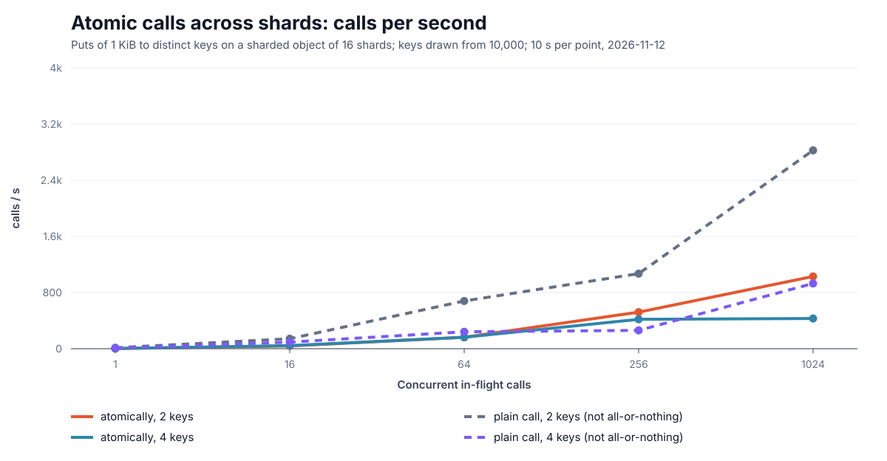
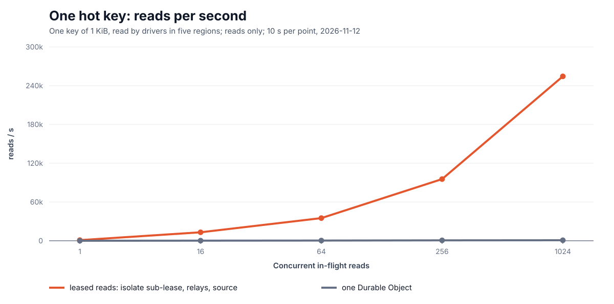

# do-kit

**Durable Objects that keep up when one object can't.** A Durable Object is one thread with 10 GB of storage. It serves about 2,000 calls a second, then queues them and starts refusing them. do-kit is a set of layers you put under your objects when you reach that point. They let you split an object by key, keep a table across the pieces, index it globally, lend out a hot key, make a few keys change together, or spread a big job over many runners. Each layer is measured on Cloudflare's network against one plain object.


## Which layer do you need?

Start from what is going wrong:

```
One Durable Object can't keep up. With what?
│
├─ Calls to many keys (accounts, documents, rows)      → ShardedObject: splits itself by key as it gets busy
│   ├─ the state is rows you get, list and count       → ShardedTable
│   │   └─ looked up by another column, unique across
│   │      the table, or listed by partition           → IndexedTable
│   └─ some keys must change together
│       ├─ they can live in one shard                  → routeOf: one transaction, as before
│       └─ they can't                                  → atomically: all or nothing across shards
│
├─ Data: more than 10 GB                               → ShardedObject: 10 GB per shard
│
├─ Reads of one key (a flag, a config, a ref)         → Leased reads: readers cache it, the source
│                                                         still sees about one read per isolate a second
│
└─ CPU: one job needs more than one invocation         → Work graphs
```

If none of these is your problem, a plain Durable Object is simpler and as fast. With one call in flight it answers in 7 ms, and a sharded call in 12 to 55 ms.

## Compared with one Durable Object

Measured on Cloudflare's network on 2026-11-12. Each point is 10 s of calls from drivers in five regions. One Durable Object runs the same code on one object: the same table schema, or the same key and value. [Method and every graph](docs/performance.md).

| What you do | One Durable Object | With do-kit | Layer |
|---|---|---|---|
| Write 1 KiB values to many keys, 2,048 in flight | 2,483 writes/s, p99 1,493 ms | **9,295 writes/s, p99 816 ms** (16 shards) | `ShardedObject` |
| Read many keys, 2,048 in flight | 1,778 reads/s, p99 1,943 ms | **7,024 reads/s, p99 728 ms** | `ShardedObject` |
| Ten hot config objects, 95% reads, 2,048 in flight | 1,890 calls/s, **41,713 failed** in 10 s | **4,780 calls/s, none failed** (16 shards) | `ShardedObject` |
| Store more than 10 GB | not possible | 10 GB per shard: 160 GB on 16 | `ShardedObject` |
| Write a table row with two indexes, 1,024 in flight | 1,604 writes/s, 9,089 failed | **8,117 writes/s, none failed** (64 shards) | `ShardedTable` |
| Get a table row by key, 1,024 in flight | 2,136 reads/s, 1,327 failed | **8,846 reads/s, none failed** (16 shards) | `ShardedTable` |
| List one team's rows, newest first, 1,024 in flight | 340 pages/s, 2,931 failed | **9,778 pages/s, p50 67 ms** (16 + 16 shards) | `IndexedTable` |
| Read one hot key, 1,024 in flight | 810 reads/s, p50 1,054 ms | **254,431 reads/s, p50 1 ms**; the source serves 29 reads/s | Leased reads |
| The same key, with 1% of calls writing it | 881 calls/s, p50 1,180 ms | **56,600 calls/s, p50 1 ms** | Leased reads |
| Change 2 keys together, 1,024 in flight | one transaction, within one object's ~2,000 calls/s | 1,030 calls/s, p50 743 ms, across 16 shards (plain 2-key calls: 2,826/s) | `atomically` |
| The same, with every call on 8 hot keys | one transaction | **31–38 calls/s** up to 256 in flight; at 1,024 nearly every call times out | `atomically` |

Reading the table:
- **Sharding pays at high load, not low.** Below a few hundred calls in flight, one object is as fast or faster, because a sharded call is routed and a new shard may be placed far from the caller.
- **Leased reads are for keys that are read far more than written.** A write waits until the leases on its key are over or given back, up to a second. A key written in the last 10 s isn't lent to relays, so its readers cache it from the source directly.
- **Atomic calls cost three round trips and hold their keys meanwhile.** Use them for keys that rarely contend: calls on the same few keys wait on each other's holds. Keys that must change together often belong in one shard (`routeOf`).

## The layers

Everything is exported from `@leostera/do-kit`. Each layer also has its own path, if you want to import only that layer.

| Layer | Also at | What it gives you |
|---|---|---|
| **Sharded object** (`ShardedObject`) | `@leostera/do-kit/sharded` | One object that splits itself into shards as it gets busy. Transactions within a shard, `atomically` across shards, and routing that follows splits. |
| **Sharded table** (`ShardedTable`) | `@leostera/do-kit/table` | Typed rows on a sharded object: indexes in every shard, conditional writes on a version per row, counts, and sorted listings across shards with a cursor that survives splits. With no indexes, a key-value store. |
| **Indexed table** (`IndexedTable`) | `@leostera/do-kit/indexed` ([RFD0003](docs/rfds/RFD0003-indexed-table.md)) | Global indexes on shards of their own: lookups by another column, unique constraints, and listings within a partition that read one index shard per page. A write returns once its index entries are written. |
| **Work graphs** (`WorkGraphRunner`) | `@leostera/do-kit/workgraph` ([RFD0005](docs/rfds/RFD0005-work-graphs.md)) | Incremental, parallel execution of a graph of pure units that your app defines, too big for one invocation's CPU. Typed edges, chunks sized to the CPU budget, N runners pulling leases, results keyed by a hash of their inputs and reused by later runs. |
| **Client** (`Client`) | `@leostera/do-kit/client` ([RFD0009](docs/rfds/RFD0009-behaviours.md)) | Calls to any Durable Object with a deadline, retries on transient failures only, cancellation, metadata, interceptors, and errors with a status code. Set options on a client, narrow them per call with `.with({ timeoutMs })`. |
| **Behaviours** (`GenServer`, `GenStatem`, `GenEvent`) | `@leostera/do-kit/behaviours` ([RFD0009](docs/rfds/RFD0009-behaviours.md)) | Base classes for an object that serves requests on its state, a state machine with durable timeouts and postponed events, and an event fan-out. Callbacks are synchronous transitions: one event at a time, each committed whole (state, its SQL, timers, outbox, answer) or not at all. Each class is its own client: `Class.client(ns, name)` runs its public methods in the caller and sends only messages. |
| **Leased reads** (`ReadLeases`, `RelayReads`, `RelayPlan`) | `@leostera/do-kit/leased` | Reads of one object's hot keys spread over relays and isolates, never stale. The object leases a key to relays, which answer from the lease and give isolates sub-leases inside it. A write commits at once, and is acknowledged once the leases on its key are over or given back. |

To try one, run an [example](examples): a small app for each layer, started with `bun dev` or `npm run dev`, with a page that shows its shards splitting live.

## Sharded objects: Durable Objects that split themselves when they get busy

A Durable Object is a great home for state, but it is one object: one thread, 10 GB of storage. When a hot account, document or room outgrows it, you are left sharding by hand. A `ShardedObject` lets you write the object as if it were one, and splits it for you. When a shard stays busy, it hands half of its keys to a new object, and your Workers follow the split without you changing a line.

A split moves that half with a single storage snapshot, so it takes seconds, not minutes, and the object keeps serving while it happens.

## What it buys you over one Durable Object

At 2,048 writes in flight, one Durable Object is past its limit: it completes 2,483 writes/s, with a median of 860 ms and a p99 of 1,493 ms. The same object split into 16 shards completes **9,295 writes/s, with a median of 122 ms and a p99 of 816 ms**. Reads tell the same story: 1,778 reads/s against **7,024 reads/s**.

| 1 KiB values, uniform keys | One Durable Object | Sharded object, 16 shards |
|---|---|---|
| **Writes**, 1,024 in flight | 2,136 writes/s, median 409 ms | **4,643 writes/s, median 123 ms** |
| **Writes**, 2,048 in flight | 2,483 writes/s, median 860 ms | **9,295 writes/s, median 122 ms** |
| **Reads**, 1,024 in flight | 1,705 reads/s, median 363 ms | **4,909 reads/s, median 102 ms** |
| **Reads**, 2,048 in flight | 1,778 reads/s, median 895 ms | **7,024 reads/s, median 112 ms** |
| **Data written**, 2,048 in flight | 2.4 MiB/s | **9.1 MiB/s** |
| **p99 latency**, 2,048 writes in flight | 1,493 ms | **816 ms** |
| **Storage ceiling** | 10 GB | **160 GB** (10 GB per shard) |


These were measured on Cloudflare's network, with up to 128 load-driver Durable Objects in several regions. Each point is 10 s of one-key reads or writes. The 16-shard object was presplit, so these numbers show the capacity that splitting gives, not the cost of the splits along the way. That cost is next.

No call failed in this run, even one object's at 2,048 in flight. On 0.4.0 one object refused 23,263 calls at that load and peaked at 2,068 writes/s. What one object takes varies with the day and the machine it lands on, so compare targets measured in the same run. More latency graphs ([p50](docs/bench/latency-p50.svg), [p95](docs/bench/latency-p95.svg), [max](docs/bench/latency-max.svg)) and the method are in [docs/performance.md](docs/performance.md).

### A control plane: a handful of hot objects

Ten configuration objects, a few far more popular than the rest (Zipf), read 95% of the time.


| In flight | One Durable Object | Sharded object, splitting by load | Sharded object, 16 shards |
|---|---|---|---|
| 256 | 1,927/s, p99 895 ms | 1,192/s, 8 shards | **3,410/s, p99 774 ms** |
| 1,024 | 2,112/s, p99 1,072 ms | 1,442/s, 19 shards | **5,308/s, p99 800 ms** |
| 2,048 | 1,890/s, **41,713 calls failed** | 2,718/s, 32 shards, 498 failed | **4,780/s, none failed** |

With only ten keys, a presplit object still spreads them over several shards (13 of its 16 hold one), and serves two and a half times what one object does. It can't split a single key, though, and the most popular object takes about a third of all calls, so throughput levels off near 5,000/s: the most one shard can serve of that one key. Splitting by load does worse than presplitting here. It kept splitting, to 32 shards for 10 keys, and each split pauses writes to the half that moves, which can't help: the split policy should stop splitting a shard whose load comes from one key. A key read far more than it's written is what [leased reads](#leased-reads-one-hot-key-read-through-relays) are for. See the [control plane graphs](docs/performance.md#a-control-plane-a-handful-of-hot-objects).

## Splits take seconds


When load splits an object, it pays for it once. Here an object seeded with 1 MiB to 1 GiB of 1 KiB rows, split once while 8 writers kept writing to random keys. No write failed in any run.

| Data in the object | Sharded object | Freeze, snapshot into two new objects | v0.1: copy rows to two new objects |
|---|---|---|---|
| 1 MiB | 1.7 s | 1.4 s | 0.9 s |
| 16 MiB | **1.8 s** | 2.9 s | 9.2 s |
| 128 MiB | **4.8 s**, slowest write 4.5 s | 31.6 s, every write blocked for it | 245 s, write p95 2.7 s throughout |
| 1 GiB | **29.5 s**, write p99 359 ms, slowest write 28.6 s | the split failed (earlier version) | did not finish in 2 hours (earlier version) |

The times are until the new object serves with all of its data. Only writes to the half that moves wait, so the slowest write is about the time to split, and the p99 stays low. The two older designs were not run again at 1 GiB: those two cells are from an earlier version. See [what was measured and how](docs/performance.md).

## What it costs

Splitting does not change what you pay per call: each write is one request to one shard, as it would be to one object.


| Per million writes (Workers Paid list prices) | One Durable Object | Sharded object |
|---|---|---|
| Update an existing key | $1.15 | $1.15 |
| Write a new key | $1.15 | $2.15 |

The difference is the index on each key's hash, which makes a new key cost one more row written ($1.00 per million rows). Duration is billed per object while it is busy, so 16 busy shards cost more than one object, but at $12.50 per million GB-s that comes to $0.0010 against $0.0025 per million writes.

A split costs the rows it deletes: each side deletes the half it gave away, at two rows written per row (table and index). The snapshot is made by the storage layer and is not billed as rows written. For 1 KiB rows that is about $0.03 to split 16 MiB, $0.26 for 128 MiB and $2.10 for 1 GiB, and an object usually splits long before it holds that much.


These are estimates from the [published prices](https://developers.cloudflare.com/durable-objects/platform/pricing/) and the row counts of the code, not from an invoice. Included monthly usage is not subtracted.

## Why it is fast

- **Only half moves.** A shard lives in the object named by its bits without trailing zeros, so when `01` splits, `010` stays where it is and only `011` goes to a new object. That means one copy, not two, and no object is left behind as a router.
- **One snapshot, not a row stream.** The new object restores from `ctx.storage.snapshot()`, a point-in-time copy of the whole database made by the storage layer. It still takes longer for a bigger database, but far less than a row-by-row copy: 4.8 s against 245 s at 128 MiB.
- **Most traffic never notices.** While the copy is made, reads go on, and so do writes to the half that stays. Only writes to the half that moves wait, and then they are sent to the new owner.
- **Cleanup stays out of the way.** Each side deletes the half it gave away in small batches in the background. Those rows are invisible from the moment of the switch.

## What you get

- **One object to write.** You write methods that read and update keys, and the base class runs them on whichever shard owns those keys.
- **Splits under load, by itself.** A shard splits when its call rate stays above a threshold. There are no shard counts to choose up front.
- **Keys that stay together.** `routeOf(key)` puts every key with the same route in one shard, so one transaction can check a rule across them, such as git refusing `refs/heads/a/b` while `refs/heads/a` exists ([RFD0006](docs/rfds/RFD0006-co-location.md)).
- **Clients that find their way.** Workers learn about splits lazily, and share what they learn in the isolate and the colo cache. A stale map costs one extra hop, never a wrong answer, because splits are final.
- **Correctness you can check.** The split protocol is an executable [Feynman](https://github.com/leostera/feynman) model, [`specs/snapshot-split.ts`](specs/snapshot-split.ts). It checks that no acknowledged write is lost or applied twice, that two objects never serve the same key, and that no read is stale, across lost messages and restarts.

## When it helps, and when it does not

**It helps** when one logical object holds many independent keys and outgrows one Durable Object: too many writes per second, or too much data for 10 GB. Each shard is a full Durable Object with its own thread and storage limit.

**It does not help:**
- **One hot key.** A key always lives on one shard, so the most popular key caps what a shard can serve. The split policy does not yet know this, and keeps splitting a shard that is hot because of one key. A key read far more than written can be spread with [leased reads](#leased-reads-one-hot-key-read-through-relays).
- **Cheap cross-key transactions.** `update` is transactional within one shard. Keys that must be decided together can share a shard: declare a `routeOf(key)` on the class and the client, and keys with the same route stay in one shard through every split ([RFD0006](docs/rfds/RFD0006-co-location.md)). A client that routes differently from its object is refused with `RouteMismatch`. Keys that can't share a shard can still change together with `atomically` ([RFD0008](docs/rfds/RFD0008-atomic-calls-across-shards.md)): one call to the primary shard, which prepares, commits and resolves the others, holding their keys meanwhile (measured below).
- **Small loads.** Below what one object can take, a plain Durable Object is simpler and as fast.

### Keys that change together, measured

`atomically` puts 1 KiB to 2 or 4 distinct keys of a 16-shard object, all or nothing. The comparison is the same put as one plain `call`, which writes each shard's keys in its own transaction, with no promise across shards.



| Keys drawn from 10,000 | Plain call, 2 keys | `atomically`, 2 keys | Plain call, 4 keys | `atomically`, 4 keys |
|---|---|---|---|---|
| 1 in flight | 14/s, p50 63 ms | 2/s, p50 288 ms | 7/s, p50 118 ms | 3/s, p50 222 ms |
| 64 | 680/s, p50 56 ms | 163/s, p50 362 ms | 241/s, p50 163 ms | 163/s, p50 364 ms |
| 1,024 | 2,826/s, p50 202 ms | 1,030/s, p50 743 ms | 930/s, p50 608 ms | 431/s, p50 1,724 ms |

- **An atomic call costs 220–290 ms at low load,** against 60–120 ms for the plain call: the caller sends it to the primary shard, which prepares on the others, decides, and commits, with the holds written to storage on the way.
- **Throughput scales with shards, at a third to a half of the plain call's.** Every shard holds its keys until the outcome, and a write to a held key waits. No call failed at any load on uniform keys.
- **Contended keys barely work.** With every call drawing its keys from 8, a younger call meeting an older one's hold gives way and retries. With 2 keys, 31–38 calls/s complete from 16 to 256 in flight, with a median of 0.4–5 s; with 4 keys, 5 calls/s at 16 in flight and almost none above. At 1,024 in flight nearly every call times out after 30 s ([graph](docs/bench/atomic-hot-throughput.svg)). Keep hot keys that change together in one shard (`routeOf`), where they are one transaction.

## Sharded tables: rows, indexes and listings

Most things built on a sharded object end up as a table: a directory, a control plane, records listed newest first. `ShardedTable` is that table. Declare the columns and indexes, and every shard keeps them for its own rows.

```ts
import { defineTable, ShardedTable, table } from "@leostera/do-kit";

type Order = { id: string; customer: string; total: number; createdAt: number; shippedAt: number | null; cancelled: boolean };
const orders = defineTable<Order>({
  primaryKey: "id", // also what routes a row to its shard
  columns: { id: "text", customer: "text", total: "integer", createdAt: "integer", shippedAt: "integer", cancelled: "boolean" },
  indexes: { byCreated: ["createdAt"], byShipped: ["shippedAt"] },
  counts: { byCancelled: "cancelled" }, // rows per value of a column, kept with every write
});

export class Orders extends ShardedTable<Env, Order> {
  protected table = orders;
  protected nodes() { return this.env.ORDERS; }
}

// In a Worker
const t = table(env.ORDERS, "shop-42", orders);
await t.put({ id: "o_1001", customer: "ada", total: 4200, createdAt: Date.now(), shippedAt: null, cancelled: false }, { ifVersion: 0 }); // only if new
const page = await t.list({ index: "byCreated", direction: "desc", where: [{ column: "cancelled", op: "=", value: false }], limit: 50 });
const next = await t.list({ index: "byCreated", direction: "desc", where: [{ column: "cancelled", op: "=", value: false }], limit: 50, cursor: page.cursor });
```

- **Writes** (`put`, `patch`, `delete`, and batches) are conditional on a version per row: `ifVersion: 0` means "only if absent". Each is one transaction with its index entries, fenced against splits. A key never has the same version twice: a row written again after a delete starts above the versions of the rows its shard deleted, so a write conditional on a version read before the delete fails. That costs a delete one more row written.
- **Listings** merge one page from every shard. The cursor holds only a sort position, so it survives splits. No row is skipped or returned twice across pages while shards split and clean up; that is model-checked in [`specs/table-listing.ts`](specs/table-listing.ts) and tested against a reference sort. `where` takes `=`, `!=`, `<`, `<=`, `>`, `>=`, `isNull`, `notNull`, `prefix` and `contains` (ignoring case).
- **Counts** are kept per hash prefix with every write, so `count()` is cheap and exact at any depth up to 16. Declare `counts` groups to also count rows per value of a column: `countBy("byCancelled")` returns `[{ value: false, count: 812 }, { value: true, count: 40 }]`, just as cheaply. A listing takes `withCount: true` (or a group's name) and returns `total` (and `counts`) from the same calls to the shards, so a page with its total costs one fan-out, not two. Counts don't take `where`: counting arbitrary conditions would read every row of every shard.
- **Schema changes:** add columns and indexes in the schema; each shard applies them the first time it runs the new code.
- Custom transactional methods use `getRow`, `putRow`, `patchRow` and `deleteRow` inside `transact`.

### What a table buys you, measured


10,000 rows of 1 KiB with two indexes, on 1 shard (one Durable Object running the same SQL) and on 4, 16 and 64 shards from the start:

| 1,024 in flight | 1 shard | 4 shards | 16 shards | 64 shards |
|---|---|---|---|---|
| **Writes** | 1,604/s, median 515 ms, 9,089 failed | 1,633/s | 6,230/s | **8,117/s, median 61 ms** |
| **Reads by key** | 2,136/s, median 446 ms, 1,327 failed | 3,330/s | 8,846/s | **10,241/s, median 39 ms*** |
| **List pages** (50 rows), 64 in flight | 874/s, median 36 ms | 469/s | 297/s | 156/s, median 302 ms |

\* Measured in a later run than the others in its row.

**Listings do not scale with shards.** Every page asks every shard for its share, so each shard serves every page: listing throughput stays below what one object serves, and a page waits for its slowest shard. At 256 and more in flight, 16 and 64 shards refuse most pages ("overloaded"), because every shard sees every page. A page also costs up to 3 × shards subrequests in the caller's invocation (one per shard per round; most pages take one round), and a Worker invocation may make only so many. Keep list-heavy tables to a few shards, or list by partition through an `IndexedTable`, which reads one index shard per page.


More in [docs/performance.md](docs/performance.md#sharded-tables) and the design in [RFD0002](docs/rfds/RFD0002-sharded-table.md).

## Indexed tables: global indexes

A sharded table answers "the row with this key" in one call. Anything else, such as "which user has this email?", asks every shard, and nothing stops two rows on different shards from having the same email. `IndexedTable` adds **global indexes**: they live on shards of their own, routed by the indexed values, so a lookup is one call and a unique index is enforced across the whole table.

```ts
import { defineTable, GlobalIndex, IndexedTable, indexedTable } from "@leostera/do-kit";

type User = { id: string; email: string; name: string; team: string; createdAt: number };
const users = defineTable<User>({
  primaryKey: "id",
  columns: { id: "text", email: "text", name: "text", team: "text", createdAt: "integer" },
  globalIndexes: {
    byEmail: { columns: ["email"], unique: true },
    byTeam: { columns: ["team", "createdAt"], partition: 1 }, // one team per index shard, sorted by createdAt
  },
});

export class Users extends IndexedTable<Env, User> {
  protected table = users;
  protected nodes() { return this.env.USERS; }
  protected indexNodes() { return this.env.USER_INDEXES; }
}

export class UserIndexes extends GlobalIndex<Env> {
  protected nodes() { return this.env.USER_INDEXES; }
  protected rowNodes() { return this.env.USERS; }
}

// In a Worker
const t = indexedTable(env.USERS, env.USER_INDEXES, "workspace-42", users);
await t.put({ id: "u_1", email: "ada@example.com", name: "Ada", team: "core", createdAt: Date.now() }, { ifVersion: 0 });
// { ok: true, version: 1 }
await t.lookup("byEmail", ["ada@example.com"]); // { row: { id: "u_1", ... }, version: 1 }
await t.put({ id: "u_2", email: "ada@example.com", name: "Ada L.", team: "web", createdAt: Date.now() });
// { ok: false, version: 0, conflict: "byEmail" }: nothing was written
await t.list({ index: "byTeam", partition: ["core"], direction: "desc", limit: 50 }); // one index shard per page
```

- **A write returns once every index has it.** A write reserves its unique values, writes the row and its index changes (an outbox) in one transaction, and delivers them before it returns. If delivery takes longer than `indexWaitMs` (5 s), the client throws `IndexPending`: the row is written, and the row shard's alarm goes on delivering.
- **Unique values are reserved with fencing tokens.** A reservation left behind by a writer that never wrote is resolved by asking the row's shard, which fences the token so that writer's write cannot land later. The protocol is model-checked in [`specs/indexed-write.ts`](specs/indexed-write.ts): at most one row has a value, a write that returned is found, and the indexes converge to the rows, across lost calls, timeouts and late deliveries.
- **The rows stay the truth.** Index entries carry a copy of the row, so a lookup or page needs no second call. Every write rewrites its entries, so each global index costs one more write per row write, and a write with a unique index makes one more call before it.
- Rows and index shards split by load, independently. Per-shard `indexes` and `counts` work as in `ShardedTable`. Custom methods that write rows use `indexedTransact`.
- A global index lists rows within one partition value, not sorted across the whole table. One added to a table that already has rows is built in the background, shard by shard: `indexStatus()` says which are still building, and which rows a new unique index could not take because another row has their value.
- A local index (`indexes`) added to a table that has rows is built a slice per call: the shard answers "not ready" (the client retries) until every row is in it, so building it never needs more CPU than a call has.

## Work graphs: work too big for one invocation

An invocation gets at most 5 minutes of CPU. Some work is a graph of pure pieces with far more than that in total: resolving the deltas of a large git pack, rebuilding a derived index, an import of many objects. You write the graph; do-kit cuts it into **chunks** that each fit one invocation, and **runners** (Durable Objects) pull them from a **coordinator**, one chunk per alarm. Each unit's result is stored before its chunk counts as done, under a hash of its inputs (or of its key), so a retried chunk, a runner evicted partway, and a later run all do the same thing: compute what is missing.

```ts
import { defineTask, ownResultsName, planWorkGraph, workGraphOf, workGraphResults, workGraphRun } from "@leostera/do-kit";

// A task is a pure function: (input, parent's value, results it runs after) → { result, value }.
// This one resolves a slice of a pack's delta forest: whole trees, about 10 s of CPU. It writes its
// rows to the app's own storage, under its own key (so a retry overwrites, not duplicates), and
// returns a small receipt.
const slice = defineTask({
  name: "slice", version: "1",
  async compute(input: { pack: string; trees: Uint8Array }, _parent: null, _after: {}, { env }) {
    const rows = await resolveTrees(env, input.pack, input.trees); // the app's code
    await env.INDEX.put(`${input.pack}/${sliceKey(input.trees)}`, encodeRows(rows));
    return { result: { objects: rows.length, digest: await digestOf(rows) }, value: null };
  },
});

// The graph's types follow its edges: a slice takes no parent, so passing one does not compile.
const g = workGraphOf({ slice });
const refs = slicesOf(pack).map((s, i) => g.add(slice, `pack-1234/slice-${i}`, { pack: "pack-1234", trees: s.trees }, { cost: s.estimatedMs }));

// Every pack is new: identify results by key, and skip hashing inputs.
const plan = planWorkGraph(g, { chunkMs: 30_000, identity: "key" });
const run = workGraphRun(env.GRAPH_COORDINATORS, "pack-1234");
await run.submit(plan);
await run.start({ runners: 32, deadlineMs: 15 * 60_000 });
await run.status(); // later: { state: "done", units: { computed, reused }, busyMs, ... }
await workGraphResults(env.GRAPH_RESULTS, ownResultsName("pack-1234")).get(plan, refs[0]); // { objects, digest } | undefined
await run.delete(); // or wait: an hour after it ends, nothing of the run is left
```

- **Runs leave nothing behind.** Once a run is done, failed, deleted or past its deadline, its runners delete their storage and alarms, and so do the coordinator and the run's own results store (shared ones, given as `results`, are yours to keep). The status is kept for `keepStatusMs`, an hour by default, so you can start a run per request.

- **Make units coarse.** Running a unit costs the layer about 0.11 to 0.12 ms of wall time on the edge (its result read and written, and its share of its chunk's calls), and planning it about 0.03 ms more (measured locally). So a unit should cost at least about 10 ms, for an overhead near 1%: batch fine-grained work, such as one delta of 0.1 ms, into one unit. Hundreds to tens of thousands of units per run is the range it is built for.
- **Keep outputs in your storage**, written by `compute` under the unit's own key, and return a receipt: results and values are capped at 1 MiB, as JSON.
- **Inputs may be bytes.** A `Uint8Array` anywhere in an input travels and is stored as raw bytes, up to 16 MiB per chunk. The whole graph, inputs included, is planned in one invocation (128 MB of memory), so put bulk inputs in your storage, and a pointer to them in the input.
- **Units can take a parent's value** (a tree edge) or other units' results (`after`), typed the same way; a tree too big for one chunk is cut, and the piece below either replays the path above it or loads its stored value. See [RFD0005](docs/rfds/RFD0005-work-graphs.md#guide-level-explanation) for that, and for the runner, coordinator and results classes, a few lines each.

### How close to the bound, measured

A graph's time on N runners is bounded by `T₁/N + T∞`: its work over N, plus its longest chain. Runners take whole chunks, so here `T∞` is the longest chain of chunks the plan has. Measured on Cloudflare's network, with units that burn 5 ms of CPU each, chunks of 1 s, and every run computing from scratch:


| Graph | one runner | 64 runners | speedup | `T₁/64 + T∞` |
|---|---|---|---|---|
| 40,000 units, in trees of 5 | 460.5 s | 8.4 s | 55× | 7.2 s |
| One random tree of 40,000 units | 289.6 s | 8.1 s | 36× | 4.6 s |
| One chain of 2,000 units | 18.7 s | 13.1 s | 1.4× | 10.3 s |

- A forest of small trees spreads across runners almost perfectly. One big tree is cut into pieces that replay the short path above them, so they need no other chunk, and it spreads too, at about 1.5× the bound. A chain is its own span: no runner count helps it.
- Every run does the same work, calibrated once (a unit's rounds are pinned), so the time it takes depends on the machines the runners land on. In this run a unit planned at 5 ms took about 7 ms: the forest's 200 s of planned work took 460 s on one runner. Speedups are against that run's own single runner, so they hold.
- **Faults cost what they redo.** On 16 runners, 20.9 s without faults; 46.5 s with 20% of chunks evicted once after computing (each is computed again on the alarm's retry); 25.0 s with 4 of the 16 runners lost for good, holding leases of 10 s that run out and pass on. Every unit is computed either way.
- **Coarse units run within their bound at every runner count.** 437 slices of about 10 s with binary inputs, and a few big trees cut into pieces, in 176 chunks of 30 s: 999 s on 4 runners, 473 s on 8, 271 s on 16, 155 s on 32, and 105 s on 64, each under its `T₁/N + T∞` bound ([graph](docs/bench/workgraph-slices.svg)). An earlier run of 0.5 took 1.4–1.9× longer and left half the runners idle: a runner that computed with a write still unconfirmed was reset by the runtime, and its chunk waited out its lease. Runners now commit their writes before computing a chunk.
- **One coordinator hands out about 450 to 630 chunks a second**, from 64 to 1,024 runners, measured on 2026-11-11 with chunks that cost nothing. With chunks of 30 s that is room for over 10,000 runners on one run, and each run has its own coordinator.

Raw data in [bench/results/workgraph.json](bench/results/workgraph.json), more graphs ([time](docs/bench/workgraph-time.svg), [faults](docs/bench/workgraph-faults.svg), [coordinator](docs/bench/workgraph-ceiling.svg)), and the method in [bench/README.md](bench/README.md#work-graphs).

## Leased reads: one hot key, read through relays

Splitting spreads keys over objects, so it can't help one key that everyone reads: a ref,
a config document, a feature flag. Leased reads let the object that holds the key (the source)
lend it out for a second at a time, without ever serving a stale value.

```
writer ──► source: commit, holdUntil(changes) ──► held: reads see the value from before
                     │  toRevoke ──► relays give their leases back (returned) ──► shown, acknowledged
readers ──► isolate sub-lease ──► relay (lease from the source, renewed RENEW_MS early) ──► source
```

- **`ReadLeases<Row>`**, in the source: grants leases (1 s, ending 150 ms late by its own clock,
  the holder ending 150 ms early by its own, so only clock rates must agree), holds a write to a
  leased key until its leases are over or given back, and asks named holders to give them back.
  Before granting, it stores how far its leases may reach, so a restarted source holds every
  write until then. The keys with a held write are stored too, through the source's `HeldKeys`
  (three synchronous calls over its own storage): call `holdUntil` in the transaction that
  commits the write, and wait until `readableAt(keys)` before answering a read, so a restarted
  source answers no read of a key it was holding a write on until every lease from before is over. A key written in the last `WRITTEN_MS` (10 s) isn't leased to relays
  (`written(key)`), so a lease never holds the next write.
- **`RelayReads<V>`**, in a relay: answers from its lease and renews it early; without one, asks
  share a source read that started after they arrived. `fresh()` is a value at least as new as
  every write acknowledged before the ask, for writers checking the current value.
- **`RelayPlan`**, in the source: when a key is hot (`HOT_READS` direct reads a second), how many
  relays it gets (sized by the relays' reports, `RELAY_READS` each), and the tree they form
  (`relayParent`: fanout 8, at most 584 relays, so the source answers at most 8). Give it the
  leases' `written`: a key being written isn't relayed (relays without a lease would only add a
  hop), so its readers read the source and cache under its isolate leases.

The layer is the logic a source and its relays embed. The objects, their storage of the horizon,
and the calls between them are the app's: [`bench/worker/src/leased.ts`](bench/worker/src/leased.ts)
wires a source, its relays and the readers' isolates in about 150 lines.

### What it buys you, measured

One key of 1 KiB, read by drivers in five regions. Each driver is an isolate that keeps its
sub-lease in memory, as an app's Worker would. The comparison is the same readers reading one
Durable Object.



| In flight | One Durable Object | Leased reads |
|---|---|---|
| 1 | 29 reads/s, p50 29 ms | 953 reads/s, p50 1 ms |
| 64 | 307 reads/s, p50 111 ms | 35,041 reads/s, p50 1 ms |
| 256 | 670 reads/s, p50 234 ms | 95,480 reads/s, p50 1 ms |
| 1,024 | 810 reads/s, p50 1,054 ms | **254,431 reads/s, p99 1 ms**; the source served 29/s, through 6 relays |

- **A read is a lookup in the isolate's memory** for as long as its sub-lease lasts, at most a
  second. The source answers each isolate and relay about once a second, whatever the read rate.
  At these rates the load generator is the limit, not the system.
- **A key that is written too is still helped.** With 1% of calls writing the key, leased reads
  did 56,600 calls/s at 1,024 in flight, with a median of 1 ms, where one object did 881 with a
  median of 1,180 ms ([graph](docs/bench/leased-mixed-throughput.svg)). A key written in the last
  `WRITTEN_MS` (10 s) isn't relayed, so isolates read the source directly (813 reads/s here) and
  cache under their own leases. The cost is in the writes: each is acknowledged once the leases
  on its key are over or given back, up to a second later.

It was built for git refs read thousands of times a second while they are pushed rarely.

## Install

```sh
bun add github:leostera/do-kit#<commit>   # or npm install / pnpm add, the same way
```

The package is its TypeScript sources: your Worker's bundler (Wrangler, Vite, esbuild, Bun) compiles them with your code, and there is no build step or lifecycle script. They type-check under strict settings, including `exactOptionalPropertyTypes` and `noUncheckedIndexedAccess`, with the Workers and Node types (`@cloudflare/workers-types` and `@types/node`, or the types `wrangler types` generates).

You need SQLite-backed Durable Objects, `nodejs_compat`, and, for snapshot splits, the `durable_object_snapshots` compatibility flag. Without that flag, or in local development (where workerd has no snapshots), splits copy rows over RPC instead. That copy is slower, but it works the same way.

## Quick start

```ts
import { ShardedObject, sharded, type UpdateResult } from "@leostera/do-kit";

interface Env {
  COUNTERS: DurableObjectNamespace<Counter>;
}

export class Counter extends ShardedObject<Env, number> {
  protected nodes() {
    return this.env.COUNTERS;
  }

  async add(keys: readonly string[], amounts: readonly number[]) {
    return this.update(keys, (current): UpdateResult<number, number[]> => {
      const writes = new Map<string, number>();
      const result = keys.map((key, i) => {
        const value = (current.get(key) ?? 0) + amounts[i]!;
        writes.set(key, value);
        return value;
      });
      return { writes, result };
    });
  }

  async get(keys: readonly string[], _payloads: null) {
    const values = await this.read(keys);
    return keys.map((key) => values.get(key) ?? null);
  }
}

// In a Worker:
const counters = sharded(env.COUNTERS, "account-123");
const shards = await counters.call(["apples", "pears"], "add", [2, 1]);
```

A method called through `client.call` takes its `keys` first and their `payloads` second (`null` when it needs none), then any other arguments. The client groups keys by shard and returns one `ShardResult` per shard, with the `positions` of its keys in your list.

- **All-or-nothing updates:** `callOneShard` runs a method on one shard, or throws `SpansShards` before applying anything.
- **All-or-nothing across shards:** `client.atomically(keys, method, payloads, ...args)` calls one of the class's `atomic` methods on every shard owning some of the keys, and every share applies or none does ([RFD0008](docs/rfds/RFD0008-atomic-calls-across-shards.md)). It answers `{ committed: true, results }` or `{ committed: false, refusals }`. Keys in one shard are one call. Across shards, the primary (the smallest key's shard) coordinates the call, and each other shard holds its keys until the outcome: writes to them wait, reads see the rows from before. A call that meets an older call's hold gives way and is made again, so calls never wait on each other in a ring. A primary that restarts mid-call leaves holds that end at their deadline (5 s), with its outcome. A caller whose answer is lost gets `committed` if the primary still has the outcome, else the error.
- **Waiting:** a call waits up to 30 s for a shard that is not serving yet (`sharded(ns, name, { notReadyWaitMs })` to change it). A write held by a split in progress waits until that split finishes or gives up (`splitTimeoutMs`), however long that is.
- **Jurisdictions:** pass `env.X.jurisdiction("eu")` to `sharded` and every shard of the object stays in that jurisdiction, including the ones splits create.
- **Stub options:** `sharded(ns, name, { stubOptions: { version: { cohort } } })` passes options to every stub of the object's shards, including the stubs shards make for each other when they split.
- **Scans:** `client.scan("method")` calls a method on every shard. It can enumerate that shard's rows with `this.allRows()`. There is one result per shard, not a global snapshot.

## Split policy

```ts
protected override splitPolicy: SplitPolicy = {
  callsPerSecond: 400, // a shard splits above this, sustained over windowSeconds
  windowSeconds: 5,
  maxDepth: 12,        // at most 2^12 shards
  keysPerCall: 25,     // a call weighs 1 + keys / keysPerCall
  initialDepth: 0,     // start at 2^initialDepth shards, each made by its first call, for uniformly distributed keys; clients route straight to them
  copy: "auto",        // "native" snapshots, "logical" row copy, or auto-detect
  splitTimeoutMs: 60_000,
  holdWaitMs: 2_000,   // a write to the half being copied waits this long, then the client backs off and retries until the split ends
};
```

The default threshold is about half of what one object handles on the edge, which leaves headroom for real work and for the split itself. Tune it with your own workload.

## Writing a subclass

- `nodes()` returns the namespace that every shard of the class lives in.
- Routed methods take `(keys, payloads, ...args)` and use `read` and `update` for keyed state. The `decide` callback of `update` runs synchronously inside a transaction, so it cannot do I/O.
- A split copies **every table**, yours too. Two hooks decide what happens to your rows for keys a shard no longer owns:
  - `afterClone(owns)` runs in the new object as it claims the copy, inside that transaction. Drop work it must not repeat here, such as its share of an outbox the original keeps delivering.
  - `cleanupForeign(owns, limit)` runs in paced batches from the alarm, on both shards after a split, until it returns 0. Delete up to `limit` rows for keys you no longer own and return how many you deleted. The default deletes nothing, so an original that delivers an outbox keeps its rows.
- **Atomic methods** (`protected atomic = { name: { holdKeys?, gather?, check, apply, applied? } }`, see `AtomicMethod`): `gather` does the I/O and writes nothing; `check(current, keys, payloads, gathered, ...args)` decides from the rows in the transaction that holds the keys, and returns `{ staged }` or `{ refused }`; `apply(current, staged)` returns `{ writes, result }`, written in the transaction that releases them; `applied(keys, result)` runs after, for work on other objects. `holdKeys` adds keys of the same route the check reads (a git ref's folders). A shard holding keys doesn't split until its holds end.
- **Write your own tables only inside `update` or `transact(keys, fn)`.** Both wait while a split copies any of `keys`, check that the shard still owns them, and run in one transaction. A write that skips them can land after the copy and be lost. List every key whose rows you touch.
- `ownedRowsPage(afterKey, limit)` pages this shard's rows in key order, a bounded number at a time, skipping keys it gave away.
- `owns(key)` says whether a key is this shard's now. Until cleanup finishes, filter bulk queries over your own tables (listings, counts, uniqueness checks) with it.
- `beforeHandOut()` runs before the copy, while writes to the moving half wait. Use it to finish work tied to rows that are about to move.
- **Alarms: override `onAlarm()` and schedule it with `scheduleAlarm(at)`, never `alarm` or `ctx.storage.setAlarm`.** The alarm also activates new shards and runs the background cleanup. `scheduleAlarm` keeps the earliest time asked for, so your work never postpones a split's and a split never loses yours. `onAlarm` runs only on a serving shard, never in a split's copy before it serves. A split's new shard keeps the scheduled time, so check in `onAlarm` which due work is yours with `owns(key)`. Overriding `alarm` throws when the object starts.
- `shardedDescribe()` reports a shard's bits, rows and call rate, plus two things for attributing errors under load:
  - `splits`: its last 8 split attempts, each with when it started, how long it took, the copy method, the rows it owned and how many moved, the writes it held, how many of those were answered "not ready", the longest wait, and why it was abandoned, if it was. A new shard starts with an empty record.
  - `counters`: since the object last started, the writes held by splits and the longest hold, and:
    - `calls`: routed calls and scans that reached a method. `ok` of them returned; the rest answered "moved" or "not ready" from inside the method (a held write released as "moved", or held past `holdWaitMs`) or threw.
    - `moved`, `notReady`, `stale`: every such answer, both from inside a method and on arrival. Arrival answers (the caller's map was out of date) are not in `calls`.
    - Calls the runtime sheds as overloaded never reach the object, so they appear nowhere: compare what you sent with `calls` plus the arrival answers.

  Reach any shard with `env.NS.get(env.NS.idFromName(shardObjectName(name, bits))).shardedDescribe()`.

## Development

```sh
bun install
bun run check        # types: the repo, then src/ under the strictest settings a consumer may have
bun test             # integration tests under cf dev: concurrent writes and CAS across splits, load splits, presplit, large rows, subclass tables
bun run specs:check  # model-check the split protocol
```

Design decisions are RFDs in [docs/rfds](docs/rfds/README.md): one numbered document per decision, proposals and snapshots of what is built. There are no other design documents.

Locally, splits copy rows: workerd has no storage snapshots. To run the same tests against snapshots, deploy the test Worker under another name, on a custom domain of yours behind a Cloudflare Access application (it is never served on `workers.dev`), with a token, and point the tests at it:

```sh
cd test/worker
echo "TEST_TOKEN=$(openssl rand -hex 32)" > /tmp/do-kit-test.vars   # not .dev.vars: cf dev would read it
TEST_WORKER_NAME=do-kit-test-snapshots TEST_HOSTNAME=do-kit-test.<your-zone> cf deploy --secrets-file /tmp/do-kit-test.vars
cd ../..
set -a; . /tmp/do-kit-test.vars; set +a
TEST_URL=https://do-kit-test.<your-zone> TEST_ACCESS_TOKEN=$(cloudflared access token -app=https://do-kit-test.<your-zone>) bun test --timeout 300000
```

The benchmark Worker and the scripts that produced the graphs above are in [`bench/`](bench/README.md).

## License

MIT
