# Performance

Everything here was measured on Cloudflare's network, on a Workers paid plan, using the benchmark Worker in [`bench/`](../bench/README.md) (compatibility date 2026-10-29, with `durable_object_snapshots`), on 2026-11-12, with do-kit after 0.4.0 (each results file names its runs, their commit and the deployed Worker version). Raw results are in [`bench/results/`](../bench/results/): one file per named run (`v050-*.json`), collected by `bun bench/collect.ts` into the files the graphs are drawn from by `bun run bench:plot`.

## How long a split takes

The split benchmark builds one object with N MiB of 1 KiB rows. Then, with 8 writers on random keys running from a second before until a second after, it splits that object once. It compares three ways to split:

- **Sharded object.** Only the right half moves, as one storage snapshot restored into one new object. Reads and left-half writes go on during the copy.
- **Freeze, snapshot into two new objects.** The object stops serving, restores its snapshot into two children, which each delete the half they do not own, and stays behind as a router.
- **v0.1: copy rows to two new objects.** Children serve at once and fetch rows from the parent as calls need them, while a background copy streams the rest in batches of 1,000 rows.

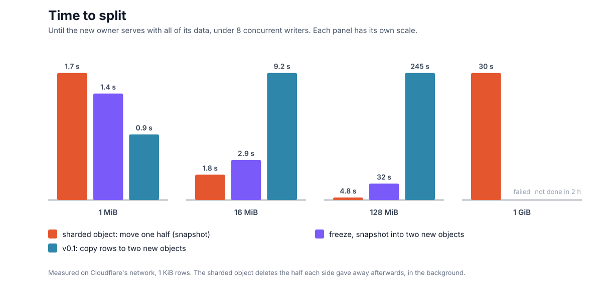

| Data | Sharded object | Freeze, two snapshots | v0.1 row copy |
|---|---|---|---|
| 1 MiB | 1.7 s | 1.4 s | 0.9 s |
| 16 MiB | 1.8 s | 2.9 s | 9.2 s |
| 128 MiB | 4.8 s | 31.6 s | 245 s |
| 1 GiB | 29.5 s | failed (earlier version) | did not finish in 2 h (earlier version) |

"Time to split" is the time until the new owner serves with all of its data:
- **Sharded object:** until the new object has claimed its copy. Deleting the half each side gave away continues in the background: 38.6 s at 128 MiB, during which those rows are invisible.
- **Freeze:** the whole freeze.
- **Row copy:** until the last row has moved.

At 1 GiB, the sharded object served after 29.5 s. During the run, writes had a p50 of 119 ms, a p95 of 295 ms and a p99 of 359 ms, with no failures. The slowest write, 28.6 s, was one to the moving half that waited for the copy. Deleting the half each side gave away then took 8.3 minutes in the background. The two older designs were measured at 1 GiB only with an earlier version: the freeze-into-two design gave up on the split (its single-transaction cleanup of half a million rows per child is the likely cause), and the v0.1 row copy was still copying after two hours.

### What callers feel during a split

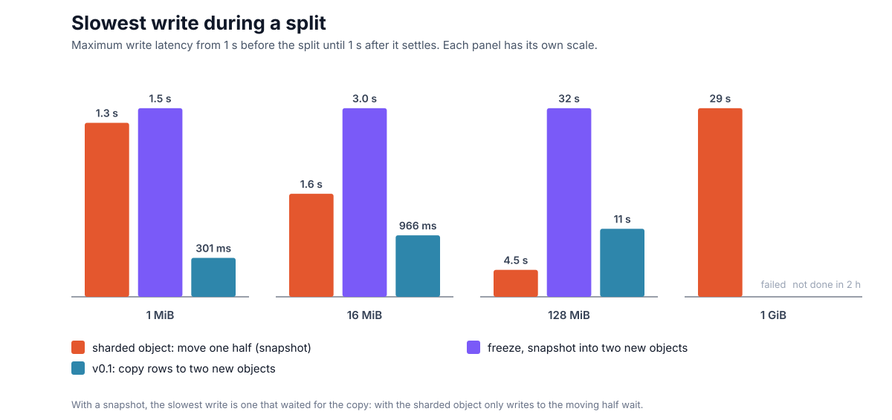

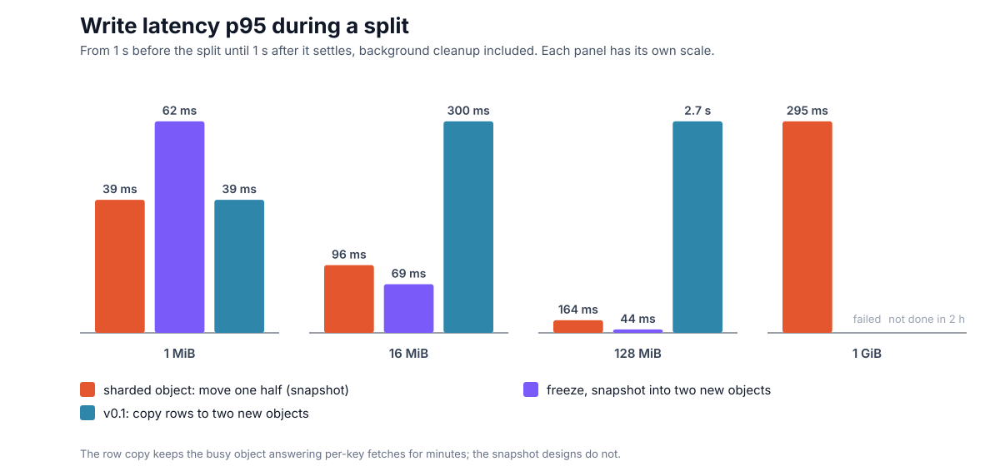

Measured from 1 s before the split until 1 s after it settles:

| Data | Sharded object p95 / max | Freeze p95 / max | Row copy p95 / max |
|---|---|---|---|
| 1 MiB | 39 ms / 1.3 s | 62 ms / 1.5 s | 39 ms / 0.3 s |
| 16 MiB | 96 ms / 1.6 s | 69 ms / 3.0 s | 300 ms / 1.0 s |
| 128 MiB | 164 ms / 4.5 s | 44 ms / 31.7 s | 2.7 s / 11.4 s |

- **Snapshots trade a short wait for a short split.** With either snapshot design, the slowest write is one that waited for the copy. With the sharded object, only writes to the half that moves wait. With the freeze, every call waits, reads too.
- **The row copy never blocks outright, but it is slow and loads the busy object.** Its children ask the parent for rows on every new key while the background copy competes with those requests. That is why its p95 is 2.7 s for the 4 minutes it takes at 128 MiB.
- **Deleting rows has a cost too.** A delete blocks the object while it runs, and takes longer the more rows it deletes. So each object deletes the half it gave away 250 rows at a time, 25 ms apart, and writes run between the batches. Deleting in large batches stalls every write for as long as each batch takes.

No write failed in any split run.

## Throughput against one Durable Object

The throughput benchmark sends one-key writes of 1 KiB values to uniform keys from driver Durable Objects in several regions, at increasing concurrency. Each driver keeps at most 16 calls in flight, so 2,048 in flight means 128 drivers. Each level runs once unmeasured, then once measured for 10 s. The object under test is either one plain Durable Object, or a sharded object presplit into 16 shards, so no split happens while it is measured ([raw data](../bench/results/v050-load.json)).

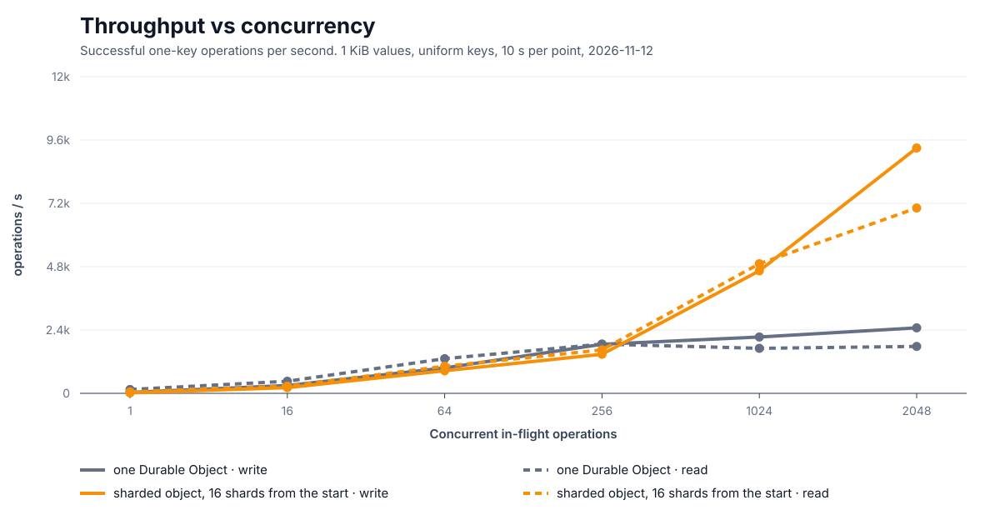

| In flight | One Durable Object | Sharded object, 16 shards |
|---|---|---|
| 1 | 35 writes/s, p50 7 ms | 18 writes/s, p50 54 ms |
| 16 | 298 writes/s, p50 40 ms | 214 writes/s, p50 55 ms |
| 64 | 964 writes/s, p50 46 ms | 856 writes/s, p50 53 ms |
| 256 | 1,860 writes/s, p50 64 ms, p99 878 ms | 1,482 writes/s, p50 109 ms, p99 624 ms |
| 1,024 | 2,136 writes/s, p50 409 ms, p99 1,131 ms | 4,643 writes/s, p50 123 ms, p99 716 ms |
| 2,048 | 2,483 writes/s, p50 860 ms, p99 1,493 ms | 9,295 writes/s, p50 122 ms, p99 816 ms |

Reads, in the same way:

| In flight | One Durable Object | Sharded object, 16 shards |
|---|---|---|
| 1 | 146 reads/s, p50 7 ms | 52 reads/s, p50 12 ms |
| 64 | 1,315 reads/s, p50 13 ms | 1,026 reads/s, p50 34 ms |
| 256 | 1,867 reads/s, p50 39 ms, p99 995 ms | 1,648 reads/s, p50 62 ms, p99 802 ms |
| 1,024 | 1,705 reads/s, p50 363 ms, p99 1,390 ms | 4,909 reads/s, p50 102 ms, p99 718 ms |
| 2,048 | 1,778 reads/s, p50 895 ms, p99 1,943 ms | 7,024 reads/s, p50 112 ms, p99 728 ms |

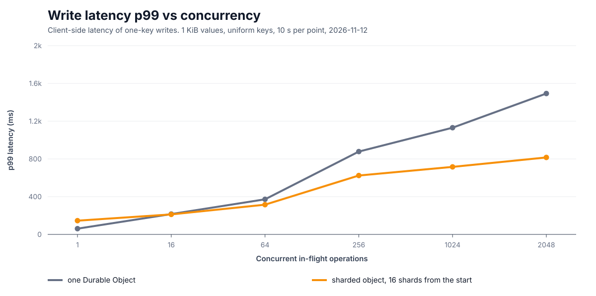

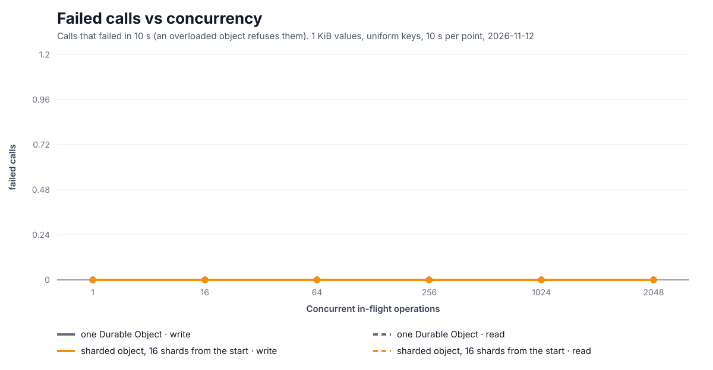

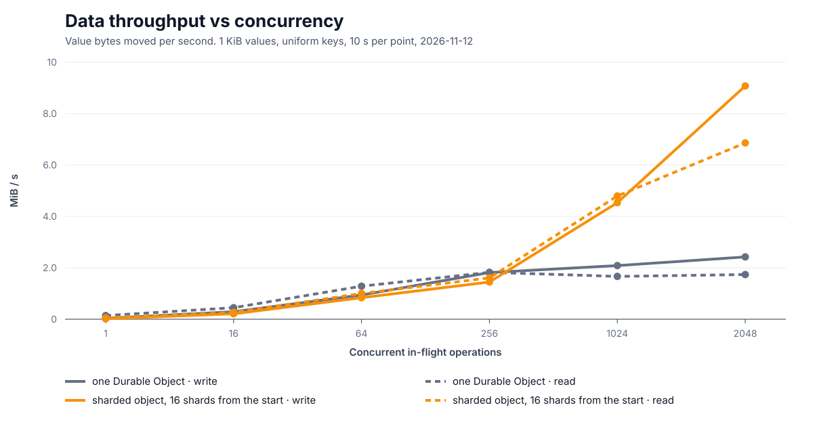

- **One object saturates at about 2,100 to 2,500 writes/s and 1,700 to 1,900 reads/s.** Past that, it queues, so its median latency at 2,048 in flight is 860 ms for writes and 895 ms for reads. In this run it refused none; on 0.4.0 it refused 23,263 writes and 31,785 reads in 10 s at 2,048 in flight, and peaked at 2,068 writes/s. What one object takes varies with the day and the machine it lands on.
- **16 shards keep their median latency near 100 to 120 ms** while writes grow from 1,482/s to 9,295/s, and they had not saturated at the highest load we offered.
- **At low load, one object is faster.** With one call in flight, a shard answered writes in 54 ms against 7 ms. A new shard is placed near the object that created it, not near the caller, so some keys live farther away. Splitting pays off when one object is the bottleneck, not before.
- **The load generator matters.** A driver Durable Object completes about 90 calls/s, however many it keeps in flight. An earlier run with 64 calls per driver capped every target near 1,500 writes/s, and made splitting look useless.
- **Read runs seed their keys from one driver, with retries.** When a hundred drivers seeded at once, they overloaded the single object before it was measured.

More graphs from the same run: [latency p50](bench/latency-p50.svg), [p95](bench/latency-p95.svg), [max](bench/latency-max.svg), and [storage ceiling](bench/capacity.svg) (shards × the 10 GB limit of one object).

## A control plane: a handful of hot objects

Ten objects, `config-0` to `config-9`, with Zipf popularity (s = 1.1): the most popular gets about a third of the calls. 95% of calls read and 5% write 1 KiB ([raw data](../bench/results/v050-control-plane.json)).

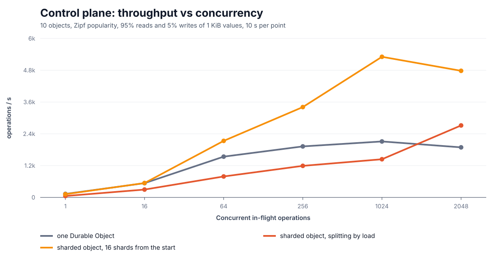

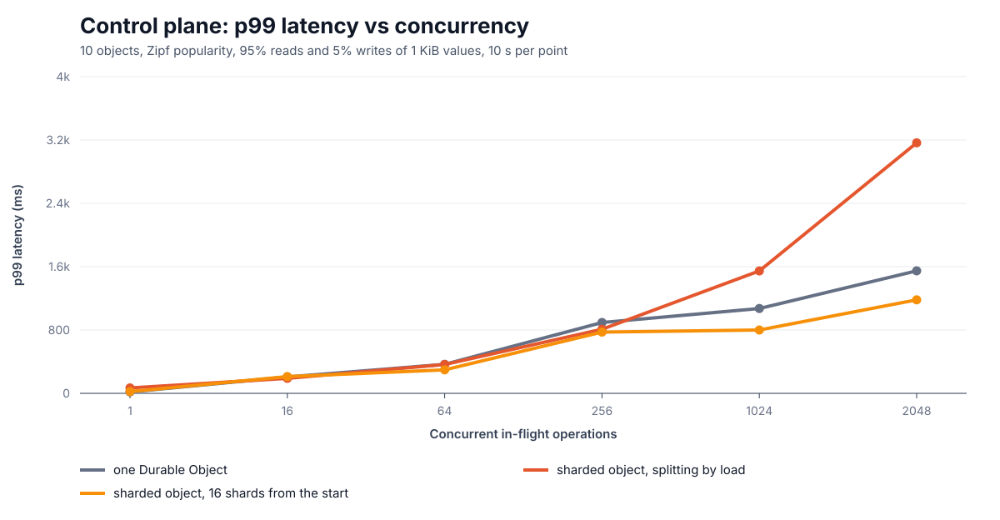

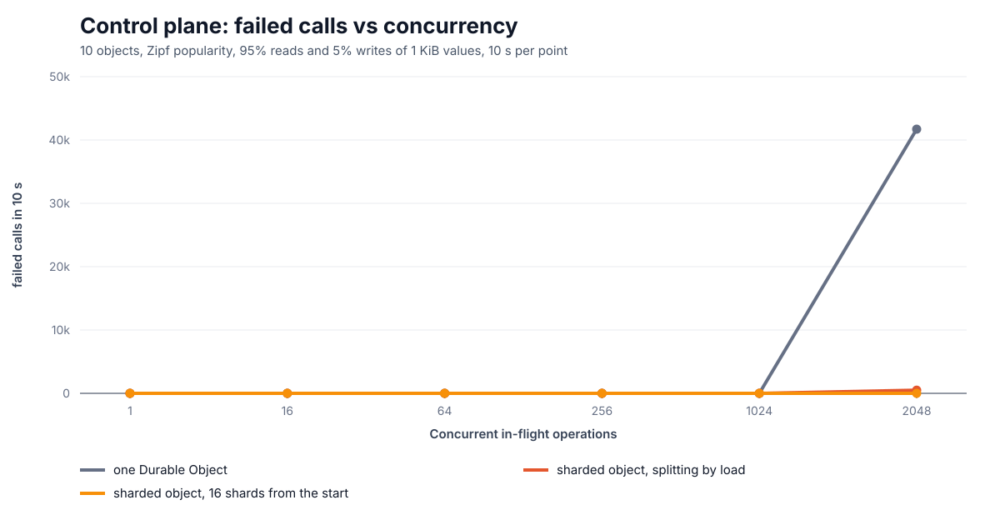

| In flight | One Durable Object | Sharded object, splitting by load | Sharded object, 16 shards |
|---|---|---|---|
| 1 | 132/s, p50 8 ms | 53/s, p50 18 ms | 121/s, p50 8 ms |
| 16 | 538/s, p50 10 ms | 297/s, p50 29 ms | 544/s, p50 11 ms |
| 64 | 1,539/s, p50 15 ms | 791/s, 4 shards, p50 50 ms | 2,135/s, p50 10 ms |
| 256 | 1,927/s, p50 63 ms, p99 895 ms | 1,192/s, 8 shards, p50 127 ms | 3,410/s, p50 22 ms, p99 774 ms |
| 1,024 | 2,112/s, p50 431 ms, p99 1,072 ms | 1,442/s, 19 shards, p50 235 ms | 5,308/s, p50 98 ms, p99 800 ms |
| 2,048 | 1,890/s, **41,713 calls failed** | 2,718/s, 32 shards, 498 failed | 4,780/s, p50 240 ms, none failed |

- **Even ten keys gain from presplitting.** They land on different shards (13 of the 16 hold one), so the object's work is shared.
- **The most popular key sets the ceiling.** A key always lives on one shard, and here one key takes a third of the calls. That shard runs out of capacity near 5,000 calls/s in total.
- **Splitting by load does worse than presplitting here,** and worse than one object below 2,048 in flight. It went to 32 shards for 10 keys: each split pauses writes to the half that moves, and splits that leave a hot key where it was don't help. The split policy should stop splitting a shard whose load comes from one key. That is not done yet.

## Atomic calls across shards

`atomically` puts 1 KiB to 2 or 4 distinct keys of a sharded object presplit into 16 shards, all or nothing ([RFD0008](rfds/RFD0008-atomic-calls-across-shards.md)), against the same put as one plain `call`, which writes each shard's share in its own transaction with no promise across shards. Keys are drawn from 10,000 (uniform) or from 8 (hot) ([raw data](../bench/results/v050-atomic.json)).

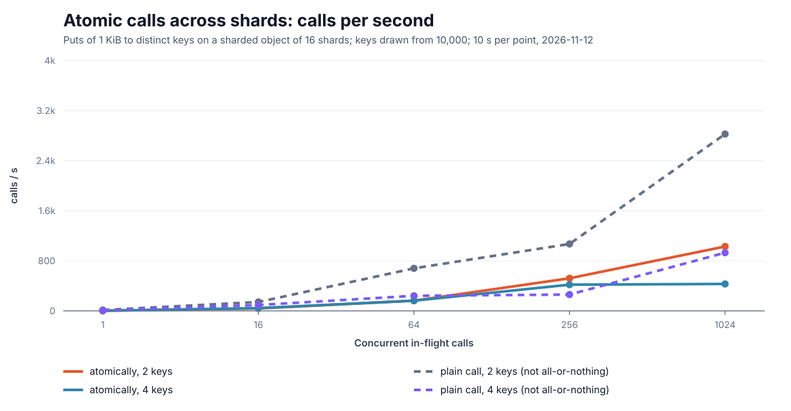

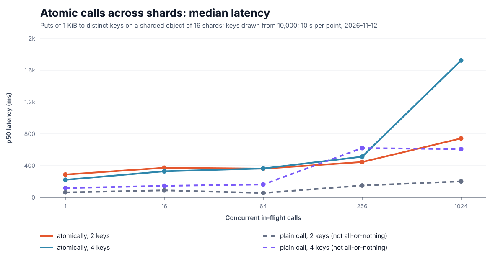

| Uniform keys | Plain, 2 keys | `atomically`, 2 keys | Plain, 4 keys | `atomically`, 4 keys |
|---|---|---|---|---|
| 1 in flight | 14/s, p50 63 ms | 2/s, p50 288 ms | 7/s, p50 118 ms | 3/s, p50 222 ms |
| 16 | 142/s, p50 89 ms | 39/s, p50 373 ms | 94/s, p50 146 ms | 44/s, p50 329 ms |
| 64 | 680/s, p50 56 ms | 163/s, p50 362 ms | 241/s, p50 163 ms | 163/s, p50 364 ms |
| 256 | 1,070/s, p50 150 ms | 521/s, p50 446 ms | 261/s, p50 621 ms | 419/s, p50 513 ms |
| 1,024 | 2,826/s, p50 202 ms | 1,030/s, p50 743 ms | 930/s, p50 608 ms | 431/s, p50 1.7 s |

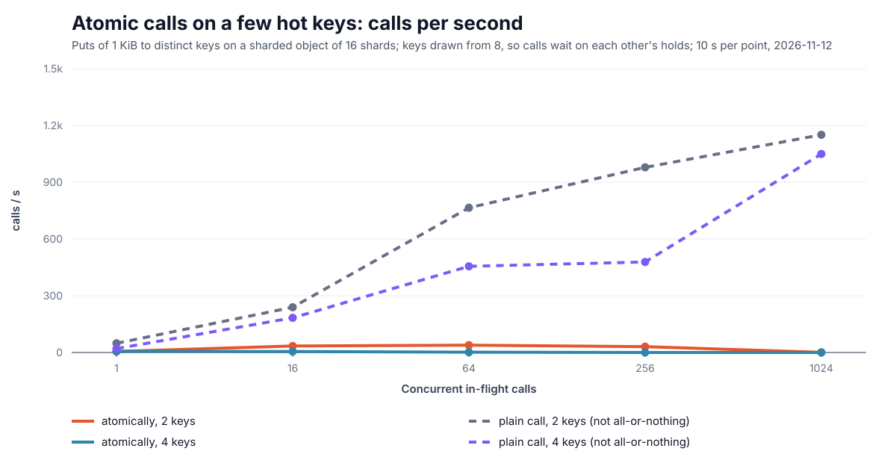

| 8 hot keys | Plain, 2 keys | `atomically`, 2 keys | Plain, 4 keys | `atomically`, 4 keys |
|---|---|---|---|---|
| 1 in flight | 49/s, p50 20 ms | 6/s, p50 177 ms | 20/s, p50 56 ms | 6/s, p50 159 ms |
| 16 | 239/s, p50 42 ms | 34/s, p50 374 ms | 183/s, p50 54 ms | 5/s, p50 3.1 s |
| 64 | 765/s, p50 47 ms | 38/s, p50 845 ms | 455/s, p50 60 ms | 2/s, p50 23.4 s, 18 failed |
| 256 | 979/s, p50 143 ms | 31/s, p50 5.1 s | 479/s, p50 249 ms | 0/s, 256 failed |
| 1,024 | 1,151/s, p50 755 ms | 1/s, 997 failed | 1,049/s, p50 487 ms | 0/s, 1,024 failed |

- **An atomic call costs 220–290 ms at one call in flight,** against 60–120 ms for the plain call. The caller sends the whole call to the primary shard (the smallest key's), which prepares on the others, decides, and commits, with each shard's holds written to storage on the way.
- **Throughput scales with shards,** at about a third of the plain call's for 2 keys and half for 4, with no failed call on uniform keys at any load.
- **Contention stops it.** A call that meets an older call's hold gives way: it aborts, and is made again with the same age, so calls never wait on each other in a ring. On 8 hot keys, 31–38 calls/s complete with 2 keys from 16 to 256 in flight, with a median rising from 0.4 s to 5.1 s; with 4 keys, 5 calls/s at 16 in flight and almost none above. At 1,024 in flight nearly every call had no answer in 30 s. Hot keys that change together belong in one shard, where `routeOf` makes them one transaction.

## Leased reads of one hot key

One key of 1 KiB, read by drivers in five regions, each driver an isolate that keeps its sub-lease in memory as an app's Worker would ([`bench/worker/src/leased.ts`](../bench/worker/src/leased.ts): a source with `ReadLeases` and `RelayPlan`, relays with `RelayReads`). The comparison is the same drivers reading one Durable Object. `mixed` makes 1% of the calls writes of the key. Each point also reports what reached the source ([raw data](../bench/results/v050-leased.json)).

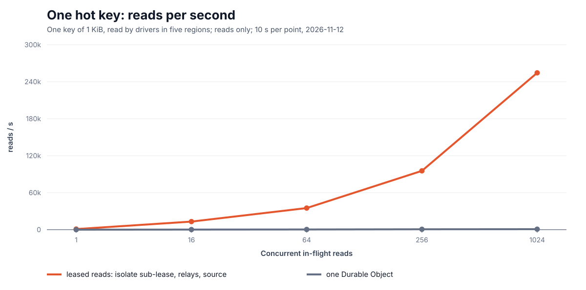

| Reads only | One Durable Object | Leased reads | The source served | Relays |
|---|---|---|---|---|
| 1 in flight | 29/s, p50 29 ms | 953/s, p50 1 ms | 1 read/s | 0 |
| 16 | 131/s, p50 78 ms | 13,141/s, p50 1 ms | 19 reads/s | 0 |
| 64 | 307/s, p50 111 ms | 35,041/s, p50 1 ms | 11 reads/s | 2 |
| 256 | 670/s, p50 234 ms | 95,480/s, p50 1 ms | 21 reads/s | 7 |
| 1,024 | 810/s, p50 1.1 s | 254,431/s, p50 1 ms | 29 reads/s | 6 |

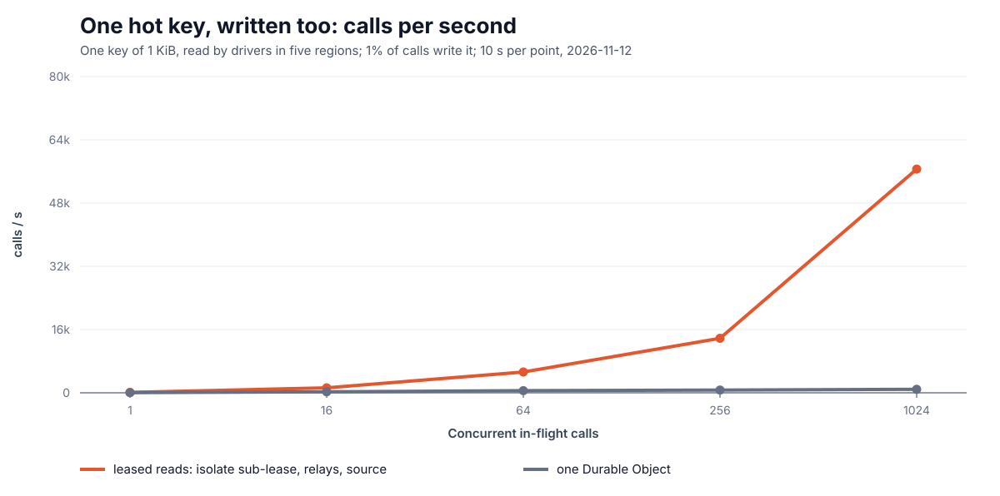

| 1% writes | One Durable Object | Leased reads | The source served | Relays |
|---|---|---|---|---|
| 1 in flight | 42/s, p50 21 ms | 109/s, p50 1 ms, p99 86 ms | 1 read/s, 1 writes/s | 0 |
| 16 | 243/s, p50 30 ms | 1,272/s, p50 1 ms, p99 199 ms | 13 reads/s, 12 writes/s | 0 |
| 64 | 539/s, p50 78 ms | 5,260/s, p50 1 ms, p99 481 ms | 54 reads/s, 52 writes/s | 0 |
| 256 | 697/s, p50 253 ms | 13,783/s, p50 1 ms, p99 825 ms | 216 reads/s, 139 writes/s | 0 |
| 1,024 | 881/s, p50 1.2 s | 56,600/s, p50 1 ms, p99 688 ms | 813 reads/s, 554 writes/s | 0 |

- **Reads of a key that isn't written are answered from memory.** The source answers each isolate and relay about once a second, whatever the read rate. 254,431 reads/s is what the drivers generated, not a limit of the layer.
- **A written key is read from the source, and cached there too.** A key written in the last `WRITTEN_MS` (10 s) isn't relayed, so isolates read the source directly and keep its value under their own leases: 56,600 calls/s at 1,024 in flight, with the source serving 813 reads/s. Relays without a lease to give would only add a hop.
- **A write waits for the leases out on its key,** up to a second: the p99 of the `mixed` runs is the writes.

## Cost

These are estimates from the [published Durable Objects prices](https://developers.cloudflare.com/durable-objects/platform/pricing/) (Workers Paid, beyond included usage) and the row counts of the code.

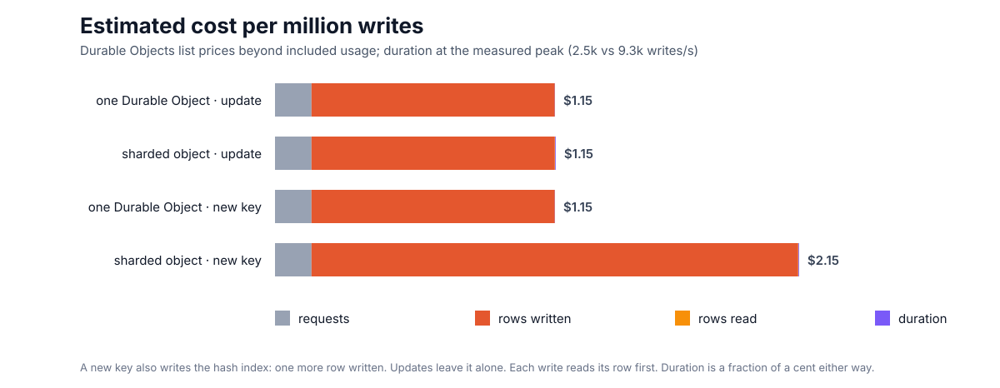

- **Requests:** one per write, in both cases ($0.15 per million).
- **Rows written:** one per write. A new key costs one more in a sharded object, for the index on its hash ($1.00 per million rows).
- **Rows read:** a sharded object reads each row before writing it ($0.001 per million rows).
- **Duration:** billed per object while it is busy, at 128 MB. At the measured peaks, 2,068 writes/s for one object and 9,800 writes/s for 16 shards, that is $0.0008 and $0.0026 per million writes.

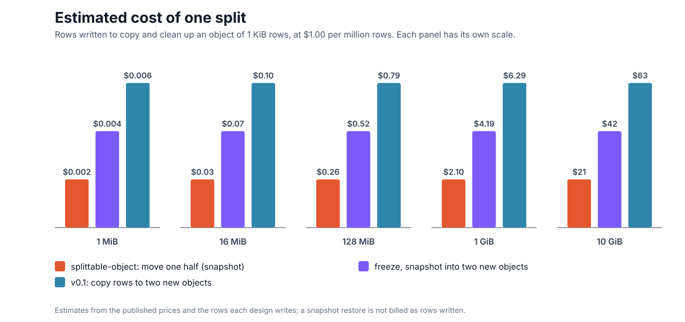

A split is billed as the rows it writes:
- **The sharded object** deletes the half each side gave away, at two rows written per row (table and index). The snapshot restore is done by the storage layer and is not billed as rows written.
- **The freeze into two** also deletes everything from the parent.
- **The v0.1 row copy** inserts every row into a child, tracks each key, and deletes it from the parent.

With 1 KiB rows, a split costs about $0.002 at 1 MiB, $0.03 at 16 MiB, $0.26 at 128 MiB, $2.10 at 1 GiB and $21 at 10 GiB.

The index is the one cost a plain object does not have. It makes deletes and range scans by hash cheap in rows read. Rows read cost a thousandth of rows written, so a version without it is worth measuring.

## Reference: what one Durable Object takes

A separate load test of no-op Durable Object RPC calls topped out at about 1,800 to 2,800 calls/s per object. With real work, about 1,000 events/s per object is a sensible starting budget. The default split threshold, 400 weighted calls/s, sits below that, to leave room for the split itself.

## Running it yourself

See [`bench/README.md`](../bench/README.md).

## Sharded tables

`ShardedTable` with 10,000 rows of 1 KiB and two indexes (`createdAt`, and `owner, createdAt`), on 1, 4, 16 and 64 shards from the start (never splitting during the run). One shard is one Durable Object running the same SQL and indexes. Writes are one-row puts of uniform keys (each updates both indexes); reads are one-row gets by key; a list operation is one page of 50 rows newest first, each caller walking its own cursor. 10 s per point; drivers scale with the calls a page makes, so the load generator is not what is measured.

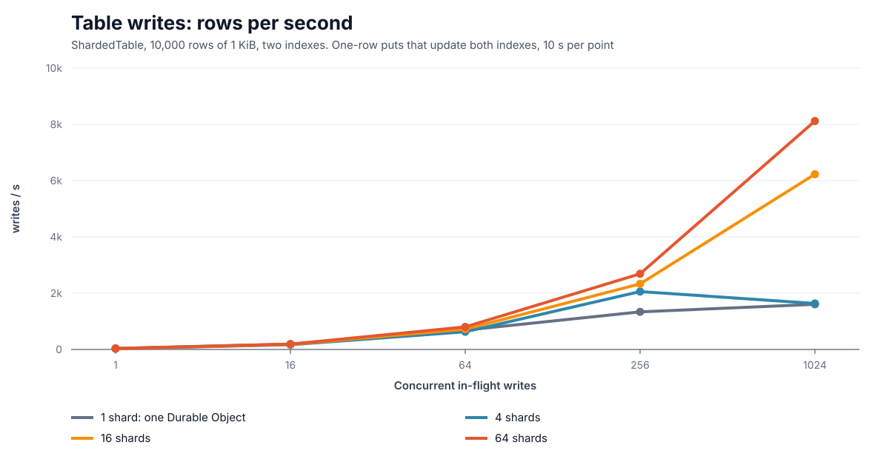

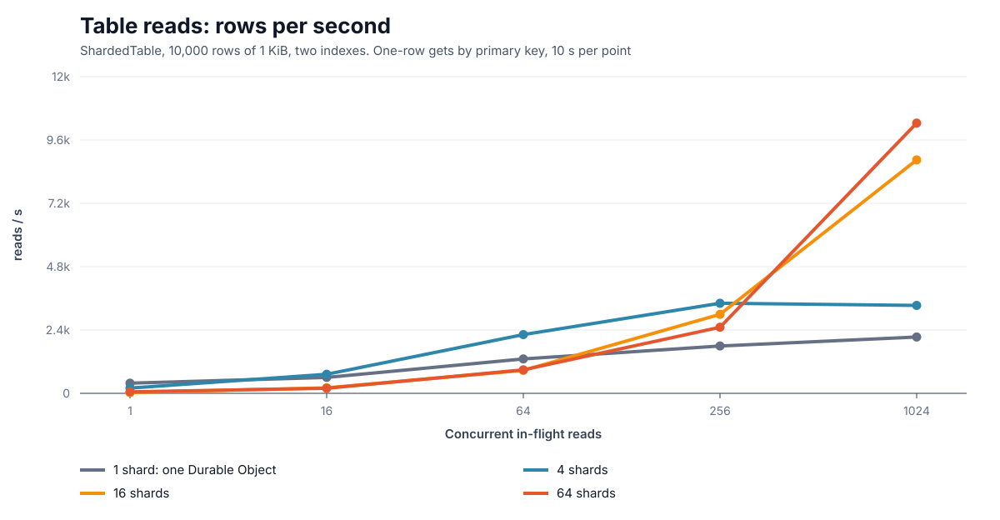

| Writes | 1 shard | 4 shards | 16 shards | 64 shards |
|---|---|---|---|---|
| 64 in flight | 686/s, p50 68 ms | 628/s, p50 77 ms | 721/s, p50 68 ms | 804/s, p50 55 ms |
| 256 | 1,338/s, p50 196 ms | 2,058/s, p50 91 ms | 2,333/s, p50 59 ms | 2,691/s, p50 50 ms |
| 1,024 | 1,604/s, p50 515 ms, 9,089 failed | 1,633/s, p50 265 ms | 6,230/s, p50 80 ms | 8,117/s, p50 61 ms |

| Reads | 1 shard | 4 shards | 16 shards | 64 shards |
|---|---|---|---|---|
| 64 in flight | 1,305/s, p50 35 ms | 2,226/s, p50 7 ms | 871/s, p50 51 ms | 891/s, p50 48 ms |
| 256 | 1,793/s, p50 118 ms | 3,413/s, p50 44 ms | 2,992/s, p50 50 ms | 2,504/s, p50 43 ms |
| 1,024 | 2,136/s, p50 446 ms, 1,327 failed | 3,330/s, p50 134 ms | 8,846/s, p50 59 ms | 10,241/s, p50 39 ms |

The 64-shard reads are from a later run than the rest ([raw data](../bench/results/table.json) names each run).

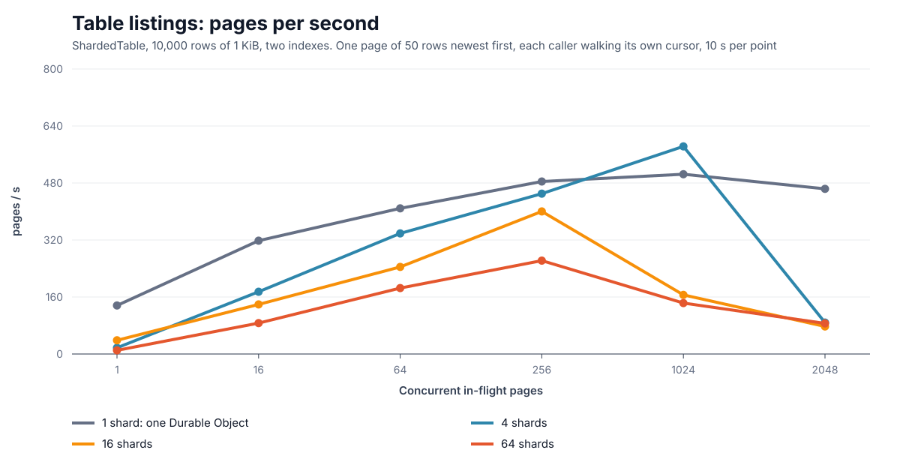

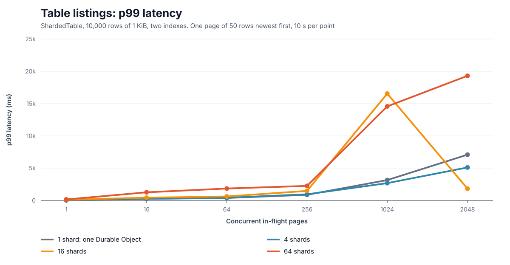

Listings were measured again on 2026-11-13, in query order and in shard order from one deploy ([raw data](../bench/results/v050-table-list.json)):

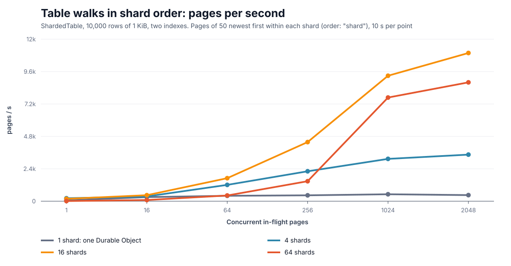

| Query order (`list`) | 1 shard | 4 shards | 16 shards | 64 shards |
|---|---|---|---|---|
| 1 in flight | 136/s, p50 8 ms | 17/s, p50 56 ms | 38/s, p50 24 ms | 10/s, p50 74 ms |
| 64 | 409/s, p50 136 ms | 338/s, p50 173 ms | 244/s, p50 264 ms | 185/s, p50 288 ms |
| 256 | 484/s, p50 496 ms | 450/s, p50 536 ms | 400/s, p50 625 ms | 262/s, p50 844 ms |
| 1,024 | 505/s, p50 1,990 ms | 583/s, p50 1,762 ms | 166/s, p50 6 ms, 9,395 failed | 143/s, p50 18 ms, 34,584 failed |
| 2,048 | 463/s, p50 3,802 ms, 2,175 failed | 88/s, p50 6 ms, 152,277 failed | 77/s, p50 6 ms, 182,098 failed | 86/s, p50 22 ms, 94,481 failed |

| Shard order (`order: "shard"`) | 1 shard | 4 shards | 16 shards | 64 shards |
|---|---|---|---|---|
| 1 in flight | 61/s, p50 17 ms | 217/s, p50 6 ms | 176/s, p50 6 ms | 13/s, p50 58 ms |
| 64 | 403/s, p50 140 ms | 1,211/s, p50 16 ms | 1,704/s, p50 8 ms | 424/s, p50 97 ms |
| 256 | 436/s, p50 571 ms | 2,218/s, p50 90 ms | 4,379/s, p50 22 ms | 1,481/s, p50 147 ms |
| 1,024 | 515/s, p50 1,932 ms | 3,136/s, p50 330 ms | 9,294/s, p50 72 ms | 7,680/s, p50 85 ms |
| 2,048 | 450/s, p50 2,827 ms, 4,778 failed | 3,452/s, p50 561 ms | 10,979/s, p50 158 ms | 8,804/s, p50 149 ms |

- **Writes and reads scale with shards** once one object is the bottleneck, from about 256 in flight. Below that, one object is as fast or faster: a sharded call is a routed call.
- **Listings in query order do not.** A page asks every shard for its share (twice limit / shards, plus two), so each shard serves every page: throughput stays at or below one object's (400–580 pages/s in this run), and a page waits for its slowest shard. From 1,024 in flight, the shards of a 16- or 64-shard table refuse most pages ("overloaded"); the error log names every shard, not one hot one. A page also costs up to 3 × shards subrequests in the caller's invocation, and a Worker invocation may make only so many.
- **Walks in shard order do.** `list({ order: "shard" })` lists rows in the query's order within each shard, shard after shard, and asks one shard a page. Each walk starts at a random shard and wraps around, so walks begun together spread over the shards. 16 shards served 10,979 pages/s at 2,048 in flight with p50 158 ms and no failures, against 77/s and 182,098 refusals in query order. A walk costs about a shard's share of the calls, so it is the way to read a whole table: exports, backfills, scans.
- **At one in flight**, latency is mostly where the caller and each shard are: a shard in another colo adds tens of milliseconds, whichever order.
- Two fixes went in while measuring: pages first scanned rows instead of seeking (10,000 rows listed at a third of the speed of 2,000), and every shard returned a full page (16 shards moved 800 rows to list 50).
- An index stored by sort order (range-partitioned) would let a page touch one or two index shards. That is the next layer.

## Table commands

`apply` against the same update made by the caller, a `get` and a `put(row, { ifVersion })` retried from a fresh read up to 8 times, on 1 and 16 shards, measured on the edge on 2026-11-13 ([raw data](../bench/results/apply.json), design in [RFD0010](rfds/RFD0010-table-commands.md)). The update raises a row's size by one, or creates the row. 10 s per point.

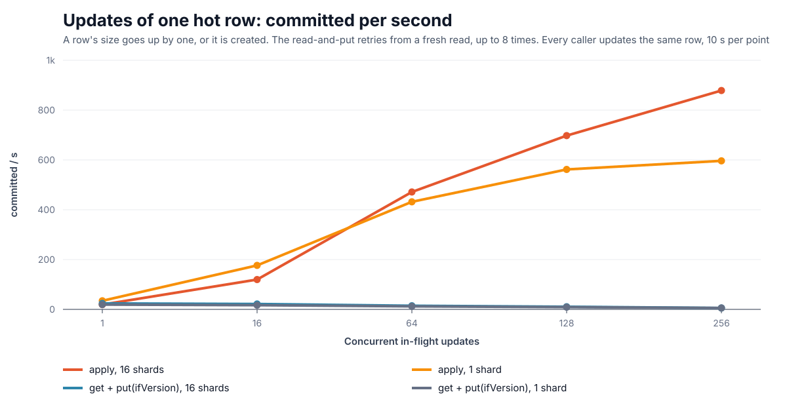

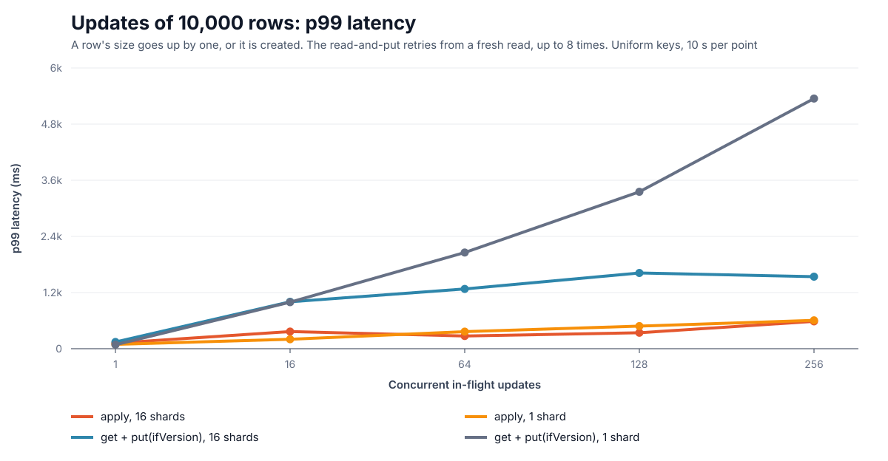

| One hot row, in flight | apply, 1 shard | get + put, 1 shard | apply, 16 shards | get + put, 16 shards |
|---|---|---|---|---|
| 1 | 34/s, p99 52 ms | 19/s, p99 123 ms | 19/s, p99 67 ms | 24/s, p99 62 ms |
| 16 | 177/s, p99 284 ms | 17/s, p99 2,935 ms, 72 failed | 120/s, p99 321 ms | 22/s, p99 2,617 ms, 117 failed |
| 64 | 432/s, p99 378 ms | 12/s, p99 3,401 ms, 344 failed | 471/s, p99 304 ms | 15/s, p99 3,000 ms, 391 failed |
| 128 | 562/s, p99 395 ms | 9/s, p99 4,237 ms, 492 failed | 698/s, p99 447 ms | 10/s, p99 3,644 ms, 611 failed |
| 256 | 596/s, p99 597 ms, 540 failed | 6/s, p99 5,231 ms, 713 failed | 879/s, p99 565 ms | 6/s, p99 5,353 ms, 827 failed |

| 10,000 rows, uniform, in flight | apply, 1 shard | get + put, 1 shard | apply, 16 shards | get + put, 16 shards |
|---|---|---|---|---|
| 1 | 23/s, p99 93 ms | 25/s, p99 86 ms | 24/s, p99 120 ms | 21/s, p99 144 ms |
| 16 | 173/s, p99 202 ms | 78/s, p99 994 ms | 146/s, p99 366 ms | 81/s, p99 1,003 ms |
| 64 | 395/s, p99 364 ms | 200/s, p99 2,056 ms, 6 failed | 616/s, p99 272 ms | 305/s, p99 1,278 ms |
| 128 | 505/s, p99 483 ms | 221/s, p99 3,354 ms, 6 failed | 1,180/s, p99 341 ms | 516/s, p99 1,618 ms |
| 256 | 590/s, p99 606 ms | 188/s, p99 5,347 ms, 25 failed | 2,064/s, p99 584 ms | 1,061/s, p99 1,539 ms, 2 failed |

- **One hot row:** `apply` commits 562–698 updates/s at 128 in flight, with no failures; the read-and-put commits 9–10/s, and 492–611 calls run out of attempts. A hot row is one object, so at 256 in flight its queue fills and calls are refused as overloaded.
- **Uniform keys:** `apply` is about twice as fast with a fifth of the p99, from the call it saves and the conflicts it avoids.

## Indexed tables

`IndexedTable` against `ShardedTable`, on the same 10,000 rows of 1 KiB, on 1 and 16 shards. The indexed table adds a unique global index on `email` and one on `(team, createdAt)`, each on as many index shards as there are row shards ("16 + 16"). Updates are one-row puts of existing rows, each moving both index entries; creates are new rows, only if absent, so the indexed table reserves the email first; reads are a lookup by email through the index, against a get by key; a listing is one page of 50 rows newest first, of one team from one index shard, against the whole table from every shard. 10 s per point, measured on the edge on 2026-11-12 ([raw data](../bench/results/indexed.json)).

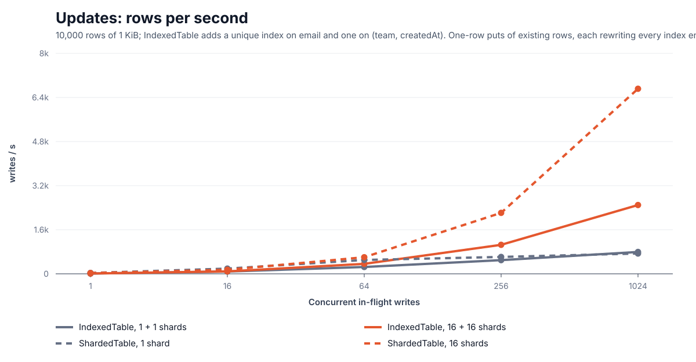

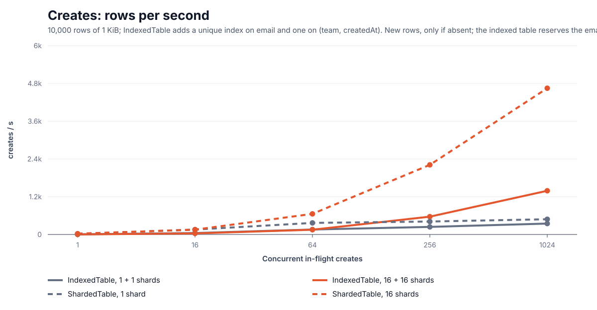

| Updates | 1 shard | 1 + 1 indexed | 16 shards | 16 + 16 indexed |
|---|---|---|---|---|
| 1 in flight | 31/s, p50 32 ms | 10/s, p50 98 ms | 29/s, p50 33 ms | 10/s, p50 98 ms |
| 64 | 504/s, p50 96 ms | 248/s, p50 251 ms | 602/s, p50 85 ms | 361/s, p50 147 ms |
| 256 | 612/s, p50 370 ms, 811 failed | 496/s, p50 507 ms | 2,213/s, p50 82 ms | 1,052/s, p50 179 ms |
| 1,024 | 737/s, p50 163 ms, 11,031 failed | 794/s, p50 936 ms, 5,130 failed | 6,716/s, p50 107 ms | 2,497/s, p50 289 ms |

| Creates | 1 shard | 1 + 1 indexed | 16 shards | 16 + 16 indexed |
|---|---|---|---|---|
| 1 in flight | 21/s, p50 46 ms | 5/s, p50 181 ms | 25/s, p50 38 ms | 1/s, p50 640 ms |
| 64 | 368/s, p50 177 ms | 158/s, p50 362 ms | 656/s, p50 85 ms | 152/s, p50 416 ms |
| 256 | 412/s, p50 609 ms, 231 failed | 242/s, p50 974 ms | 2,213/s, p50 85 ms | 567/s, p50 441 ms |
| 1,024 | 485/s, p50 1,457 ms, 4,670 failed | 348/s, p50 2,816 ms | 4,648/s, p50 148 ms | 1,389/s, p50 578 ms |

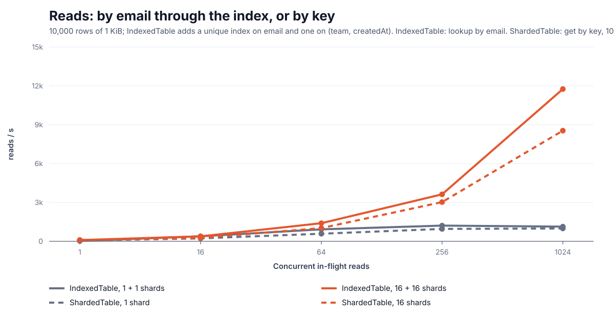

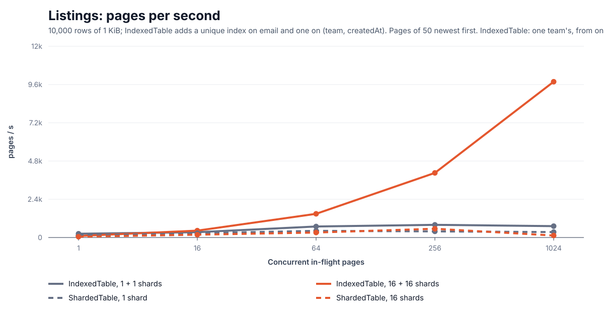

| Lookups by email / reads by key | 1 shard | 1 + 1 indexed | 16 shards | 16 + 16 indexed |
|---|---|---|---|---|
| 1 in flight | 63/s, p50 16 ms | 23/s, p50 44 ms | 94/s, p50 13 ms | 93/s, p50 8 ms |
| 64 | 583/s, p50 91 ms | 925/s, p50 51 ms | 1,017/s, p50 44 ms | 1,397/s, p50 17 ms |
| 256 | 953/s, p50 287 ms | 1,212/s, p50 205 ms | 3,026/s, p50 49 ms | 3,626/s, p50 38 ms |
| 1,024 | 990/s, p50 247 ms, 11,274 failed | 1,134/s, p50 447 ms, 11,082 failed | 8,540/s, p50 73 ms | 11,755/s, p50 54 ms |

| List pages | 1 shard | 1 + 1 indexed | 16 shards | 16 + 16 indexed |
|---|---|---|---|---|
| 1 in flight | 121/s, p50 9 ms | 237/s, p50 5 ms | 52/s, p50 18 ms | 99/s, p50 10 ms |
| 64 | 418/s, p50 140 ms | 691/s, p50 68 ms | 312/s, p50 198 ms | 1,487/s, p50 14 ms |
| 256 | 386/s, p50 675 ms | 796/s, p50 317 ms | 549/s, p50 451 ms | 4,054/s, p50 39 ms |
| 1,024 | 340/s, p50 1,622 ms, 2,931 failed | 714/s, p50 1,461 ms | 128/s, p50 6 ms, 12,800 failed | 9,778/s, p50 67 ms |

- **Writes cost about two to three times as much.** An update or create makes three calls in a row (reserve on the index, write the row, deliver the entries) and returns only once the index has them, so at one in flight an update takes 98 ms against 32 ms, and an indexed table needs about twice the shards for the same write rate. It still scales with shards: 16 + 16 shards take 2,497 updates/s and 1,389 creates/s at 1,024 in flight with no failed calls.
- **Listings within a partition scale with shards; whole-table listings do not.** A team's page reads one index shard, so 16 + 16 shards serve 9,778 pages/s at 1,024 in flight with p50 67 ms, while a whole-table page asks every shard: 16 shards served 549 pages/s at 256 in flight and refused most pages at 1,024.
- **Lookups by email cost one call, as reads by key do,** and scale the same: 11,755/s on 16 index shards at 1,024 in flight, against 8,540 reads by key on 16 row shards.
- **One object is the ceiling, as before.** With one row shard, calls fail once it is overloaded, from 256 in flight. With 1 + 1 shards, 5,130 of the updates at 1,024 in flight failed.

## Presplitting

Presplitting is now lazy: no shard above `initialDepth` is created, each shard at that depth creates itself on its first call (asking the root for the tree's depth, once), and every "moved" answer tells the client the depth, so it routes straight to it. A first call costs at most two hops and one object creation, whatever the depth. Before, a client learned one level per answer, so each isolate asked the shards above (shared by every key) for every path, and those overloaded under many isolates. The measurements below are of the eager presplit it replaced.

With the eager presplit, the first calls to a new object waited while it created its shards. Measured with 64 concurrent first calls to a fresh name (`POST /first-calls` on the bench Worker), 5 runs each:

| Shards | Before | Now |
|---|---|---|
| 16 (`initialDepth: 4`) | 3.8–5.4 s until the last call returned | 1.4–3.2 s |
| 4,096 (`initialDepth: 12`) | 22.8–25.6 s | 9.0–14.9 s |

Before, the root created one shard per level in turn, and each new shard did the same on its first call: up to 10 object creations one after another for 16 shards. Now an object creates every shard up to 6 levels below it at once, at its final bits (at most 63 calls per round), so 16 shards take one round and 4,096 take two.

## Where a native split's time goes

Each split records its steps (\`splits[].steps\` in \`shardedDescribe()\`). Measured with \`POST /split-steps\` on the bench Worker: 8,000 rows of 200 bytes, then forced native splits a whole level at a time (1, 2, 4, then 8 at once) to 15 shards, with no load and with 64 writes in flight, 4 runs each (120 splits):

| Step | Median | Slowest |
|---|---|---|
| Starting the new object (before writes are held) | 325 ms | 667 ms |
| Snapshot | 1 ms | 192 ms |
| Handing the snapshot over (of which the sibling scheduling the restore: 178 ms median) | 192 ms | 1,048 ms |
| Claim: the sibling restarting on the snapshot, then accepting | 632 ms | 4,145 ms |
| **Writes held** (the split's \`ms\`) | **847 ms** | **4,284 ms** |

- Before the new object was started ahead of the split, starting it was paid while writes were held: held time had a median around 1.1–1.2 s, and once 12.8 s, all of it in the first call to the new object.
- What remains is the platform restarting the new object on the snapshot. One restart took 4.1 s. The library cannot shorten it: the copy is a point in time, so writes to the moving half wait until the copy serves.

