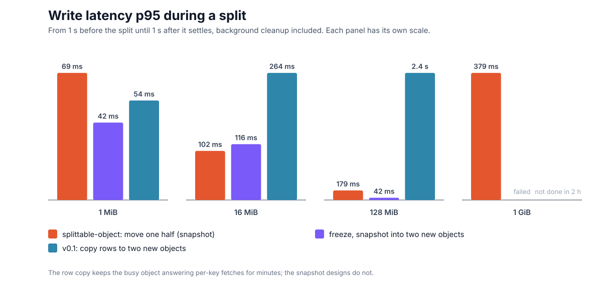
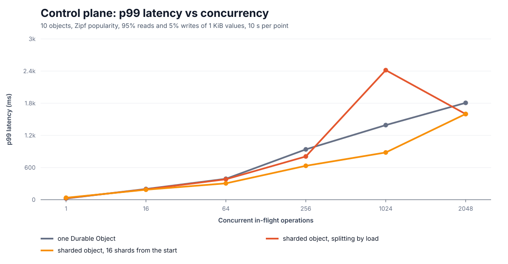
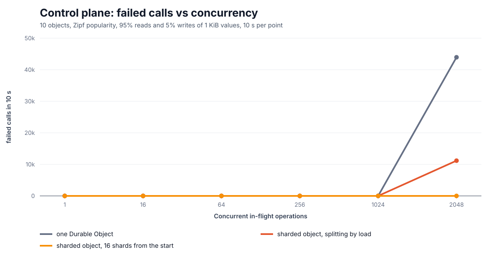
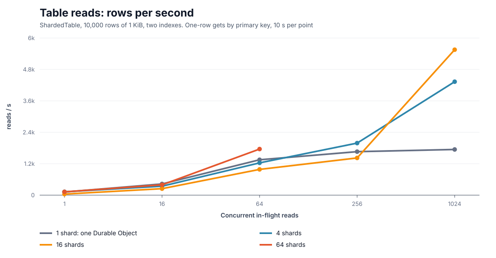
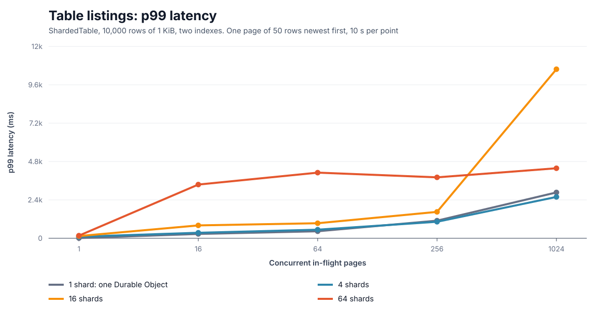

# Performance

Everything here was measured on Cloudflare's network, on a Workers paid plan, using the benchmark Worker in [`bench/`](../bench/README.md) (compatibility date 2026-10-29, with `durable_object_snapshots`), with do-kit 0.4.0. Raw results are in [`bench/results/`](../bench/results/), and the graphs are regenerated from them with `bun run bench:plot`.

## How long a split takes

The split benchmark builds one object with N MiB of 1 KiB rows. Then, with 8 writers on random keys running from a second before until a second after, it splits that object once. It compares three ways to split:

- **Sharded object.** Only the right half moves, as one storage snapshot restored into one new object. Reads and left-half writes go on during the copy.
- **Freeze, snapshot into two new objects.** The object stops serving, restores its snapshot into two children, which each delete the half they do not own, and stays behind as a router.
- **v0.1: copy rows to two new objects.** Children serve at once and fetch rows from the parent as calls need them, while a background copy streams the rest in batches of 1,000 rows.

| Data | Sharded object | Freeze, two snapshots | v0.1 row copy |
|---|---|---|---|
| 1 MiB | 1.8 s | 1.2 s | 1.1 s |
| 16 MiB | 1.7 s | 2.1 s | 5.1 s |
| 128 MiB | 3.4 s | 13.4 s | 267 s |
| 1 GiB | 16.9 s | failed (earlier version) | did not finish in 2 h (earlier version) |

"Time to split" is the time until the new owner serves with all of its data:
- **Sharded object:** until the new object has claimed its copy. Deleting the half each side gave away continues in the background: 30.1 s at 128 MiB, during which those rows are invisible.
- **Freeze:** the whole freeze.
- **Row copy:** until the last row has moved.

At 1 GiB, the sharded object served after 16.9 s. During the run, writes had a p50 of 67 ms, a p95 of 153 ms and a p99 of 265 ms, with no failures. The slowest write, 16.0 s, was one to the moving half that waited for the copy. Deleting the half each side gave away then took 4.7 minutes in the background. The two older designs were measured at 1 GiB only with an earlier version: the freeze-into-two design gave up on the split (its single-transaction cleanup of half a million rows per child is the likely cause), and the v0.1 row copy was still copying after two hours.

### What callers feel during a split

Measured from 1 s before the split until 1 s after it settles:

| Data | Sharded object p95 / max | Freeze p95 / max | Row copy p95 / max |
|---|---|---|---|
| 1 MiB | 18 ms / 1.2 s | 16 ms / 1.2 s | 25 ms / 0.3 s |
| 16 MiB | 62 ms / 1.3 s | 43 ms / 2.2 s | 127 ms / 0.7 s |
| 128 MiB | 105 ms / 3.0 s | 170 ms / 14.7 s | 2.2 s / 16.3 s |

- **Snapshots trade a short wait for a short split.** With either snapshot design, the slowest write is one that waited for the copy. With the sharded object, only writes to the half that moves wait. With the freeze, every call waits, reads too.
- **The row copy never blocks outright, but it is slow and loads the busy object.** Its children ask the parent for rows on every new key while the background copy competes with those requests. That is why its p95 is 2.2 s for the 4 minutes it takes at 128 MiB.
- **Deleting rows has a cost too.** A delete blocks the object while it runs, and takes longer the more rows it deletes. So each object deletes the half it gave away 250 rows at a time, 25 ms apart, and writes run between the batches. Deleting in large batches stalls every write for as long as each batch takes.

No write failed in any split run.

## Throughput against one Durable Object

The throughput benchmark sends one-key writes of 1 KiB values to uniform keys from driver Durable Objects in several regions, at increasing concurrency. Each driver keeps at most 16 calls in flight, so 2,048 in flight means 128 drivers. Each level runs once unmeasured, then once measured for 10 s. The object under test is either one plain Durable Object, or a sharded object presplit into 16 shards, so no split happens while it is measured.

| In flight | One Durable Object | Sharded object, 16 shards |
|---|---|---|
| 1 | 65 writes/s, p50 7 ms | 2 writes/s, p50 42 ms |
| 16 | 354 writes/s, p50 28 ms | 206 writes/s, p50 52 ms |
| 64 | 1,035 writes/s, p50 27 ms | 849 writes/s, p50 48 ms |
| 256 | 1,800 writes/s, p50 52 ms, p99 874 ms | 1,815 writes/s, p50 68 ms, p99 602 ms |
| 1,024 | 2,064 writes/s, p50 386 ms, p99 1,050 ms | 5,527 writes/s, p50 110 ms, p99 649 ms |
| 2,048 | 2,068 writes/s, p99 1,357 ms, **23,263 calls refused** | 9,800 writes/s, p50 139 ms, p99 705 ms, none refused |

Reads, in the same way:

| In flight | One Durable Object | Sharded object, 16 shards |
|---|---|---|
| 1 | 162 reads/s, p50 7 ms | 110 reads/s, p50 10 ms |
| 64 | 1,201 reads/s, p50 17 ms | 1,562 reads/s, p50 11 ms |
| 256 | 1,483 reads/s, p50 96 ms, p99 912 ms | 2,611 reads/s, p50 21 ms, p99 763 ms |
| 1,024 | 1,753 reads/s, p50 597 ms, p99 1,205 ms | 7,445 reads/s, p50 79 ms, p99 720 ms |
| 2,048 | 1,611 reads/s, p99 2,216 ms, **31,785 calls failed** | 14,947 reads/s, p50 71 ms, p99 782 ms, none failed |

- **One object saturates at about 2,100 writes/s.** Past that, it queues, so its median latency at 1,024 in flight is 386 ms. Then it refuses calls: 23,263 in 10 s at 2,048 in flight. (Its 116 ms median at that level is misleading, because many of those calls failed fast.)
- **16 shards keep their median latency near 100 ms** while writes grow from 1,815/s to 9,800/s, and they had not saturated at the highest load we offered.
- **At low load, one object can be faster.** With one call in flight, a shard answered in 42 ms against 7 ms, and the first calls also wait for the presplit. A new shard is placed near the object that created it, not near the caller, so some keys live farther away. Splitting pays off when one object is the bottleneck, not before.
- **The load generator matters.** A driver Durable Object completes about 90 calls/s, however many it keeps in flight. An earlier run with 64 calls per driver capped every target near 1,500 writes/s, and made splitting look useless. The graphs above use the fixed harness.
- **Read runs seed their keys from one driver, with retries.** When a hundred drivers seeded at once, they overloaded the single object before it was measured.

More graphs from the same run: [latency p50](bench/latency-p50.svg), [p95](bench/latency-p95.svg), [max](bench/latency-max.svg), and [storage ceiling](bench/capacity.svg) (shards × the 10 GB limit of one object).

## A control plane: a handful of hot objects

Ten objects, `config-0` to `config-9`, with Zipf popularity (s = 1.1): the most popular gets about a third of the calls. 95% of calls read and 5% write 1 KiB.

| In flight | One Durable Object | Sharded object, splitting by load | Sharded object, 16 shards |
|---|---|---|---|
| 1 | 97/s, p50 11 ms | 78/s, p50 13 ms | 56/s, p50 19 ms |
| 16 | 232/s, p50 54 ms | 296/s, p50 27 ms | 291/s, p50 26 ms |
| 64 | 810/s, p50 46 ms | 998/s, 5 shards, p50 27 ms | 1,122/s, p50 25 ms |
| 256 | 1,142/s, p50 135 ms, p99 939 ms | 1,668/s, 8 shards, p50 71 ms, p99 807 ms | 1,904/s, p50 53 ms, p99 632 ms |
| 1,024 | 1,527/s, p50 675 ms, p99 1.4 s | 2,388/s, 15 shards, p50 327 ms, p99 2.4 s | 3,547/s, p50 217 ms, p99 881 ms |
| 2,048 | 1,713/s, **27,650 calls failed** | 4,656/s, 29 shards, 9,655 failed | 4,522/s, **10,516 calls failed** |

- **Even ten keys gain from splitting.** They land on different shards, so the object's work is shared.
- **The most popular key sets the ceiling.** A key always lives on one shard, and here one key takes a third of the calls. That shard runs out of capacity near 4,700 calls/s in total: at 2,048 in flight it refuses calls even with 16 shards.
- **Splitting by load overshoots.** It went to 29 shards for 10 keys. Splits that leave a hot key where it was do not help, but they still pause writes to the half that moves. The split policy should stop splitting a shard whose load comes from one key. That is not done yet.

## Cost

These are estimates from the [published Durable Objects prices](https://developers.cloudflare.com/durable-objects/platform/pricing/) (Workers Paid, beyond included usage) and the row counts of the code.

- **Requests:** one per write, in both cases ($0.15 per million).
- **Rows written:** one per write. A new key costs one more in a sharded object, for the index on its hash ($1.00 per million rows).
- **Rows read:** a sharded object reads each row before writing it ($0.001 per million rows).
- **Duration:** billed per object while it is busy, at 128 MB. At the measured peaks, 2,068 writes/s for one object and 9,800 writes/s for 16 shards, that is $0.0008 and $0.0026 per million writes.

A split is billed as the rows it writes:
- **The sharded object** deletes the half each side gave away, at two rows written per row (table and index). The snapshot restore is done by the storage layer and is not billed as rows written.
- **The freeze into two** also deletes everything from the parent.
- **The v0.1 row copy** inserts every row into a child, tracks each key, and deletes it from the parent.

With 1 KiB rows, a split costs about $0.002 at 1 MiB, $0.03 at 16 MiB, $0.26 at 128 MiB, $2.10 at 1 GiB and $21 at 10 GiB.

The index is the one cost a plain object does not have. It makes deletes and range scans by hash cheap in rows read. Rows read cost a thousandth of rows written, so a version without it is worth measuring.

## Reference: what one Durable Object takes

A separate load test of no-op Durable Object RPC calls topped out at about 1,800 to 2,800 calls/s per object. With real work, about 1,000 events/s per object is a sensible starting budget. The default split threshold, 400 weighted calls/s, sits below that, to leave room for the split itself.

## Running it yourself

See [`bench/README.md`](../bench/README.md).

## Sharded tables

`ShardedTable` with 10,000 rows of 1 KiB and two indexes (`createdAt`, and `owner, createdAt`), on 1, 4, 16 and 64 shards from the start (never splitting during the run). One shard is one Durable Object running the same SQL and indexes. Writes are one-row puts of uniform keys (each updates both indexes); reads are one-row gets by key; a list operation is one page of 50 rows newest first, each caller walking its own cursor. 10 s per point; drivers scale with the calls a page makes, so the load generator is not what is measured.

| Writes | 1 shard | 4 shards | 16 shards | 64 shards |
|---|---|---|---|---|
| 64 in flight | 636/s, p50 54 ms | 634/s, p50 78 ms | 665/s, p50 55 ms | 440/s, p50 105 ms |
| 256 | 1,022/s, p50 130 ms | 1,457/s, p50 103 ms | 2,092/s, p50 41 ms | 1,252/s, p50 134 ms |
| 1,024 | 1,226/s, p50 688 ms | 2,109/s, p50 302 ms | 5,125/s, p50 95 ms | 5,174/s, p50 124 ms |

| Reads | 1 shard | 4 shards | 16 shards | 64 shards |
|---|---|---|---|---|
| 64 in flight | 1,351/s, p50 17 ms | 1,234/s, p50 30 ms | 984/s, p50 37 ms | 1,761/s, p50 9 ms |
| 256 | 1,660/s, p50 68 ms | 1,988/s, p50 68 ms | 1,421/s, p50 103 ms | not measured* |
| 1,024 | 1,745/s, p50 561 ms | 4,333/s, p50 109 ms | 5,555/s, p50 127 ms | not measured* |

\* The 64-shard read runs at 256 and 1,024 in flight never answered: a Durable Object used up its CPU time until the runtime reset it. Other runs on 0.4.0 hit the same thing at times (in the 4,096-shard benchmark too), and the cause is not known yet.

| List pages | 1 shard | 4 shards | 16 shards | 64 shards |
|---|---|---|---|---|
| 1 in flight | 163/s, p50 7 ms | 37/s, p50 26 ms | 18/s, p50 53 ms | 10/s, p50 73 ms |
| 64 | 556/s, p50 61 ms | 326/s, p50 126 ms | 240/s, p50 193 ms | 64/s, p50 456 ms |
| 256 | 544/s, p50 366 ms | 400/s, p50 613 ms | 440/s, p50 501 ms | 206/s, p50 563 ms |
| 1,024 | 578/s, p50 1,681 ms | 564/s, p50 1,693 ms | 169/s, p50 65 ms, 37,300 calls failed | 369/s, p50 2,287 ms, 40 calls failed |

- **Writes and reads scale with shards** once one object is the bottleneck, from about 256 in flight. Below that, one object is as fast or faster: a sharded call is a routed call.
- **Listings do not.** A page asks every shard for its share of the page (twice limit / shards, plus two), so each shard serves every page. Throughput stays near one object's, about 560–580 pages/s, and a page waits for its slowest shard, so latency grows with the number of shards. At high load, more shards shed load sooner, because every one of them sees every page.
- Two fixes went in while measuring: pages first scanned rows instead of seeking (10,000 rows listed at a third of the speed of 2,000), and every shard returned a full page (16 shards moved 800 rows to list 50).
- An index stored by sort order (range-partitioned) would let a page touch one or two index shards. That is the next layer.

## Presplitting

With `initialDepth`, the first calls to a new object wait while it creates its shards. Measured with 64 concurrent first calls to a fresh name (`POST /first-calls` on the bench Worker), 5 runs each:

| Shards | Before | Now |
|---|---|---|
| 16 (`initialDepth: 4`) | 3.8–5.4 s until the last call returned | 1.4–3.2 s |
| 4,096 (`initialDepth: 12`) | 22.8–25.6 s | 9.0–14.9 s |

Before, the root created one shard per level in turn, and each new shard did the same on its first call: up to 10 object creations one after another for 16 shards. Now an object creates every shard up to 6 levels below it at once, at its final bits (at most 63 calls per round), so 16 shards take one round and 4,096 take two.

## Where a native split's time goes

Each split records its steps (\`splits[].steps\` in \`shardedDescribe()\`). Measured with \`POST /split-steps\` on the bench Worker: 8,000 rows of 200 bytes, then forced native splits a whole level at a time (1, 2, 4, then 8 at once) to 15 shards, with no load and with 64 writes in flight, 4 runs each (120 splits):

| Step | Median | Slowest |
|---|---|---|
| Starting the new object (before writes are held) | 325 ms | 667 ms |
| Snapshot | 1 ms | 192 ms |
| Handing the snapshot over (of which the sibling scheduling the restore: 178 ms median) | 192 ms | 1,048 ms |
| Claim: the sibling restarting on the snapshot, then accepting | 632 ms | 4,145 ms |
| **Writes held** (the split's \`ms\`) | **847 ms** | **4,284 ms** |

- Before the new object was started ahead of the split, starting it was paid while writes were held: held time had a median around 1.1–1.2 s, and once 12.8 s, all of it in the first call to the new object.
- What remains is the platform restarting the new object on the snapshot. One restart took 4.1 s. The library cannot shorten it: the copy is a point in time, so writes to the moving half wait until the copy serves.

