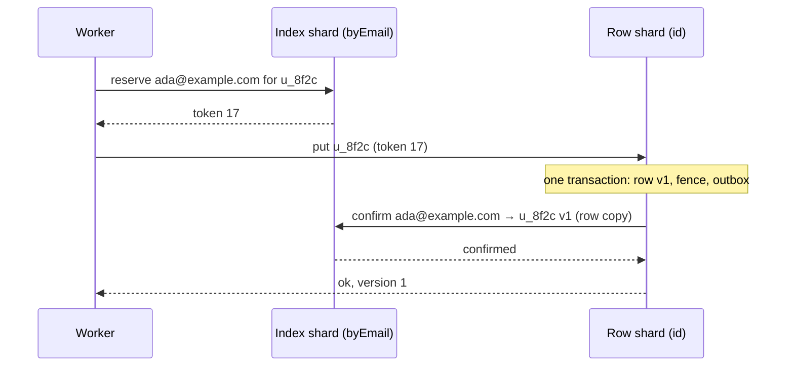

# RFD0003 - Indexed tables: global indexes across shards

- Feature Name: `indexed-table`
- Status: Draft (phase 1 built)
- Author: `leostera`
- Start Date: `2026-10-30`
- Updated: `2026-10-31`
- Discussion PR: none
- Tracking Issue: none

## Summary

`IndexedTable` is a sharded table ([RFD0002](RFD0002-sharded-table.md)) with **global indexes**.
A global index lives apart from the rows, in its own sharded object, so it can do three things
the per-shard indexes cannot:
- look a row up by a column other than its primary key, in one call;
- enforce uniqueness on such a column;
- list rows sorted by it while touching only one or two shards.

These are what DynamoDB calls global secondary indexes (GSIs), with two differences: a write here
returns only after its index entries are written, where a DynamoDB GSI is updated asynchronously
and may serve stale reads; and an index here can be unique, which a GSI cannot enforce.

A write returns only once its index entries are written, so a row is found through every index as
soon as its write returns. The row's shard stays the source of truth. Index changes go into an
outbox in the same transaction as the row. Unique values are reserved with fencing tokens before
the row is written. An index entry carries a copy of the row, so a lookup or a page is answered by
the index alone.

The work comes in two phases:
1. Indexes partitioned by the hash of their leading columns: lookups, uniqueness, and listings
   within one value (all members of a team, newest first). These need no change to the
   core.
2. Indexes partitioned by range: sorted listings over the whole table. These need range splits in
   the core.

## Motivation

`ShardedTable` keeps every index inside each shard, next to the rows it indexes. That makes index
writes transactional and free, but every question that is not "the row with this primary key" has
to ask every shard:

- **Lookups by another column.** A user directory keys rows by user ID, and signing in needs
  "which user has the email `ada@example.com`?" Today that is a listing across all shards, or a
  second table the caller maintains by hand.
- **Uniqueness on another column.** Two sign-ups with the same email land on different shards, and
  nothing stops both.
- **Listings.** A page asks every shard for its share. In our benchmarks, listing throughput stays
  near one object's (about 370–400 pages/s at 1, 4 and 16 shards) while writes grow with shards
  (1,011 writes/s on one shard, 4,391 on 64), and a page gets slower as shards are added: at 64 in
  flight, its median is 805 ms on 64 shards against 231 ms on one.

## Goals

- `lookup(index, values)` returns the row in one call to one index shard.
- `unique: true` refuses a write that would give two rows the same values. Nothing is written, and
  the result names the index.
- `list({ index, ... })` on a global index reads one index shard per page for an index
  partitioned by value (phase 1), and one or two for an index partitioned by range (phase 2).
- **Read-your-writes through every index.** When a write returns, `lookup` and `list` see it.
- No index entry without its row, and no row missing from its index, once writes have returned or
  been recovered. This holds across lost messages, restarts and splits of either side.
- Nothing changes for tables without global indexes.

## Non-goals

- Transactions across rows on different shards. A global index is not a general cross-shard
  transaction.
- Indexes that lag behind writes ("eventual"). Writes wait for their index entries. This was
  decided before this RFD, because callers expect to find what they just wrote.
- Joins, and queries that combine two global indexes.
- Splitting one hot index value. All entries with one partition value live on one index shard.
- Becoming a database. do-kit is the smallest set of layers an app picks from, and this one adds
  only global indexes. Transactions across many items, an expression language, item expiry, and
  change feeds to other systems stay out; an app that wants them wants a database such as
  FokosDB (see Prior art).

## Guide-level explanation

```ts
type User = { id: string; email: string; name: string; team: string; status: string; createdAt: number };

const users = defineTable<User>({
  primaryKey: "id", // rows still live on the shard of their ID
  columns: { id: "text", email: "text", name: "text", team: "text", status: "text", createdAt: "integer" },
  indexes: { byStatus: ["status"] }, // per-shard, as in ShardedTable
  counts: { byStatus: "status" },
  globalIndexes: {
    byEmail: { columns: ["email"], unique: true }, // partitioned by email (phase 1)
    byTeam: { columns: ["team", "createdAt"], partition: 1 }, // by team, sorted by createdAt (phase 1)
    byName: { columns: ["name"], partition: 0 }, // by range of names: the whole table sorted (phase 2)
  },
});

export class Users extends IndexedTable<Env, User> {
  protected table = users;
  protected nodes() { return this.env.USERS; } // the rows
  protected indexNodes() { return this.env.USER_INDEXES; } // every global index, one class
}

const t = indexedTable(env.USERS, env.USER_INDEXES, "workspace-42", users);

// Sign-up: reserves the email, writes the row, writes its index entries, then returns.
const created = await t.put({ id: "u_8f2c", email: "ada@example.com", name: "Ada", team: "core", status: "active", createdAt: Date.now() }, { ifVersion: 0 });
// { ok: true, version: 1 }

// Found at once, through the index, in one call:
await t.lookup("byEmail", ["ada@example.com"]); // { row: { id: "u_8f2c", ... }, version: 1 }

// A second user with the same email is refused, and nothing is written:
await t.put({ id: "u_91ab", email: "ada@example.com", name: "Ada L.", team: "web", status: "active", createdAt: Date.now() }, { ifVersion: 0 });
// { ok: false, version: 0, conflict: "byEmail" }

// The core team, newest first: one index shard per page.
await t.list({ index: "byTeam", partition: ["core"], direction: "desc", limit: 50 });
```

- `partition` is how many leading columns are hashed to pick the index shard. A unique index is
  partitioned by all its columns. `partition: 0` partitions the index by range instead (phase 2).
- Per-shard `indexes` and `counts` work as in `ShardedTable`.

### Diagram



## Reference-level explanation

### Architecture and boundaries

- **Row shards**: a `ShardedTable` with two more tables, the **outbox** (index changes not yet
  delivered) and **fences** (the highest reservation token applied or refused, per key, index and
  value).
- **Index shards**: one more sharded class, bound separately (`indexNodes()`), holding the entries
  of every global index of the table. An entry's routing key is `index name + partition values`,
  so the core routes it unchanged in phase 1.
- **The client** (`indexedTable(...)`) reserves, writes, looks up and lists. It routes to both
  classes with the core client.

### Data model

An index entry is stored under its **entry key**:
- for a unique index, the encoded values;
- for any other index, the encoded values plus the primary key.

Encoding is the order-preserving index key of RFD0002, so entries sort by values, then key. An
entry holds:

| Field | Meaning |
|---|---|
| `owner` | The row's primary key. |
| `version` | The row version the entry reflects (0: reserved, never confirmed). |
| `row` | A copy of the row at that version, so lookups and pages need no second call. |
| `pending` | Unique indexes only: the newest reservation token not yet confirmed, or none. |
| `issued` | The newest token issued to `owner` for this value. |
| `removed`, `floor` | A tombstone: the owner's row let go of the entry at version `floor`, and older changes are ignored. Kept for an hour. |
| `fenced` | Every token issued to `owner` is fenced on its row shard, so the value may pass to another row. |

Index shards issue tokens from a counter that only grows, one counter per index shard. A split
copies the counter, and all tokens for one value come from the shard that owns its route, so the
tokens for one value only grow.

### Writes

A write is a `put`, `patch` or `delete` through the client. Custom transactional methods may
write rows too (see "Custom methods").

1. **Reserve.** For each unique index whose values the write sets, or changes, the client calls
   `reserve(entryKey, key)` on that index's shard.
   - If no entry exists, the shard creates one with `owner: key, version: 0, pending: token`.
   - If the entry is the same key's, the shard sets `pending` to a new token.
   - If the entry is another key's and confirmed, the answer is `taken`. The write returns
     `{ ok: false, conflict: index }`, and nothing is written.
   - If the entry is another key's and only pending, or let go of but not fenced yet, the index
     shard first **resolves** it (below) and decides again. After two rounds it answers
     `contended`, and the client asks again with backoff (`IndexContended` after six tries).
   - If the entry is another key's, let go of, and fenced, the reservation takes it.
2. **Write the row.** The client calls the row shard with the row and the tokens. In one
   transaction, the row shard:
   - checks `ifVersion`;
   - refuses a write that gives the row a unique value without a token above its fence for that
     key, index and value (`refused`: the client reserves again and retries, up to three times);
   - writes the row and raises the fences to the tokens it used, so an older write still in flight
     cannot land after it;
   - appends to the outbox one **put** for each entry the row now has (a unique index's put carries
     its token, which confirms the reservation) and one **remove** for each entry it no longer has.

   A write retried with the same tokens after it landed is refused like any stale token, and the
   client reserves again: a write conditional on `ifVersion` then fails on the version it already
   moved past, as any conditional retry does.

   A delete is a write too: its removes carry one past the row's last version, and a row written
   later starts above that, so a recreated row's puts are never mistaken for older changes.
3. **Deliver.** Still inside the call, the row shard sends the outbox entries to their index
   shards in parallel, deletes each one acknowledged, and only then returns the write's result.
   If delivery has not finished by the client's deadline, the call throws `IndexPending` with the
   row's version. The row is written, and the alarm keeps delivering. The alarm also delivers
   whatever a restart left in the outbox.
4. **Apply.** Index shards apply what is delivered, idempotently and by version, and only the
   entry owner's changes:
   - a put sets the entry's version and row if it is newer than both the entry and its tombstone,
     and clears `pending` if its token is at least the pending one;
   - a remove leaves a tombstone at its version (also where no entry is yet, so a put that
     arrives after it is ignored).

   Messages may arrive in any order and more than once. The versions make the end state the same.

A failed `ifVersion` check leaves the reservation pending. The repair resolves it (below).

### Resolving a reservation

An index shard resolves a pending reservation (`owner k`, value `b`, token `t`) in two cases: when
another key asks to reserve `b`, and from its alarm, once the reservation is a few seconds old. It
asks the row shard of `k` (routed as any call, so splits are followed). In one transaction, the row
shard answers:
- **committed**, if row `k` has value `b`: the index confirms the entry;
- **aborted**, otherwise: it raises the fence for (`k`, index, `b`) to `t`, so no write carrying
  `t` or an older token can land afterwards. If `t` is still the newest token issued, the index
  marks the entry let go of and fenced; another key's reservation may then take it.

The index asks with the newest token issued, so a let-go-of entry passes on only once every token
its owner holds is fenced. Taking a value another row let go of therefore costs one resolution,
the first time.

The fence is what makes stealing a stale reservation safe. Without it, a write of `k := b` still
in flight could land after the index gave `b` to another key.

### Lookups and listings

- `lookup(index, values)`, for a unique index, reads the entry from one index shard. It returns
  the confirmed row copy, and treats a pending-only entry as absent. A non-unique index is read with
  `list` and its partition.
- `list({ index, partition: values, ... })`, phase 1, pages one index shard's entries under the
  partition values in index order. The cursor is the entry key of the last row. `where` filters
  the row copies, with the same budget and frontier as RFD0002.
- `list({ index, ... })` on `partition: 0`, phase 2, reads the index shard holding the cursor's
  range, and the next one when the page crosses the range's end.

### Custom methods

Inside `indexedTransact`, `putRow`, `patchRow` and `deleteRow` append the same outbox entries, and
the method returns once they are delivered (or throws, with the rows written and the alarm
delivering). They refuse (`refused: index`) to give a row a unique value without a token. Such
changes go through the client, which reserves first.

### Splits

- **Row shards.** The outbox and fences are tables, so a split copies them with the rows. The
  original goes on delivering its whole outbox, and the copy drops the outbox it got (`afterClone`):
  index changes apply by version, so the original's late ones are harmless. Each side drops the
  fences of keys it does not own (`cleanupForeign`).
- **Index shards** are sharded objects: they split by load like any other, by entry routing key.
  All entries of one partition value stay together (phase 1).
- **Phase 2** needs the core to split a shard by range at a key chosen from its data, and to
  route by comparing keys against the split keys along the path, carried in `moved` answers. Object
  naming by path stays as it is. This is a core change with its own model, specified before
  phase 2 is built.

### Invariants

- **Unique:** for a unique index, at most one row has a given value at any time.
- **Read-your-writes:** when a write returns, every index answers it (lookups and pages show the
  row at that version or later).
- **Converges:** once nothing is in flight, the outboxes are empty and no reservation is pending,
  every row has exactly its entries, and every entry's owner row has those values and that version.
- **Reservations end:** every pending reservation is eventually confirmed or aborted.

### Compatibility and migration

- `IndexedTable` is a new class, and `ShardedTable` is unchanged.
- Turning a `ShardedTable` into an `IndexedTable` keeps its storage. Adding a global index to a
  table with rows needs a backfill: each row shard pages its rows into the outbox, and the index
  is not used for lookups until every shard reports done. The backfill has to reserve unique
  values like any write, and reports rows that conflict.
- Removing a global index drops its entries.

### Security, privacy, and observability

- Index entries copy rows, so data in a row is also stored in index shards. Deleting a row
  removes its entries in the same write.
- Per index shard, `describe` reports:
  - entries, pending reservations and tombstones;
  - resolutions, as committed and aborted;
  - deliveries applied, and those ignored as old.
- Per row shard, it reports the outbox depth and the age of the oldest outbox entry.

### Rollout and validation

1. **A Feynman spec of the write protocol**, `specs/indexed-write.ts`, before code (done):
   - two writers race for a unique value, with value changes, deletes, lost calls and timeouts;
   - the four invariants above hold on every path within the bounds (one more write per writer
     past each scenario, one fault);
   - each rule is needed: without fences, unique breaks; without waiting for delivery,
     read-your-writes breaks; without tombstones, converges breaks.
2. **Phase 1** (built: `src/indexed/`, `test/indexed.test.ts`), with tests under `cf dev` against a reference model:
   - unique conflicts, lookups, listings within a partition;
   - reservations abandoned by `ifVersion` failures and by killed writers;
   - splits of row and index shards during writes.
3. **Benchmarks on the edge:** create with a unique index, lookup, and list within a partition,
   against `ShardedTable` (fan-out listing, no uniqueness) at 1, 4 and 16 shards.
4. **Phase 2:** a separate spec for range splits, then the core change, then range-partitioned
   listings.

## Drawbacks

- **Slower writes.** A write with global indexes makes its row write, plus one call per changed
  index shard, in parallel, plus one reservation call per unique index, before it returns. That
  is about one to two extra round trips: a create that takes 40 ms might take 70–90 ms.
- **More storage.** Every entry copies its row, so a table with three global indexes stores each
  row four times.
- **More moving parts.** Outboxes, fences, tokens, tombstones and repairs are new state, and each
  has to survive splits and restarts. The model-checked spec is the main defence.
- **A refused write can be ambiguous under failure.** `IndexPending` means the row was written but
  not every entry yet. Callers must treat it as success that is not yet visible everywhere, or retry
  with the same request.
- **Hot partitions.** Entries of one value (one team with millions of members) live on one
  index shard. Phase 2 has the same problem for sequential values such as `createdAt`, where every
  insert goes to the last range.

## Rationale and alternatives

### Proposed design

The row's shard stays the only source of truth, so every index is derived and can be repaired
from it. Writing the outbox with the row avoids a two-phase commit. Reserving with fencing tokens
gives uniqueness without locks held across shards. Waiting for delivery gives read-your-writes.
Phase 1 needs no core change and answers the questions users have today: lookups and uniqueness.

### Simpler or narrower approach

- **A second table by hand** (an `email → id` table written next to the row). This is the usual
  workaround today. It is two independent writes, so a crash between them leaves one without
  the other, and nothing enforces uniqueness.
- **Choosing IDs that route with the email.** Generate user IDs whose hash shares its first 12
  bits with the email's, so both live on one shard. This works only when the system picks the ID, and
  gives neither uniqueness nor listings.

### Other alternatives considered

- **Eventual indexes.** Faster writes, but a lookup right after a write may miss it, and
  uniqueness cannot be enforced. Rejected: callers expect to find what they just wrote.
- **Two-phase commit across the row and index shards.** Atomic, but it holds locks across objects
  and needs a coordinator that survives restarts. Recovering an abandoned transaction means asking
  the row shard anyway, as the resolution here does.
- **One object per index.** Simple and totally ordered, but every write of the table would go
  through that one object. In our benchmarks one object saturates at about 2,100 writes/s, while a
  sharded object with 16 shards reached 9,800 writes/s: the index would cap the table far below
  what its rows can take.
- **Entries without a row copy.** Writes would be smaller, but every lookup and page would need a
  second call to the row shards, which brings back the fan-out for pages. A future `include` option
  could narrow the copy.

### Do nothing

Users keep listing with a fan-out across all shards, keep lookup tables by hand, and get no
uniqueness beyond the primary key.

## Prior art

- **FokosDB** is a DynamoDB-style database on Durable Objects: items by hash and sort key,
  partitions that split by size, transactions of up to 100 items across partitions, SQLite
  expressions, item expiry, and change capture. Its GSIs are built from that change capture in the
  background: reads are eventually consistent, and a GSI does not make a key unique. This RFD makes
  the opposite trade, write latency for read-your-writes and uniqueness, and builds nothing else of
  a database. Its producer epochs and fences, which keep a stale writer's changes out of an index,
  are close to the reservation fences here, and are worth reading before the spec is written.
- **DynamoDB global secondary indexes** are partitioned by a partition key and sorted by a sort key
  within it, like phase 1. They are updated asynchronously, so reads may be stale, and they cannot
  enforce uniqueness. Here writes wait for the index instead.
- **Vitess consistent lookup vindexes** write the lookup row before the main row. On a conflict,
  they check whether the existing lookup row's owner really exists, and take it over if not.
  Resolving a pending reservation is the same idea. The fence replaces Vitess's transaction locks.
- **Spanner and CockroachDB** keep secondary indexes in the same distributed transaction as the
  row. That is atomic, but it needs the transaction layer this system does not have.
- **Bigtable** and **Spanner** split by range at data-chosen keys, as phase 2 will. They show the
  hot-range problem of sequential keys.

## Unresolved questions

### Before acceptance

Phase 1 is built with the first answer to each, so each can still change before a release:

- The `partition` option: is "how many leading columns" clear enough, or should it be named
  columns (`partitionBy: ["owner"]`)? Built: `partition: n`.
- `IndexPending`: throw, or return `{ ok: true, indexed: false }`? Built: the client throws
  `IndexPending` with the key and version.
- Should the index shards be a separate binding (`indexNodes()`), or another name in the rows'
  class? Built: a separate binding, of a `GlobalIndex` class.

### During implementation

- Tombstone and fence lifetimes. Built: tombstones are kept an hour (`tombstoneMs`); fences are
  kept until the key moves to another shard. Fences could be dropped once older than any write
  deadline.
- How long a reservation waits before the alarm resolves it. Built: 5 s (`reservationTimeoutMs`).
- Batching outbox delivery per index shard for `putMany`. Built: one routed call per write batch,
  which the sharded client splits per index shard.
- Not built yet: the backfill of a global index added to a table that has rows.

### Out of scope

- Range splits in the core (phase 2): a separate spec and change.
- `include` lists to copy only some columns into entries.
- Queries over two indexes at once.

## Future possibilities

- Change feeds and watches can read the outbox, which already records every index change in
  order per row.
- Cached reads can key on entry versions.
