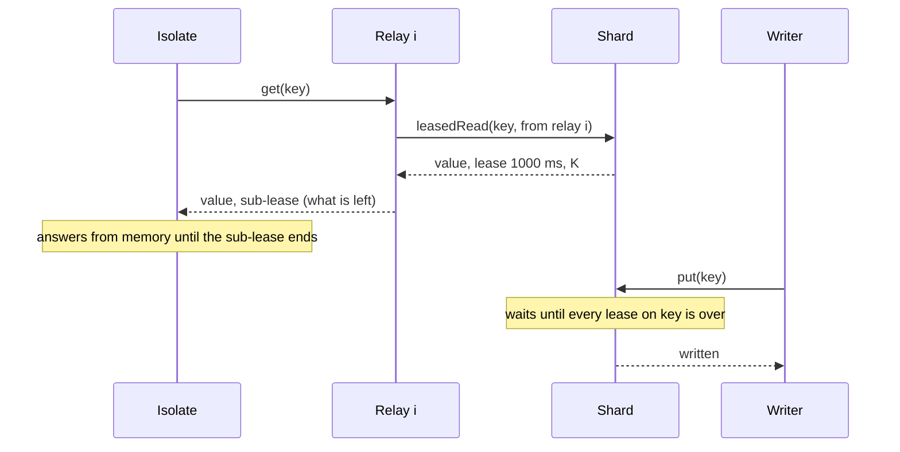

# RFD0004 - Leased reads for hot keys

- Feature Name: `leased-reads`
- Status: Draft
- Author: `leostera`
- Start Date: `2026-10-31`
- Updated: `2026-10-31`
- Discussion PR: none
- Tracking Issue: none

## Summary

A shard can **lease** a hot key to a few **relay** objects, so that reads of that key stop
reaching the shard, and a read still never misses an acknowledged write.

A lease is a promise from the shard: "this value will not change for the next second". While it
runs, the relay answers reads from memory. It hands each Worker isolate a **sub-lease** that ends
before its own, so isolates answer from memory too.

A write to a leased key waits until every lease on it is over, then commits and returns. While
that write waits, no new lease reaches past it, so a write waits at most one lease length.

The shard leases a key only once it is hot. It sizes the number of relays from the load they
report, so that each relay, and the shard, stays well under what one Durable Object serves.
Keys that are not hot get no leases, and their writes do not wait.

It is an opt-in capability of `ShardedObject` ([RFD0001](RFD0001-sharded-object.md)), so
`ShardedTable` and `IndexedTable` get it too. It adds a client, `leased(...)`, and a relay
class, `LeaseRelay`.

## Motivation

A key always lives on one shard. Splitting spreads many keys over many objects, but it cannot
spread one key. The most read key caps what the whole sharded object can serve. The control-plane
benchmark in [docs/performance.md](../performance.md#a-control-plane-a-handful-of-hot-objects)
shows this: with ten keys, one of which takes a third of the calls, throughput stops near
4,700 calls/s. At 2,048 in flight, the shard holding the hot key refuses calls even with 16
shards. RFD0001 lists "a hot key cannot be split" as a drawback, and its non-goals rule out
splitting one key.

A key many requests read, but few write, is common:
- **A kill switch or feature flag** that every request checks.
- **A revocation entry** (an API key, a session, an OAuth grant) checked on every call made with
  a big tenant's credential.
- **The member list or permissions of a popular resource**: a shared document every viewer
  opens, a large workspace.
- **A placement or routing entry**: which region a tenant lives in, which schema version is live.
- **Live state that changes rarely**: the current round of an event, the head of a branch.

These keys have a correctness requirement that a cache does not meet. Once "revoke this key" or
"turn off checkout" returns, no request anywhere may still act on the old value. A TTL cache
(per isolate, KV, or the Cache API) serves the old value until its TTL ends, whatever the write
said.

Reading the key from its shard on every request meets the requirement, but puts every request
on one object. Caching it per isolate with a lease from the shard (one lease per isolate) moves
the problem: the shard then takes one renewal per isolate, about twice a second. With about
1,000 isolates, that is over what one object serves. The number of lease holders must not grow
with the number of isolates.

## Goals

- A read of a leased key sees every write acknowledged before the read started (**fresh reads**).
- A read sees at least what an earlier finished read saw, through any path (**reads never go
  back**).
- The shard's load from one hot key stays bounded, whatever the number of isolates reading it.
- Keys that are not hot pay nothing: no leases, no extra hop, and writes that do not wait.
- Correct across shard restarts, relay restarts, and splits.
- Opt-in, per class. A class that does not enable it behaves as today.

## Non-goals

- Hot writes. A write to one key is still served by one object. A key that is both read- and
  write-hot gets little from this: each write waits for the leases on it.
- Reads that tolerate stale values. A TTL cache is cheaper for those, and needs nothing from
  do-kit.
- Leasing whole listings or query results. A lease covers keys, and the values stored under them.
- Exact clocks. Only clock rates need to agree, within a margin (see Time).

## Guide-level explanation

A class enables leased reads with a policy, and names its relay binding:

```ts
export class Settings extends ShardedTable<Env> {
  protected override leasedReads = { hotReadsPerSecond: 100 };
  protected nodes() {
    return this.env.SETTINGS;
  }
}

// A relay class per owner class: it says which binding it relays.
export class SettingsRelay extends LeaseRelay<Env> {
  protected owners() {
    return this.env.SETTINGS;
  }
}
```

A Worker reads through the leased client:

```ts
const settings = leased(env.SETTINGS, env.SETTINGS_RELAYS, "tenant-42");

// From memory while this isolate holds a sub-lease on it, else through a relay or the shard.
const flag = await settings.get(["checkout-enabled"]);
```

Writes do not change:

```ts
const table = shardedTable(env.SETTINGS, "tenant-42", settingsSchema);
await table.put({ key: "checkout-enabled", on: false });
// Returned: no read anywhere sees on = true any more.
```

What happens, in order:

1. The first reads of `checkout-enabled` go to its shard directly and get no lease. The shard
   counts them.
2. Once it is read 100 times a second, the shard answers that the key is **relayed**, with a
   relay count K, sized so each relay sees about 250 asks a second.
3. Each isolate picks relay `floor(draw × K)`, where `draw` is a random number it fixes at
   startup. Each relay so gets about 1/K of the isolates.
4. A relay without a lease reads the shard, and gets a lease of about 1 s. It answers from it,
   giving each isolate a sub-lease of what is left. It renews the lease shortly before it ends,
   so asks rarely wait.
5. An isolate with a sub-lease answers from memory. When the sub-lease is about to end, one
   request renews it while the others keep answering.
6. The `put` arrives while relays hold leases. The shard records that the write is waiting, until
   the last lease ends. Leases granted from then on end by that time. When it comes, the write
   commits and returns.

The shard then sees a few reads a second per relay, whatever the number of isolates. The write
took up to about 1.15 s, instead of milliseconds. If the key cools down, its relay count shrinks,
and then it stops being relayed: reads go to the shard again, and writes no longer wait.

### Diagram



## Reference-level explanation

### Architecture and boundaries

| Piece | Where | Does |
|---|---|---|
| Leases | inside each shard (`ReadLeases`) | grants leases on keys, tracks when they end, and makes writes to leased keys wait |
| Relay plan | inside each shard (`RelayPlan`) | finds hot keys, sizes their relay count K from relay reports |
| Shared reads | inside each relay (`SharedRead`) | answers asks from the lease. Without one, asks share one read of the shard |
| Relay | `LeaseRelay` (a Durable Object class) | holds leases in memory, gives sub-leases. Stores nothing |
| Client | `leased(owners, relays, name)` | per-isolate memory of sub-leases and relay counts. Picks a relay, falls back to the shard |

The shard is the only place a key's value is decided. Relays and isolates only hold copies under
a lease, and drop them when it ends.

Why in `ShardedObject`: the write has to wait inside the shard, in `update` and `transact`, where
the split hold already waits (RFD0001, "Splitting"). Every write of every layer goes through
those, so `ShardedTable` and `IndexedTable` need no change to their write paths.

`ReadLeases` and `SharedRead` are exported on their own too. A plain Durable Object, not
sharded, can use them to the same end.

### Interfaces

On the shard:
- `protected leasedReads: LeasedReadsPolicy | null = null`: `null` disables everything.
  `LeasedReadsPolicy` has `hotReadsPerSecond` (100), `relayReadsPerSecond` (250), `maxRelays`
  (64), and `leaseMs` (1,000).
- `protected leasedValues(keys): Promise<Map<string, unknown>>`: what a lease covers. It
  defaults to `read(keys)`. `ShardedTable` overrides it to return rows.
- A routed method, `shardedLeasedRead(keys, null, from)`, where `from` is `null` for a direct
  read or `{ relay, asks }` for relay `relay`, which had `asks` asks in the last second. It
  answers `{ values, leaseMs, relays }`: `leaseMs` is 0 for a direct read, and `relays[i]` is
  key i's relay count, 0 if it is not relayed.

`LeaseRelay` is an abstract Durable Object class. A subclass implements `owners()`, the namespace
of the shards it relays. A relay is named `relayName(name, key, i)`, so there is one per sharded
object name, key, and relay index.

The client:
- `leased(owners, relays, name, options?)` returns `{ get(keys): Promise<Map<string, V | null>> }`.
- Each isolate keeps, for at most 10,000 keys:
  - each key's sub-lease and value;
  - each hot key's relay count, believed for 30 s after it last heard it.
- A relayed key is read through its relay, and keys that are not relayed are read from their
  shards in one routed call. A relay call that fails is read around, at the shard, by the same
  request.

### Leases and waiting writes

The shard keeps in memory, per key:
- when the last lease granted on it ends, by the shard's clock and including the margin;
- if a write is waiting, until when.

Granting, for a relay's read of `keys`:
- `ms = leaseMs`, capped for each key with a waiting write at `waitingUntil - now - margin`.
- If `ms < MIN_LEASE_MS` (200), the answer carries no lease. The relay answers from the value,
  without sub-leases, and reads again on its next ask.
- Before the answer leaves, the shard makes sure its stored **horizon** covers `now + ms +
  margin` (see Restarts).

A write (`update` or `transact`) to `keys`:
1. Waits for the split hold, as today.
2. Takes `until = max(lease end of each key)`, and the restart hold (see Restarts). If that is in
   the future, it records `waitingUntil = until` for those keys and waits until then. From that
   point on, no lease on them reaches past `until`.
3. Checks ownership again and runs its transaction in one synchronous turn, as after the split
   hold today, and returns.

Writes to the same key that arrive while one waits wait for the same time. They then run in
arrival order. A write's `decide` runs after the wait, on the values as they are then.

A key that was never leased has no lease end, so its writes never wait. A direct read never gets
a lease, so only relayed keys make writes wait.

### Relays

A relay asked for a key:
- **With a lease** that has at least `MIN_LEASE_MS` left, it answers from it, with a sub-lease of
  what is left. In the lease's last `RENEW_MS` (600 ms) it also starts a renewal, without waiting
  for it.
- **Without one**, it waits for a read of the shard that **started after the ask arrived**. It
  joins the read in flight if that read began after the ask. Otherwise it waits for it to end,
  and then joins or starts the next one. Every ask waiting shares one read.

The rule in the second case is what makes sharing reads safe. A read that started before the ask
may have been answered before a write was acknowledged, without a lease (the shard grants none
when a waiting write is too close). The ask may have arrived after that acknowledgement.

A relay counts its asks per second, and sends the count with each read of the shard. It keeps
nothing durable. A restarted relay has no lease, and reads the shard again.

### Relay counts

The shard counts direct reads of each key per second. Once a key reaches `hotReadsPerSecond`, it
is relayed. From then on, every answer about it names K, starting at
`ceil(reads / relayReadsPerSecond)`.

Relay reports set K to `ceil(sum of the asks the relays reported in the last 2 s /
relayReadsPerSecond)`, at most `maxRelays`. K rises at once, and falls only after it has been too
high for 10 s. When the relays together see fewer than a quarter of `hotReadsPerSecond` for 10 s,
the key stops being relayed: answers name K = 0, and isolates read the shard directly again.

A shard that restarted knows no relays. Their reports rebuild K, which starts at least at the
reporting relay's index plus one.

### Time

Each holder times its lease from before it asked, less the margin `READ_LEASE_MARGIN_MS`
(150 ms). The shard times it from after it granted, plus the margin.

Take a relay that asks at its time `a` and gets `L` ms. It holds the lease until
`a + L - margin`. An isolate that asks this relay, and is answered at relay time `t`, gets
`left = a + L - margin - t`. It holds the sub-lease until `asked + left - margin`, where `asked`
is its own time before it asked. So an isolate's sub-lease ends at least one margin before the
relay's lease, which ends at least one margin before the shard's.

Only clock rates need to agree, never the clocks themselves. The margin also has to cover how
long a Worker's clock can stand still. `Date.now()` advances only across I/O, so a request that
computes for a long stretch without I/O sees an old time. A holder that serves from memory after
such a stretch may serve the value up to that long after its lease ended. The margin covers
150 ms of this. That is a documented assumption, and the margin is configurable.

### Restarts

A shard's lease ends live in memory, and a restart loses them. Before a lease leaves, the shard
stores how far its leases may reach, as `horizon` in `sharded_meta`. It stores it in steps of
`HORIZON_STEP_MS` (5 s) ahead, so this needs a write only every few seconds while it leases. The
output gate holds the answer until that write is durable.

A shard that starts with a horizon in the future treats every key as leased until
`horizon + RESTART_SKEW_MS` (1 s): writes wait until then. The skew allows for the restarted
object running on another machine, with another clock. A shard that has never leased has no
horizon, and restarts as today.

### Splits

A split copies the whole storage (RFD0001), `sharded_meta` included, so the new shard starts
with the original's horizon. On claiming the copy, it treats every key as leased until
`horizon + RESTART_SKEW_MS`, the same as a restart.

That covers leases granted before the copy. Reads go on during a split, so the original may still
grant leases on keys of the moving half after it has made the copy. Those leases must end by the
horizon the copy carries. While the moving half is held, a lease on its keys is capped at
`copiedHorizon - now - margin`, and none is given under `MIN_LEASE_MS`. After the commit, those
keys answer `moved`. Their relays follow, and read the new shard.

The cost: after a split of a shard that leased recently, writes to the new shard wait up to about
6 s once. A shard that never leased pays nothing.

### Invariants

- **Fresh reads:** a read that starts after a write is acknowledged sees it, or something newer.
- **Reads never go back:** a read sees at least what an earlier finished read saw, through any
  path: relay, isolate memory, shard, listing or index.
- **Leases nest:** every sub-lease an isolate holds sits inside a lease its relay holds, which
  sits inside one the shard still counts (across restarts and splits too).
- **Bounded waiting:** a write waits at most `leaseMs + margin` after it arrives, or until a
  restart or split horizon.

"Reads never go back" holds through every path because a write commits only once no lease on its
keys remains. Before then, every read path, listings and global index entries included, sees the
old value. Nothing needs to hide a committed value.

### Compatibility and migration

Off by default. A class that enables it adds one binding (its relay class) and one migration (a
new Durable Object class, with no storage). Storage gains one `sharded_meta` key. Existing
clients keep working. Only `leased(...)` reads use leases.

### Security, privacy, and observability

Relays hold values in memory only, in the same account and jurisdiction as the shard: a relay is
made in the shard's jurisdiction, as other shards are. No value is stored outside the shard.

`shardedDescribe()` gains:
- the number of keys leased now, and the relayed keys with their K;
- direct reads, relay reads and leases granted per second;
- writes that waited, and the longest wait.

### Rollout and validation

1. Specs before code:
   - `specs/leased-reads.ts`: fresh reads, reads never go back, and leases nest, with two relays,
     restarts of relays and of the shard, and asks joining shared reads. It should show the miss
     when an ask may join an earlier read.
   - Add a split scenario: a lease granted on a moving key during the hold. It should show the
     miss when the cap at the copied horizon is removed.
2. `ReadLeases`, `SharedRead` and `RelayPlan`, with unit tests that move the clock.
3. The `ShardedObject` integration, `LeaseRelay` and `leased(...)`. Integration tests under
   `cf dev` and deployed: hot reads through relays under failing relay calls, evicted relays, and
   splits.
4. Benchmarks on the edge: one hot key read by many isolates (the benchmark driver spread over
   many Workers), and against the same key without leases. Measure shard calls per second, read
   latency, write latency on the hot key, and refused calls.

## Drawbacks

- **Writes to hot keys wait**, up to about 1.15 s, and up to about 6 s once after a restart or a
  split. That is the price of fresh reads, and it lands on the writer.
- **Time is part of correctness.** The margin has to cover clock rate drift and the time a
  Worker's clock stands still. A request that computes for longer than the margin between I/O
  can serve a value just past its lease.
- **More objects.** A hot key adds up to K relays. They store nothing and stop when idle, but
  each is a Durable Object.
- **One more hop when a sub-lease runs out**: isolate to relay to shard, instead of isolate to
  shard. Under a lease, the relay answers from memory, so most such reads cost one call.
- **The ramp to K is not instant.** The first relays may see more than 250 asks a second until
  their reports raise K, in about a second.

## Rationale and alternatives

### Proposed design

Leases keep the strongest read guarantee the shard gives, while moving reads off it. Relays keep
the number of lease holders independent of the number of isolates. Sizing K from relay reports
keeps each object under its budget without configuration. Making writes wait, rather than reads,
fits keys that are read far more than written.

### Simpler or narrower approach

- **Leases to isolates directly, with no relays.** It is simpler, and enough with few isolates.
  With many, each one renews about twice a second, and that alone overloads the shard. Relays fix
  exactly that. A class could run without relays (K fixed at 0), with leases to isolates. It is
  worth offering only if benchmarks show a range where it wins.
- **A TTL cache.** It is cheapest, but cannot give fresh reads (see Motivation).

### Other alternatives considered

- **Commit at once, and show the old value until the leases end.** The write is durable and
  decided at once, but every read path must then overlay the old value for held keys: `read`,
  table gets and listings, scans, and the row copies a global index receives. Missing one breaks
  "reads never go back". Waiting before committing needs no overlay. The cost is that a write's
  `decide` runs after the wait, which `update` already allows.
- **Invalidation.** The shard tells holders to drop a value before a write returns. It needs the
  shard to know and reach every holder, including isolates it cannot call, and a holder that
  misses the message serves stale values. Leases expire by themselves, so a lost message costs
  nothing.
- **Replicas that apply every write.** They give fresh reads too, but every write has to reach
  every replica before it returns. That is more work per write, and more state to keep correct,
  than letting leases run out.
- **Splitting a hot key into copies** (write all, read one). It handles reads, but turns each
  write into K writes, and needs the copies kept consistent.

### Do nothing

The most read key keeps capping a sharded object, near 4,700 calls/s in our benchmark, and apps
either accept stale reads or build this themselves.

## Prior art

- **Leases** (Gray and Cheriton, 1989): time-bounded promises that let a cache serve without
  asking, as long as clocks agree in rate. Writes wait for leases to expire, or for holders to
  give them up. This design is that, with expiry only, because relays and isolates cannot be
  called back.
- **Chubby**: cached data under leases, invalidated before a write completes. Here, expiry
  replaces invalidation, for the same reason.
- **Leader leases** in Raft and Spanner: a leader serves reads locally while its lease holds, and
  successors wait out the old lease after a failover. The restart horizon here is the same wait,
  for a restarted shard.
- **Memcache leases** (Facebook, 2013) use the word for something else: tokens that stop
  thundering herds and stale sets. The shared-read rule here (one read for all waiting asks) has
  the same aim.

## Unresolved questions

### Before acceptance

- **Is waiting writes the right default**, or should a class choose between waiting and
  committing at once with an overlay (see alternatives)?
- **Lease groups.** Should one lease cover several keys a reader wants together, such as all
  settings of one app? That would need fewer relays and calls. It ties in with routing by key
  prefix, where a prefix would be both the unit of routing and of leasing.
- **Defaults**: a lease of 1 s, a margin of 150 ms, hot at 100 reads/s, 250 asks per relay.
  These are starting points, to be set from benchmarks.

### During implementation

- How a `LeaseRelay` subclass reads values of a `ShardedTable`: decoded rows, or the stored form.
- Whether the client fixes one `draw` per isolate, or one per key, to spread isolates better over
  the relays of several hot keys.
- The limit on keys per relayed read, when an isolate needs many hot keys at once.

### Out of scope

- Hot writes: coalescing writes to one key into one transaction.
- Leasing listings or query results.
- A Cache API tier in front of relays.

## Future possibilities

- A split policy that uses the relay plan: a shard hot because of one relayed key should not
  split (RFD0001, "Unresolved questions").
- Leases on global index lookups ([RFD0003](RFD0003-indexed-table.md)), so a hot lookup by email
  stops reaching its index shard.
