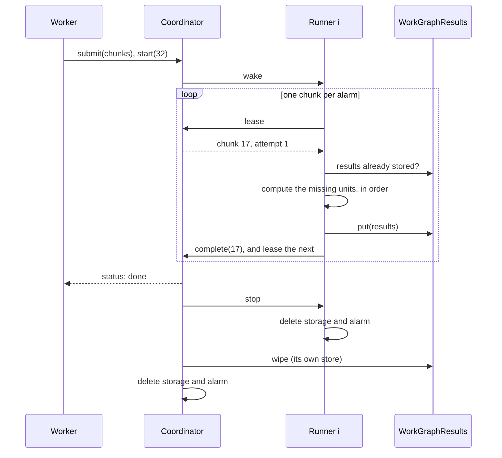

# RFD0005 - Work graphs: incremental, parallel execution

- Feature Name: `work-graphs`
- Status: Draft (built)
- Author: `leostera`
- Start Date: `2026-11-10`
- Updated: `2026-11-12`
- Discussion PR: none
- Tracking Issue: none

## Summary

A **work graph** is a graph the app defines, of pure **units** of work, each with its inputs, a cost, and the units it depends on. do-kit does not
split a computation into pieces. The app does, when it writes down the graph, and the layer
executes that graph incrementally and in parallel, across many invocations and objects, when
the whole is too big for one invocation's CPU budget. One execution of a graph is a **run**.

A planner cuts the graph into **chunks**, each of which fits one invocation. A **coordinator** object
hands out leases on chunks to N **runner** objects, which pull them, compute them, and write
each unit's **result** into a store keyed by a hash of the unit's inputs. A run is done once
every chunk is done. A runner evicted partway through a chunk takes it up again from its alarm,
and a runner that never comes back loses its lease to another runner. Because results are keyed
by a hash of the unit's inputs, a later run reuses every result whose inputs did not change.
A run is ephemeral: once it ends, it leaves no object behind holding anything, so an app can
start one per request.

In short, it is a build system's executor for Durable Objects. It is a new layer,
`@leostera/do-kit/workgraph`, made of plain Durable Objects, with
`WorkGraphResults` built on `ShardedObject` ([RFD0001](RFD0001-sharded-object.md)).

## Motivation

The sharded layers spread **data** that outgrows one object. Nothing in do-kit spreads **work**
that outgrows one invocation. A Worker invocation, a Durable Object request included, gets at
most 5 minutes of CPU time (`limits.cpu_ms`, 300,000 at most; 30 s by default). In a Durable
Object, each incoming request or alarm starts a new budget.

Some work is already a graph of many small, independent pieces, with too much work in total for
one invocation. The app knows that graph, because its domain defines it:
- **Resolving the deltas of a large git pack.** Each delta has one base, so the deltas form a
  forest of independent trees. Resolving them is most of the work of indexing a pack, and a pack
  of several gigabytes needs more than one invocation's CPU budget.
- **Rebuilding a derived index** over every row of a large table.
- **Imports and copies** of many independent objects.
- **Garbage collection**: marking what is reachable, then sweeping.

In each case the app can say what the units are and how they depend on each other. What it
lacks is an engine that executes such a graph. Written by hand, each of these needs the same
machinery: cutting the work into pieces that fit,
handing them out, noticing a piece whose runner died, retrying it safely, knowing when everything
is done, and not redoing work that is already done. Each is also easy to get subtly wrong. For
example, a piece reported done before its results are durable is lost if the runner then dies.

### Work and span

The time a graph takes on N runners is bounded by Brent's theorem:

```
T_N ≤ T₁ / N + T∞
```

- `T₁`, the **work**, is the total time of every unit on one runner.
- `T∞`, the **span**, is the time of the longest chain of units that must run one after another.

When the span is small next to the work, adding runners divides the time. A delta forest is that
case: git limits delta chains to 50 by default (`pack.depth`), so the span is at most 50 units,
while the work is every delta in the pack. A single chain is the opposite case, where more runners
cannot help. The design does not try to beat this bound. It tries to stay close to it, and its
benchmarks measure how close.

## Goals

- Execute a graph of any total size, as long as each unit fits one invocation.
- Time close to `T₁/N + T∞`, plus a bounded overhead per chunk.
- Survive runner eviction, runner loss, coordinator restarts, and lost calls, without losing
  or corrupting a result.
- **Done means every unit has a result**, written durably before its chunk counts as done.
- Incremental: a unit whose inputs did not change is not computed again, in this run or a later
  one.
- Plain Durable Objects and alarms, with no other product.

## Non-goals

- Splitting work automatically. The app defines the units and their edges. A computation that
  is one indivisible piece (one big sort, one long loop) gets nothing from this layer until the
  app expresses it as a graph.
- Units that do not fit one invocation. A unit is the smallest piece; the app makes it small
  enough.
- Impure units. A unit that writes elsewhere, or depends on the time, is run at least once, and
  maybe several times: its effects must be idempotent, and are the app's to make so.
- A general workflow engine: no sleeps, no events, no human steps. Cloudflare Workflows covers
  those.
- Moving bulk data. Units read their inputs from where the app keeps them (R2, a table), and
  results are small. Large values cross chunks only at cuts (see Cuts).
- Dynamic graphs. The graph is known when the run is planned. Work whose next steps depend on
  results is a sequence of runs.
- Background jobs or scheduling. A run executes one graph to completion; when to start one, and
  what to do with its results, is the app's.

## Guide-level explanation

The app describes its work as a graph, and do-kit executes it. Think of a build system: the app
writes the build graph, and the engine runs it in parallel, skipping what is already built.

A **task** is a pure function. It takes a unit's input, optionally its **parent**'s value (a tree
edge: the unit continues from what its parent produced), and optionally the results of units it
runs **after** (cross edges: it reads what they produced). It returns a **result**, which is kept,
and a **value**, which is passed to its children.

A unit is coarse: seconds of work, not microseconds (see Unit size). Indexing a git pack, for
example, is resolving a forest of delta trees. The app slices the forest into groups of whole
trees of about 10 s each, and cuts a tree too big for one slice at a subtree, below a slice that
resolves the path down to it:

```ts
import { defineTask, workGraphOf, type TaskContext } from "@leostera/do-kit";

// A slice of whole trees: no parent, nothing it runs after. It writes its rows to the app's own
// storage under its own key, so a retry overwrites them, and returns a receipt.
const slice = defineTask({
  name: "slice",
  version: "1", // changing it invalidates this task's results
  async compute(input: { pack: string; trees: Uint8Array }, _parent: null, _after: {}, { env }: TaskContext<Env>) {
    const { rows, path } = await resolveTrees(env, input.pack, input.trees);
    await writeRows(env, input.pack, input.trees, rows);
    return { result: { objects: rows.length, digest: await digestOf(rows) }, value: path };
  },
});
// A piece of a big tree, cut below a slice: it continues from the bases the slice resolved.
const piece = defineTask({
  name: "piece",
  version: "1",
  async compute(input: { pack: string; trees: Uint8Array }, parent: PathState, _after: {}, { env }: TaskContext<Env>) {
    const { rows } = await resolveTrees(env, input.pack, input.trees, parent);
    await writeRows(env, input.pack, input.trees, rows);
    return { result: { objects: rows.length, digest: await digestOf(rows) }, value: null };
  },
});
// A summary: reads receipts, by name, once their slices are done.
const check = defineTask({
  name: "check",
  version: "1",
  compute(input: { expected: number }, _parent: null, after: { first: Receipt; second: Receipt }) {
    const objects = after.first.objects + after.second.objects;
    if (objects !== input.expected) throw new Error(`${objects} objects, ${input.expected} expected`);
    return { result: objects, value: null };
  },
});
export const TASKS = { slice, piece, check };
```

The graph is built with these tasks, and its types follow from them. `add` returns a handle typed
by the task's result and value, and checks each edge against what the unit's task takes:

```ts
const g = workGraphOf(TASKS);
const a = g.add(slice, "pack-1234/slice-0", { pack: "pack-1234", trees: s0 }, { cost: 9_800 }); // cost: estimated CPU ms
const b = g.add(piece, "pack-1234/piece-0", { pack: "pack-1234", trees: p0 }, { cost: 10_400, parent: a }); // a's value is a PathState: fits
g.add(check, "pack-1234/check", { expected: 41_337 }, { cost: 1, after: { first: a, second: b } });         // both results are receipts: fit
g.add(piece, "pack-1234/piece-1", { pack: "pack-1234", trees: p1 }, { cost: 10_100 });                       // type error: a piece needs a parent
g.add(slice, "pack-1234/slice-1", { pack: "pack-1234", trees: s1 }, { cost: 9_900, parent: a });             // type error: a slice takes none
```

The planner cuts the graph into chunks, and a run executes them on N runners. The app writes one
runner class, which names its tasks, and binds the generic coordinator and results classes:

```ts
export class PackRunners extends WorkGraphRunner<Env> {
  protected tasks() { return TASKS; }
  protected coordinators() { return this.env.GRAPH_COORDINATORS; }
  protected results() { return this.env.GRAPH_RESULTS; }
}
export class GraphCoordinators extends WorkGraphCoordinator<Env> {
  protected runners() { return this.env.PACK_RUNNERS; }
}
export class GraphResults extends WorkGraphResults<Env> {
  protected nodes() { return this.env.GRAPH_RESULTS; }
}
```

A Worker plans the graph, submits it as a run, and starts runners. Every pack is new, so results
are identified by the units' keys, and no input is hashed (see Identity):

```ts
const plan = planWorkGraph(g, { chunkMs: 30_000, identity: "key" });
const run = workGraphRun(env.GRAPH_COORDINATORS, "pack-1234");
await run.submit(plan);
await run.start({ runners: 32, deadlineMs: 15 * 60_000 });

// Later, or polled:
await run.status(); // { state: "done", chunks: { done: 176, ... }, units: { computed, reused }, busyMs, ... }
const receipt = await workGraphResults(env.GRAPH_RESULTS, ownResultsName("pack-1234")).get(plan, b); // Receipt | undefined
await run.delete(); // or let its status expire: then nothing of the run is left
```

Without `results`, the run gets a results store of its own, wiped with it. A store shared by
runs (`results: "index"`) is what makes later runs incremental, and is the app's to keep.

What happens:
1. `planWorkGraph` hashes every unit: by default its task's name and version, its input, its
   parent's hash, and the hashes of the units it runs after, by name; with `identity: "key"`, its
   task, version and key. It packs whole trees of units into chunks of about `chunkMs`, and cuts
   trees bigger than that at subtrees.
2. The coordinator stores the chunks. Each chunk waits for the chunks it needs.
3. Each runner's alarm leases a chunk, computes it, writes its results, and completes it. The same
   call leases the next chunk. One chunk is one alarm invocation, with its own CPU budget.
4. Once every chunk is done, the run is done, and every unit's result is in `WorkGraphResults`.
5. The coordinator stops every runner, each of which deletes its storage and alarm. It keeps
   only the run's status, for an hour by default, then wipes the run's own results store and
   itself.

With the default identity, a later run over a graph that shares most units plans the same hashes
for them. Its runners find those results already stored, and compute only the units that are new.
A build whose inputs change a little at a time, such as a derived index rebuilt each day, gets
that for free; work that is new every time, such as a pack, turns it off.

### Diagram



## Reference-level explanation

### Units and hashes

A unit is `{ key, task, version, cost, input, parent, after }`, where `after` maps the names its
task reads to unit keys. The typed graph (above) builds these; `planWorkGraph` also takes them as a
plain array, for graphs built elsewhere.

A unit's **hash** is the key of its result. It depends on the plan's `identity`:
- **`"inputs"`** (the default): the SHA-256 of `[task, version, input, parent's hash, its after
  units' hashes by name]`, with any `Uint8Array` in the input hashed as its bytes. Two units with
  the same inputs, in any run, have one hash and one result. A unit whose parent changed has a new
  hash, and so has every unit below it. This is what makes later runs incremental.
- **`"key"`**: the SHA-256 of `[task, version, key]`. No input is hashed, so large inputs cost
  nothing to identify, and retries are as idempotent as before. A later run that uses the same
  keys in the same results store finds their results already there, whatever its inputs: keys
  name what a unit computes (`pack-1234/slice-17`), and work that is new gets new keys or a new
  store. Apps whose work is new every time use this.

### Unit size

Each unit costs the layer something besides its own work: its hash and its share of planning
(about 0.03 ms each, measured locally, and linear in the units: 200,000 units with no edges plan
in half a second), its input in the chunk's body, its result encoded,
written and read back, and its share of its chunk's calls to the coordinator. On one runner on the
edge, units that do nothing, 5,000 to a chunk, took 0.11 to 0.12 ms of wall time each. So:
- A unit should cost at least about **10 ms**, which keeps the overhead near 1%. Fine-grained
  work goes into one unit: one delta (about 0.1 ms) per unit would more than double the CPU,
  while a slice of whole trees (seconds) does not notice.
- A run is built for **hundreds to tens of thousands of units**. The whole graph is planned in
  one invocation, inputs included, and an isolate has 128 MB of memory.
- A chunk holds at most `maxUnitsPerChunk` units (5,000), so with units much smaller than
  `chunkMs / 5,000` the chunks come out small, and the overhead per chunk grows with them: a
  lease, a read and a write of the results store, and an alarm. With 16 runners on chunks that
  cost nothing, each runner completed about 14 a second, about 70 ms of wall time a chunk.

### Inputs

Inputs are JSON values, and may hold `Uint8Array`s anywhere. A chunk's **body**, its units and
what it exports, is encoded as JSON with each `Uint8Array` as raw bytes after it, not as base64
text, so binary inputs travel and are stored at their own size. The coordinator stores each body
in rows of 1 MiB (a row holds at most 8 MB), and a body may be up to 16 MiB, since it travels to
its runner in one call. `submit` refuses a bigger one, with the chunk's id.

Inputs should describe work, not carry it: a few hundred KiB per unit at most, and bulk data in the
app's storage behind a pointer (an R2 key and a range). The planner holds every input at once.

The graph refuses a unit whose task is not in its set, a duplicate key, and a parent or after unit
not yet added, so a graph built with `add` has no cycles. The planner checks the same of a plain
array.

### Planning

`planWorkGraph(graph, { chunkMs, maxUnitsPerChunk, replayMs })` is a pure function, with
`chunkMs` 10,000 by default (a third of the default CPU limit). It runs where
the graph is: in a Worker, or in a Durable Object.

1. **Rounds.** A unit's round is the larger of its parent's round and one more than the round of
   each unit it runs after. Units with no edges are in round 0. A unit's after units are always
   in earlier rounds, so their results exist before it runs.
2. **Trees.** Within a round, the units connected by parent edges form trees. A parent in an
   earlier round is a cut.
3. **Packing.** Trees that fit in `chunkMs` are packed into chunks, largest first, each into the
   first chunk with room (first-fit decreasing). A chunk also holds at most `maxUnitsPerChunk`
   units (5,000), which keeps its stored row under 1 MiB.
4. **Cutting.** A tree over `chunkMs`, or over `maxUnitsPerChunk` units, is cut bottom-up, to
   pieces of at most `chunkMs - replayMs` and half the units, which leaves room for a replayed
   path. In post-order, once a unit's remaining subtree exceeds that, its heaviest remaining child
   subtree is cut off into a piece of its own. This repeats until what is left fits.

### Cuts

A piece cut from a tree needs its root's parent value. The planner chooses, per cut:
- **Replay**, if the path from the tree's root down to the parent costs at most `replayMs`
  (`chunkMs / 4` by default, and less than `chunkMs`), and the piece with its path still fits a
  chunk. The piece's chunk holds the path's units as **replayed** units.
  They are computed again for their values, and their results are not written again. The piece
  needs no other chunk. A delta chain is at most 50 long, so most cuts in a delta forest replay.
- **Store**, otherwise. The parent's chunk **exports** the parent's value into `WorkGraphResults`, and
  the piece's chunk **needs** that chunk and loads the value. A piece that stores is a chunk of
  its own: it is never packed with other trees. So a chunk that needs another is always below it
  in one tree, and the chunks never wait on each other in a cycle.

A unit with after units in an earlier round needs the chunks that hold them. Rounds only ever
increase along these edges, so the graph of chunk needs has no cycles.

### The coordinator

One `WorkGraphCoordinator` object per run, named by the run. Its SQLite holds:
- `graph_chunks`:
  - `id`, `round` and `cost`;
  - `state`: `waiting`, `ready`, `leased` or `done`;
  - `needs`: how many of its needed chunks are not done;
  - `runner`, `lease_until` and `attempts`.
- `graph_bodies`: each chunk's body, in parts of 1 MiB.
- `graph_needs`: (chunk, needed chunk) pairs.
- `graph_runners`: each runner's index and when it last called.
- `graph_meta`: the run's state, runner count, `leaseMs`, counters, and the first error.

Methods:
- `graphSubmit(chunks)` adds chunks in batches, with their bodies encoded. It is idempotent per
  chunk id, and a no-op once the run is sealed, so a retried submission is harmless. `graphSeal()` ends
  submission, and checks that every needed chunk exists.
- `graphStart(name, { runners, results?, deadlineMs?, keepStatusMs?, ... })` records the runner
  count, the results store (the run's own, `ownResultsName(run)`, unless one is named), the
  deadline (24 h by default) and how long to keep the status (1 h), starts each runner, and arms
  the alarm. It refuses a run never submitted. A runner its call does not reach is started by the
  alarm, so a start that fails partway still leaves a run that finishes.
- `graphNext(runner, finished)` completes the runner's `finished` chunk, if any (with its counts or
  its error), and leases it the next one. It answers:
  - `{ chunk, attempt }`;
  - `{ wait: ms }` when nothing is ready yet;
  - `{ done }`, or `{ failed: error }`. These it also answers, writing nothing, once the run has
    ended or is gone.
- `graphStatus()`: the run's status, or null once the run is wiped (or was never submitted).
- `graphDelete(name)`: cancels the run if it has not ended, and wipes it at once, without keeping
  the status. It returns null once nothing is left, or the status while runners are still
  stopping (the alarm goes on). The client's `run.delete()` calls it until it returns null, for up
  to a minute. It is idempotent, and on a run that is gone it makes nothing.

Leasing:
- A runner that already holds a lease gets the same chunk back, with the same attempt. This is
  how a runner evicted partway through a chunk resumes it.
- Otherwise the runner gets the ready chunk of the lowest round, then the lowest id, with
  `lease_until = now + leaseMs` (120 s by default). The chunk's `attempts` goes up by one.

Completing:
- A chunk's completion is accepted from any runner, even one whose lease ran out and passed to
  another, and the first completion wins. Units are pure and results are keyed by hash, so two
  executions of a chunk write the same results.
- Completing a chunk decrements the `needs` of every chunk that needs it. A chunk whose `needs`
  reaches 0 becomes `ready`, and the coordinator wakes the runners that are waiting.

Failing:
- A chunk whose `compute` threw goes back to `ready`, until it has failed `maxAttempts` times
  (3). Then the run fails, with the error.
- A chunk whose lease runs out after it was leased `maxLeases` times (5) fails the run: its
  runners never reported. A chunk that needs more CPU than an invocation has kills each runner
  that takes it, and would otherwise be leased again until the deadline. The planner refuses a
  unit that costs more than `chunkMs`, since a unit is never cut.

The alarm, every 5 s until the run ends:
- **Expiry.** A lease that ran out goes back to `ready`.
- **Wake.** A runner that has not called for 30 s is started again if its start never reached it,
  and woken otherwise. A runner's own alarm is retried at most 6 times by the platform, so a
  runner whose retries ran out would otherwise stay asleep. When chunks become ready, as many
  waiting runners are woken as there are chunks to take; the others poll every 2 s.
- **Deadline.** A run past its deadline fails. A run submitted and never started fails a day after
  its first submission.
- **Done.** Once every chunk is done, the run is done, and its cleanup begins.

### Ending a run

A run ends done, failed (a chunk out of attempts, or the deadline), or cancelled (deleted). It
then leaves nothing behind, in three steps, each driven by the coordinator's alarm until it has
happened:
1. **Stop the runners.** The coordinator calls `graphStop()` on every runner that has not yet
   answered it, and records each answer in `graph_stopped`. A runner deletes its storage and its
   alarm, and answers. One writing a chunk finishes the write first, then stops before reporting
   it. A runner that got `{ done }` or `{ failed }` has already wiped itself, and a runner lost for
   good is reached as well: the call starts a new instance of its object, which finds it empty or
   wipes it. A stop that fails or takes over a minute is asked again from the alarm.
2. **Keep the status.** Once every runner has answered, the coordinator drops its chunks, bodies,
   needs and runners, and keeps only `graph_meta`, with the final counts, until `keepStatusMs` is
   up. On delete it keeps nothing.
3. **Wipe.** The coordinator wipes the run's own results store, every shard of it, with the
   sharded layer's `wipe()`, then deletes its own storage and alarm. A shared store is left alone.

Two things make sure a wiped object stays empty:
- An object that holds nothing is not made again by being asked. The coordinator, the runners and
  the sharded layer create their tables only when they first store something, so a late status,
  stop or delete, a late `graphNext`, or a read of a wiped results shard creates no storage.
- A results shard, once wiped, refuses every call for 5 s. A write from a runner stopped while
  writing finds it so, and fails; the runner, stopping, writes nothing more. After that the name
  is free again: a run's name can be reused once the run is deleted, though its first chunks wait
  out those seconds.
  A wipe waits for a shard that is splitting or moving, and follows a shard that moved.

### Runners

`WorkGraphRunner` is abstract. A subclass gives:
- `tasks()`: every task its runs' graphs use, by name. A chunk naming another task fails;
- `coordinators()` and `results()`: the namespaces of the coordinator and results classes.

A runner is a Durable Object named `run/runner/i` (`runnerName`). `graphRun(run, i, results)`
stores the run's name, the runner's index and the results store's name, and sets its alarm to now.

One alarm invocation:
1. `graphNext(i, finished)` leases a chunk. On `wait`, it sets its alarm for then. On `done` or
   `failed`, it deletes its storage and its alarm.
2. It reads the results already stored for the chunk's units.
3. It computes, in order (parents first), each unit that is needed:
   - a unit with no stored result;
   - an ancestor in the chunk of a unit that is needed, for its value;
   - a unit whose value the chunk exports, unless that value is already stored.

   A replayed unit is computed only if a needed unit is below it.
4. It writes the new results, and any exported values, to `WorkGraphResults`. These writes are
   idempotent, by hash.
5. It stores the chunk id as `finished`, and sets its alarm to now. The next invocation reports
   the chunk done, and leases the next one, in one call.

Each chunk runs in its own alarm invocation, and so has its own CPU budget. A runner that is
evicted during step 3 or 4 has its alarm retried by the platform. The retry leases the same
chunk, finds the results already written, and computes only what is missing.

A chunk leased for the first time in a run that writes to its own results store has nothing
stored yet, so the coordinator says so (`fresh`) and the runner skips step 2 for the chunk's own
units: it reads only the values it loads and the results it runs after. That is one round of
calls to the results store less per chunk: locally, with chunks that cost nothing, 20,000 chunks
took 69 to 70 s instead of 83 to 95 s. A chunk leased again, a lease given back to an evicted
runner, and a run on a shared store read as before.

`compute` throwing is reported as the chunk's failure, with its message.

### Results

`WorkGraphResults` is a `ShardedObject`, named by the app: one store can serve many runs, and that
sharing is what makes later runs incremental. Its keys are `r:` and `v:` and the unit's hash, for a
result and an exported value, and each is written once. It splits by load, like any sharded object.
Results and values are JSON, with `Uint8Array` encoded as base64. `workGraphResults(ns, name)`
reads them by node, typed: `.get(plan, node)` and `.many(plan, nodes)`. A result or value over
1 MiB fails its chunk, with an error that names it.

**Outputs belong in the app's storage.** A task writes what it produces itself, from `compute`
(which has `env`), under a name that its unit determines, so that running it twice overwrites
rather than duplicates. It returns a **receipt**: a count and a digest, say, which the store keeps.
`WorkGraphResults` then holds receipts, not data. This needs no hook: the layer runs a unit at
least once, and an output written under the unit's own name is as idempotent as the result is.

### Invariants

- **Results before done:** a chunk is done only after its results are durable in `WorkGraphResults`.
  The runner writes them, then reports them in a later call.
- **Inputs before compute:** a chunk is leased only once every chunk it needs is done, so its
  loaded values and after results exist.
- **One result per hash:** a unit's result is a function of its hash, so every run writes the
  same one, and running a chunk twice is harmless.
- **Progress:** while any runner can run, every chunk is eventually done, or the run fails with
  an error. Expiry passes the chunks of a lost runner on, and waking restarts a runner whose
  alarm retries ran out.
- **Nothing left behind:** once a run is done, failed, deleted or past its deadline, every object
  it touched eventually holds no storage and no alarm: the coordinator, each runner (one evicted
  mid-chunk, or lost for good, too), and the run's own results store. The coordinator wipes
  itself last, after every runner has said it stopped.

`specs/work-graph-run.ts` checks these, with two runners, chunks that need others, and faults: lost
calls, runner crashes (the alarm resumes them), and a runner lost for good, as well as the
deadline and delete at any point. Its check is exhaustive at depth 60 (1.8 million states). Each
of its rules is needed: without stopping the runners, or with the coordinator wiping before every
runner answered, a run leaves a runner behind; without a wiped shard refusing writes, a late write
fills the store again. The coordinator is not crashed in the spec: it keeps everything in
storage, and its alarm is durable.

The tests under `cf dev` check it on real objects: after a run is done, failed, deleted partway
(with every chunk thrown away once, as by an eviction) and past its deadline (its only runner
lost holding a lease), they list every table, key and alarm of the coordinator, each runner, and
each shard of the results store. Then they restart every one of those objects, call it again,
and list it again.

### Observability

`graphStatus()` returns:
- the run's state;
- its chunks by state;
- units computed, reused and replayed;
- leases expired, and runners woken;
- the first error;
- the elapsed time.

With `logChunks` (off by default), each chunk completion logs one JSON line, `graph-chunk`, with
the run, the chunk, its attempt, its units computed, reused and replayed, and its wall time.

### Compatibility and migration

A new layer. Nothing existing changes.

### Security, privacy, and observability

Results are kept in the app's account, and the coordinator makes every stub in its own
jurisdiction. A run's units carry the app's inputs: they are as private as the app's storage.

### Rollout and validation

1. The spec first.
2. The planner, with unit tests and property tests: every unit lands in exactly one chunk, or is
   replayed into others; chunks fit; chunk needs have no cycles; hashes change only along changed
   paths.
3. The coordinator, runners, and results, with integration tests under `cf dev`:
   - small forests and a deep chain;
   - one tree bigger than a chunk, with replayed and stored cuts;
   - cross edges;
   - a runner that throws partway through a chunk;
   - a lease that runs out;
   - an incremental second run;
   - a unit that always fails.

   The tests compare every result with a local reference computation.
4. Benchmarks on the edge, on synthetic forests with units that burn a known amount of CPU:
   - many small trees, one huge tree, and one long chain;
   - against N runners (1 to 64);
   - each run's time compared with `T₁/N + T∞`;
   - runners killed during a run, and the time to resume;
   - the coordinator's own limit: how many chunks a second it hands out, with chunks that cost
     nothing.

### Measured

On Cloudflare's network, with units that burn 5 ms of CPU each, chunks of 1 s, and every run
computing from scratch (`bench/workgraph/`, data in `bench/results/workgraph.json`). `T∞` for the
bound is the plan's **chunk span**, the longest chain of chunks, since runners take whole chunks:

| Graph | Chunks | Chunk span | 1 runner | 64 runners | `T₁/64 + T∞` |
|---|---|---|---|---|---|
| 40,000 units, in trees of 5 | 200 | 1.0 s | 236.5 s | 5.1 s (47×) | 4.7 s |
| One random tree of 40,000 units | 259 | 1.0 s | 185.0 s | 5.9 s (32×) | 3.9 s |
| One chain of 2,000 units | 14 | 10.0 s | 9.5 s | 9.3 s (1×) | 10.1 s |

- The random tree's unit span is 115 ms, and its cuts replay paths of at most 250 ms (of which
  it replays 10 s in total, 5% of its work). So no chunk needs another, and its chunk span is one
  chunk. It runs at about 1.5× the bound at 32 and 64 runners, against 1.1× for the forest; the
  difference is not in the schedule (a greedy simulation of the plan gives the same 3.8 s for both).
- One runner's time for the same 200 s of planned work varied from 179 s to 266 s across six runs:
  a runner is one object on one machine. The table uses medians, of three runs on one runner and
  four on 32 and 64.
- Faults, on 16 runners: 13.6 s without; 21.9 s with 20% of chunks evicted once after computing;
  16.8 s with 4 runners lost for good, holding leases of 10 s (4 expired, every unit computed).
- **Coarse units**, the shape this layer is for: 400 independent slices of 8 to 12 s, each with
  64 KiB of binary input, and 6 big trees of a slice and 2 to 10 pieces of 10 s that load its
  value; 437 units in 176 chunks of 30 s, identified by key. Each run's bound is from its own
  measured work (`busyMs`, 3,634 to 3,867 s against 4,339 s planned):

  | Runners | 4 | 8 | 16 | 32 | 64 |
  |---|---|---|---|---|---|
  | Measured | 981 s | 514 s | 250 s | 147 s | 76 s |
  | `T₁/N + T∞` | 1,002 s | 507 s | 273 s | 152 s | 90 s |
  | Runners busy, on average | 3.9 | 7.4 | 15.2 | 25.5 | 47.7 |

  Within 1.02× of the bound at every runner count. At 64, 176 chunks are under three rounds of
  runners, and the cut trees need two chunks in turn, so runners go idle at the end.
- Units that do nothing, 40,000 of them 5,000 to a chunk, ran in 4.4 to 4.7 s on one runner: about
  0.11 to 0.12 ms each (see Unit size).
- Bodies of 10 MiB, four slices of 2.5 MiB a chunk, ran on the edge in parts. Stored as one row
  each, the same bodies are refused (`SQLITE_TOOBIG`).
- One coordinator completed 226 chunks a second with 16 runners, and 411 to 629 from 64 to 1,024
  runners, with chunks that cost nothing (a lease, a read and a write of the results store, and a
  completion each). At 30 s a chunk, that is room for over 10,000 runners.

## Drawbacks

- **One coordinator per run** handles every lease. Its limit is in chunks a second, not units:
  about 450 to 630, measured. A chunk is seconds of work, so 32 runners need about 10 calls a
  second.
- **Planning needs the whole graph in one place.** A graph too big to plan in one invocation
  has to be planned in parts, as separate runs.
- **Replayed cuts recompute work**: at most `replayMs` per cut.
- **Results go through JSON** into a sharded object: fine for small results, wrong for bulk
  data.
- **Estimated costs.** Chunks are only as even as the costs the app gives. A unit that costs far
  more than estimated can push its chunk past the CPU limit. It fails, and then fails again on
  every retry, until the app fixes the estimate.

## Rationale and alternatives

### Proposed design

Pull-based leasing balances load by itself: fast runners take more chunks. Keying results by a
hash of the inputs makes retries, duplicate executions of a chunk, and later runs of a changed graph the same operation:
"compute what is missing". Chunks sized to the CPU budget turn the platform's limit into the
planner's one parameter.

### Simpler or narrower approach

- **One object per unit.** Each unit gets its own Durable Object, its own invocation, and its own
  retry. Millions of units would be millions of objects and calls, and a tree would pass its
  values between objects at every edge. Chunks amortize both.
- **A fixed split with no coordinator.** Runner i takes every Nth tree. That is fine for even
  forests, but one slow runner or one huge tree stalls the whole run, and nothing notices a dead
  runner.

### Other alternatives considered

- **Cloudflare Workflows.** Durable steps with retries is a close fit for a run's chunks, as one
  step each. But fanning out to N parallel runners, pulling work, and sharing results across runs
  would all still be ours to build, on top of another product's limits. Plain objects keep the
  whole run in one place to reason about.
- **Queues.** A queue of chunks gives pull-based delivery and retries. Dependencies between
  chunks, "done", and incremental reuse would still need a coordinator. The coordinator here is
  that queue, with its dependencies built in.
- **Push scheduling.** The coordinator assigns chunks to runners. It has to know each runner's
  speed, and it rebalances badly. Pulling needs neither.

### Do nothing

Apps keep writing their own chunking, leasing and retry loops, or stay under one invocation's
budget.

## Prior art

- **Brent's theorem** (1974) and **work stealing** (Cilk; Blumofe and Leiserson, 1999): the
  bound, and pull-based scheduling that meets it. Here, runners pull from one queue rather than
  stealing from each other.
- **MapReduce** (2004): re-executing tasks whose worker died, made safe by deterministic tasks,
  and task output made durable before the master counts the task done. The same two rules hold
  here.
- **Bazel and Dune**: actions keyed by a hash of their inputs, with results reused from a shared
  cache. `WorkGraphResults` is that cache. *Build systems à la carte* (Mokhov, Mitchell and Peyton
  Jones, 2018) names this design: a static graph, a topological scheduler, and constructive
  traces (results keyed by their inputs' hashes).
- **Dask and Ray** execute task graphs the app builds, across workers. Their graphs live in
  memory on one scheduler; here, the graph is cut into chunks first, so the coordinator tracks
  chunks, not units.
- **Bin packing** (first-fit decreasing), for packing trees into chunks.

## Unresolved questions

### Before acceptance

- **Cost units.** Estimated CPU milliseconds are concrete, but apps have to calibrate them. The
  alternative is arbitrary units, with `chunkCost` in the same units.

### Decided during implementation

- `leaseMs` is 120 s by default: more than a chunk at the default `chunkMs` (10 s) on a slow
  machine (one runner ran 1.3× slower than calibrated), and short enough that a lost runner
  costs two minutes. Apps with chunks near the 5-minute limit set it higher.
- `submit` sends chunks in batches of at most 8 MiB, and a chunk holds at most `maxUnitsPerChunk`
  units (5,000).
- A unit whose task the runner lacks, or whose result or value cannot be stored (over 1 MiB, or not
  JSON), fails its chunk like a compute that throws: it would fail the same way on every attempt.
- Logs are opt-in: `logChunks`, off by default.
- Values go to the app's storage from `compute` itself, with receipts as results (see Results),
  rather than through a storage hook: a hook would be a second write path with the same need to be
  idempotent.
- `identity: "key"`, for work that is new every time (see Units and hashes).
- A run is ephemeral (see Ending a run): its status is kept for `keepStatusMs` (1 h) as a
  tombstone with the final counts, rather than the caller waiting on a call that returns it before
  the wipe. A tombstone needs no caller connected, and that is what a poll from another request
  needs. It has no alarm but the one that expires it, and holds no chunks.
- `graphStatus()` reports `busyMs`, the runners' time on the chunks done, so a run measures its own
  work: `busyMs / elapsedMs` is how many runners were busy on average.

### Out of scope

- Planning a graph too big for one invocation.
- Stealing between runners.
- Priorities between runs.

## Future possibilities

- A planner that learns costs from measured chunk times, and re-plans what is left.
- Backfilling a new global index of an `IndexedTable` ([RFD0003](RFD0003-indexed-table.md)) as
  a work graph: one unit per page of rows.
