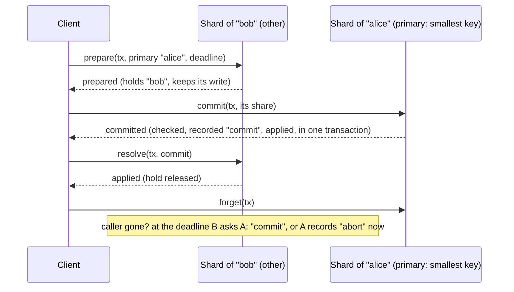

# RFD0008 - Atomic calls across shards

- Feature Name: `atomic-across-shards`
- Status: Implemented
- Author: `leostera`
- Start Date: `2026-11-11`
- Updated: `2026-11-11`
- Discussion PR: none
- Tracking Issue: none

## Summary

A sharded object gets an all-or-nothing call over keys in any number of shards:
`client.atomically(keys, method, payloads, ...args)`. Each shard owning some of the keys
**prepares** its share (checks it, and keeps what it would write, without writing it), and holds
those keys; the shard of the call's smallest key, the **primary**, records the outcome once every
other shard has prepared; then every shard **applies** what it kept, or drops it. A shard left
holding keys (its caller gone) asks the primary for the outcome once its hold's deadline passes,
and a primary that has none by then records an abort. Calls whose keys are in one shard keep the
one-call path of `callOneShard`, and nothing else changes: the cost lands on cross-shard atomic
calls only.

## Motivation

A shard is the unit of a transaction ([RFD0001](RFD0001-sharded-object.md)), and co-location
([RFD0006](RFD0006-co-location.md)) puts keys that must be checked together in one. That covers
rules about related keys. It does not cover a caller that asks for several unrelated keys to change
together, all or none:
- **Git's atomic pushes.** `git push --atomic origin main v1.0` updates a branch and a tag, or
  neither. A git server that routes refs by their first three path components (RFD0006's example)
  puts `main` and `v1.0` in different shards, as it does `main` and any other branch. Without this,
  it has to refuse every such push ("atomic push across ref shards is not supported"), which is
  most atomic pushes: the release push above, and any two branches.
- **Moving a value between keys**: a transfer between two accounts, a rename that deletes one key
  and creates another.

`callOneShard` refuses these (`SpansShards`). The app can't build it above this layer either: it
would need to hold keys against the layer's own writes, and to survive splits of the shards it
holds, which only this layer sees.

## Goals

- **Atomicity:** an atomic call's writes apply in every shard it touches, or in none.
- **Isolation of held keys:** between a shard's prepare and its apply, no other write to the keys it
  holds applies, so what it checked at prepare still holds when it applies.
- **Every hold ends**, with the call's outcome, whether or not its caller is still there.
- **Writes queue, never fail:** a write to a held key waits, as a write to a key a split is copying
  does (`holdWaitMs`, then "not ready" and the client backs off).
- **Nothing else pays:** single-shard calls, `callOneShard`, `call` and reads are unchanged.

## Non-goals

- **Atomic visibility to readers.** Reads go on while keys are held, and see the rows from before;
  after the outcome, each shard applies when it hears of it, so a reader may briefly see one
  shard's writes and not another's. This is what git's default (`files`) ref backend shows a reader
  racing an atomic push: it renames one lock file at a time.
- **Serializable transactions across shards** (reads that are checked again at commit). A prepare
  checks the keys it holds; what it read of other keys is not held.
- **Atomic scans**, and atomic calls on `IndexedTable` (its indexes write through their own client).

## Guide-level explanation

A class declares a method atomic by giving its steps; the client calls it with `atomically`:

```ts
export class Accounts extends ShardedObject<Env, number> {
  protected override atomic = {
    transfer: {
      // Each shard's share, in the transaction that holds its keys: check it against the rows, and
      // say what it would write. Nothing is written yet.
      check: (balances: ReadonlyMap<string, number>, keys: readonly string[], deltas: readonly unknown[] | null) => {
        const after = keys.map((k, i) => (balances.get(k) ?? 0) + (deltas![i] as number));
        if (after.some((b) => b < 0)) return { refused: "insufficient funds" };
        return { staged: keys.map((k, i) => [k, after[i]!] as [string, number]) };
      },
      // Once the outcome is commit, in the transaction that ends the hold: the rows to write.
      apply: (_balances: ReadonlyMap<string, number>, staged: [string, number][]) => ({ writes: new Map(staged), result: "ok" }),
    },
  };
}

const accounts = sharded(env.ACCOUNTS, "bank");
const outcome = await accounts.atomically(["alice", "bob"], "transfer", [-10, +10]);
if (!outcome.committed) console.log(outcome.refusals); // [{ keys: ["alice"], result: "insufficient funds" }]
```

`check` and `apply` are synchronous and run inside transactions, as `update`'s `decide` does: `check`
in the one that holds the keys, so no write lands between the check and the hold; `apply` in the one
that releases them, so a crash can't apply without releasing, or the other way round. I/O the check
needs (reading another object) goes in an optional `gather`, run before it. An optional
`applied(keys, result)` runs after `apply` (async),
for work that waits on other objects; its answer is what the caller gets.

### Diagram



## Reference-level explanation

### Architecture and boundaries

The client (`ShardedClient.atomically`) drives the call. The shards hold keys and keep what they
would write (`sharded_atomic_holds`); the primary keeps the outcome (`sharded_atomic_outcomes`).
The subclass gives `check` and `apply`, and optionally `gather`, `holdKeys` and `applied`; it
never sees transaction ids. Every step reaches a shard through one routed entry point,
`shardedAtomic(name, bits, step, keys, payloads, args, ...)`, checked and fenced as `shardedCall`.

### Data model and interfaces

```ts
type Prepared<S, R> = { readonly staged: S } | { readonly refused: R };
interface AtomicMethod<V, G, S, R, A> {
  holdKeys?(keys: readonly string[], ...args: unknown[]): readonly string[]; // more keys of the same routes the check reads
  gather?(keys: readonly string[], payloads: readonly unknown[] | null, ...args: unknown[]): Promise<G>; // I/O; writes nothing
  check(current: ReadonlyMap<string, V>, keys: readonly string[], payloads: readonly unknown[] | null, gathered: G, ...args: unknown[]): Prepared<S, R>;
  apply(current: ReadonlyMap<string, V>, staged: S): { writes: ReadonlyMap<string, V | null>; result: A };
  applied?(keys: readonly string[], result: A): Promise<A>;
}
type AtomicStep = solo | prepare(tx, method, primaryKey, deadline) | commit(tx, method) | abort(tx) | outcome(tx) | forget(tx) | resolve(tx, outcome);
type AtomicOutcome<R, A> =
  | { readonly committed: true; readonly results: ShardResult<A>[] } // a shard that applied late (recovery) is missing
  | { readonly committed: false; readonly refusals: ShardResult<R>[] };
```

Tables, in every shard (created with the others):
- `sharded_atomic_holds(tx PRIMARY KEY, primary_key, deadline, method, keys JSON, staged JSON)`:
  this shard's prepared share of `tx`, and the keys it holds.
- `sharded_atomic_outcomes(tx PRIMARY KEY, outcome 'commit'|'abort', at)`: written by the primary
  only, once per `tx`.

### Lifecycle and failure semantics

1. **Route.** The client routes the keys as `call` does. One shard: the `solo` step, with `gather`,
   then `check` and `apply` in one transaction; no ids, no tables.
2. **Prepare** every shard but the primary's, in parallel (`prepare` step). The shard waits out
   holds on these keys (a split's, or a younger atomic call's: two calls holding one key would each
   check against rows the other is about to change; an older call's hold it gives way to, see
   *Contention* below), runs `gather`, waits out any hold that
   appeared meanwhile (and gathers again), then in one fenced transaction runs `check` and, if
   staged, stores the hold; then asks for an alarm at the deadline. "moved" and "not ready" answers are retried as `call`
   retries them; a group that moved may become two shards, both prepared.
3. **Any refusal:** the client waits for every prepare's answer, so it knows every shard that
   prepared, then asks the primary to record "abort" (`abort` step), tells the prepared shards to
   drop their holds (`resolve`), and answers the refusals. If those messages are lost, the
   holds end at their deadline (6). (Deciding on the first refusal would leave a shard whose
   prepare answered later holding until its deadline: correct, but a stall.)
4. **Commit** at the primary (`commit` step) waits out holds on its keys (but its own call's: a
   stale client may have prepared one of the primary's keys as another shard's, and an older
   call's, to which it gives way, recording "abort"), gathers and checks. Refused: it records "abort" and answers the refusal (then 3). Staged: in
   one transaction it records "commit", unless an outcome for `tx` exists ("abort" from a recovery,
   6: it answers that), and runs `apply`. Then `applied`.
5. **Resolve** every prepared shard, in parallel: `resolve(tx, "commit")` runs `apply` and
   deletes the hold in one transaction, then `applied`. A lost resolve is recovered (6); the
   call is still committed. After every shard answered, the client tells the primary it may drop
   the outcome (`forget`). If the commit's answer is lost, the client asks the outcome as a shard
   would (6), resolves with it, and does not forget.
6. **Recovery.** A shard whose hold has passed its deadline (alarm) asks the primary for the
   outcome (`outcome` step, routed by the primary key, so it reaches the primary's shard
   whatever split since). The primary answers the stored outcome, or records "abort" and answers it.
   The shard applies or drops, as in 5. A shard reached by a write that has waited a hold out past
   its deadline runs recovery at once, rather than waiting for the alarm. An alarm can be lost (a
   failed `setAlarm`, or one the runtime stopped retrying), and reads do not wait on holds: so every
   routed call that reaches a shard holding keys checks, at most every 5 s, that an alarm is set no
   later than its earliest hold's deadline, as it does for a split's pending work.

**Contention (wait-die).** A call's id starts with the time its first attempt started, so ids
order calls by age, and a call made again keeps its age. A prepare or commit that finds its keys
held by an older call does not wait: it holds nothing, the commit records "abort", and it answers
`contended`; the client aborts the call (3), waits with jittered backoff, and makes it again, until
`notReadyWaitMs` (30 s) has gone by. Only older calls wait on younger ones, so waits can't form a
ring: without the rule, two calls that prepare in parallel can each hold a key the other needs and
wait on each other until a deadline aborts one of them. And a call does not keep its keys while it
waits on an older one: the hold that blocks it and the hold it keeps would otherwise chain, which
on a few hot keys held every call's keys past its deadline, so most calls ended aborted by
recovery: over 8 hot keys at 1,024 in flight, plain two-key writes ran 2,194 calls/s, and atomic
ones 9, with 1,016 of them failed. The
oldest call never gives way, so each call commits once it is the oldest one left on its keys.
Plain writes and `solo` calls hold nothing, and wait as before.

Deadline: `ATOMIC_HOLD_MS` (5 s) after the prepare. The whole call takes a few round trips,
so a hold reaches its deadline only if its caller is gone or the primary is slow; then the hold's
keys wait up to the deadline, and the call may abort when it would have committed. Never the
other way: a primary records "commit" only while no outcome exists.

Outcomes are kept until `forget`, or `ATOMIC_OUTCOME_TTL_MS` (24 h) if it never comes, far longer
than any hold lives (its deadline, plus alarm retries). A recovery's ask can still be on its way
when the call commits, every share resolves and the primary forgets; arriving then, it records an
"abort" for a call that committed. That record is never read: every shard of the call has
resolved, and the only other asker, a client whose commit answer was lost, does not forget. It is
purged with the outcomes past their TTL. The alarm purges them: a shard keeping outcomes keeps an
alarm for the oldest one's expiry (re-armed by the same check as holds' if it was lost), so they go
whether or not any call reaches it again (a split
half keeps copies of its source's outcomes, which only their TTL removes). Subclasses may change
the TTL (`atomicOutcomeTtlMs`).

**Splits.** A shard holding keys does not split (`splittable()` is false while
`sharded_atomic_holds` has rows; holds live for milliseconds). Prepares are fenced like any write,
so a split that started first holds them, and they then answer "moved". A primary's outcomes are
copied with its storage to both halves on a split; only the half owning the primary key is asked.

### Invariants

1. **All or nothing:** for every `tx`, either every prepared share is applied, or none is.
2. **One outcome:** the primary records at most one outcome per `tx`; "commit" only after every
   other share prepared, and never once "abort" is recorded.
3. **Held keys are frozen:** between a shard's prepare and its resolve, no other write to its held
   keys applies (fenced writes wait on them).
4. **Every hold ends:** each hold is resolved by its caller or, after its deadline, by recovery.
5. **Nothing staged shows before the outcome:** reads see rows from before until a shard applies.
6. **Single-shard calls unchanged:** a call in one shard writes no ids, holds or outcomes.

Modelled in `specs/atomic-across-shards.ts` (Feynman 0.15): a client, a primary and other shards;
a refusal by either kind of shard or none; another writer on a held key; the client, the primary
and each shard crashing (the shards keep their holds and outcomes), every request and answer lost
(a lost one fails the client's call, as a DO RPC does, and the client handles it as
`atomicAcross` does), messages overtaking each other, and holds reaching their deadline at any
moment. Seven properties: all or nothing (and the primary's record true while a shard holds for the
call), one outcome, held keys frozen, a hold ending before the next, the caller told the truth,
every committed share applied, every hold ended. Exhaustive in three bounds: two other shards and
1 fault (1.3M states), one other shard and two calls (5.3M), and 2 faults (48k); safety also
holds over 9M states with two other shards and 2 faults. Five rules, each needed (check breaks a
property without it): a prepare gives way to an older call's hold, writes wait out holds, the commit
answers a recorded outcome, a recovery's ask records the abort it answers, and the client forgets
only once every share has resolved. Found while modelling: the prepare's wait, which the first
design lacked, and the stale "abort" a late ask records after a forget (above), which is harmless.
Calls come one after another in the spec, so a hold another call left is always older there; it
checks that a call given way holds nothing and is not committed, and the argument above that age
keeps waits from forming a ring covers calls at the same time.

### Compatibility and migration

Additive. Tables are created with the others on first use. `atomic` is empty by default.

### Security, privacy, and observability

Logs: `sharded-atomic` per cross-shard call (shards, outcome, ms per phase), and
`sharded-atomic-recovered` per hold resolved by recovery (how late, outcome).

### Rollout and validation

- Unit tests under `cf dev`: commit across shards; a refusal in each position; the client stopping
  after each step (holds end at the deadline with the right outcome); writes to held keys waiting
  and then applying; splits during a call; a mutation of each guard fails a test.
- A git server on a sharded object: atomic pushes across ref shards, against stock git
  (`git push --atomic`).

## Drawbacks

- A held key stalls its writers for the call's duration, and up to the deadline if the caller dies.
- Cross-shard atomic calls take three round trips instead of one (prepare, commit, resolve).
- More protocol in the layer: two tables, five routed entry points, a recovery path.

## Rationale and alternatives

### Proposed design

Two-phase commit with the decision kept by one of the participants (the primary key's shard), as
Percolator keeps it in its primary lock. No separate coordinator object, so no extra hop, and the
primary prepares and decides in one transaction.

### Simpler or narrower approach

- **Apply shard by shard, undo on failure.** The undo can itself be refused (a write landed in
  between), leaving a partial result: not all-or-nothing.
- **Check everywhere, then apply everywhere.** A write between the two passes makes one shard
  refuse after another applied: partial again. Holding the checked keys between the passes is this
  design.
- **Co-locate everything an atomic call might touch.** Atomic calls name arbitrary keys; one route
  for all of them is one shard for the whole object.

### Other alternatives considered

- **A coordinator object per call** (its own Durable Object): one more object and one more hop,
  for nothing the primary can't hold.
- **Three-phase commit:** non-blocking only under synchronous assumptions the platform doesn't give;
  the deadline plus "abort if no outcome" bounds the blocking instead.

### Do nothing

A git server on sharded refs keeps refusing most atomic pushes, which stock git servers accept.

## Prior art

- Percolator (Peng and Dabek, 2010): a transaction's primary lock holds the commit decision;
  secondaries point to it, and a reader that finds a stale lock resolves it through the primary.
- Spanner: two-phase commit with one participant group as coordinator.
- GitHub's Spokes: a three-phase commit across a repository's replicas for each push.

## Unresolved questions

### Before acceptance

- The subclass shape (`atomic = { name: { ... } }`) or methods by convention: the record (below).
- Defaults for the hold deadline and the outcome TTL: 5 s and 24 h, as constants
  (`ATOMIC_HOLD_MS`, `ATOMIC_OUTCOME_TTL_MS`).

### During implementation

- **The subclass shape follows `update`.** A share's check and its hold must be one transaction, or
  a write landing between them makes the check stale. So `prepare` became `gather` (async, the I/O)
  plus `check(current, ...)` (synchronous, in the holding transaction), and `apply(current, staged)`
  returns `{ writes, result }` as `update`'s decide does; `holdKeys` names keys of the same route
  the check reads. `applied` stayed: a server with read leases (RFD0004) waits on them there before it answers.
- **A gather that outlasts another hold.** If another call holds the keys by the time `gather`
  returns, the share waits that hold out and gathers again (`whenFree`).
- **The primary's own keys and a stale map.** A client whose map is stale can route a key as
  another shard's when it is the primary's; that share then holds a key in the primary's own
  object. The primary's commit doesn't wait on holds of its own call.
- **Hot keys and wait-die.** The first design waited out every other call's hold, up to
  `holdWaitMs`, while keeping its own. Benchmarked on the edge, calls over 8 hot keys collapsed (see
  *Contention*); `test/atomic.test.ts` has a commit and a prepare that meet an older call's hold and
  give their keys back at once, and 24 contended calls over three shards that all commit.
- **The holds in memory are kept only once loaded.** A shard keeps its holds in memory, by key,
  loaded from storage on first use. The first version kept the map before it loaded it: a load
  that threw (a storage error) left it empty, so that instance let writes through on keys a stored
  hold covered, and the hold's share, applied by recovery later, wrote over them. Found with
  storage faults injected: a transfer committed with one of its shares lost.
- **Recovery has two triggers:** the alarm at the earliest deadline (the guarantee), and a write
  that waits on a hold past its deadline (sooner).
- Tested under `cf dev`, `test/atomic.test.ts` (11 tests): commit across two shards; a refusal by
  the primary and by another shard; a refusal in one of three shards dropping another's hold at
  once; one shard is one call with no tables; a caller gone after the prepares (aborted at the
  deadline, the waiting write applied) and after the commit (applied by recovery, the waiting write
  on top); a recovery that reaches the primary first refusing the late commit; the alarm alone ending
  a hold; a gather outlasting another hold; no split while holding; 36 racing transfers and 24 plain
  writes conserving the total. Each of 17 guards broken in turn fails a test, except the first of
  the split's two hold checks, which the second covers.

### Out of scope

- Reads that wait on held keys (atomic visibility).

## Future possibilities

- Atomic calls on `ShardedTable` rows (`update`-style writes staged per row).
