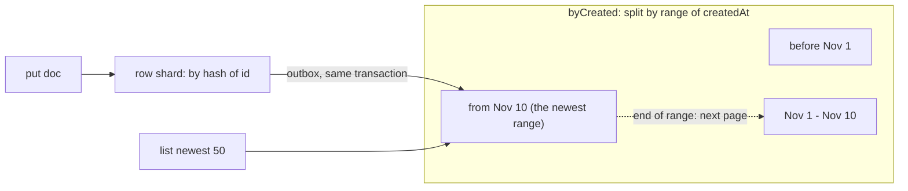

# RFD0012 - Shard-local tables: ShardedTable answers from one shard, IndexedTable across them

- Feature Name: `shard-local-tables`
- Status: Draft (the ShardedTable removals built)
- Author: `leostera`
- Start Date: `2026-11-15`
- Updated: `2026-11-15`
- Discussion PR: none
- Tracking Issue: none

## Summary

Every `ShardedTable` call should reach one shard, or the few shards its keys are on. The calls
that ask every shard (a listing in query order, `withCount`, `count()` and `countBy()`) leave
`ShardedTable`, and `IndexedTable` ([RFD0003](RFD0003-indexed-table.md)) answers them instead:
- an **ordered global index** split by ranges of its sort key, so a page of the whole table in
  order reads one index shard (two where a range ends), however many row shards there are;
- counts kept by index shards;
- a per-index `consistency: "consistent" | "eventual"` that says whether a write waits for its
  index changes.

`ShardedTable` gains a listing scoped to one route (`list({ route })`), and `list()` is its
shard-order walk ([RFD0009](RFD0009-walks-in-shard-order.md)), with no `order` to pick. The model is [specs/ordered-index.ts](../../specs/ordered-index.ts).

## Motivation

On the deployed benchmarks, every `ShardedTable` operation that touches one shard scales with the
number of shards, except listing:

| operation | 1 shard | 16 shards | 64 shards |
|---|---|---|---|
| get | 1.9k/s | 11.8k/s | 14.6k/s |
| put | 1.1k/s | 6.4k/s | 5.9k/s |
| walk (shard order) | 0.4k/s | 7.6k/s | 9.6k/s |
| list (query order) | 495/s | 462/s | 186/s |

Query-order listings got no faster with more shards, and errors started at fewer callers as
shards were added (1,024 callers on 16 shards, about 512 on 64). The cause is the fan-out:
- **A point call divides the load by N.** With N shards, each shard sees 1/N of the calls.
- **A page in query order multiplies it by N.** Every page asks every shard for its next rows and
  merges them (RFD0002). Each shard serves every page, however many shards there are, and 64
  shards make 64 calls a page. The slowest of them sets the page's latency.
- **Sometimes twice.** Each shard sends about its share of a page (`perShardLimit`). When the merge
  cannot fill the page up to the frontier, it asks all N again.

`count()` and `countBy()` have the same shape: one stored number per shard, but N calls.

Three more problems are in the API itself:
- **The default is the costly one.** `list()` without `order` lists in query order. A user's first
  listing is the one that asks every shard, and `maxShardsPerPage` (64) turns it into an error
  once the table grows.
- **A route cannot be listed.** With `routeOf` (RFD0006), every row of one route is on one shard,
  so "this team's documents, newest first" could be one call. `list` has no way to say which route,
  so it asks every shard.
- **There is no cheap ordered listing of a whole table.** RFD0003's global indexes are split by
  hash of their partition values. That serves a listing within one partition (6.9× from 1 to 16
  shards) but not "every document, newest first": with no partition, the whole index is one
  object. RFD0003 reserved `partition: 0` (by range) for this, and left it unbuilt.

## Goals

- No `ShardedTable` client call makes a number of shard calls that grows with the number of shards,
  except the admin `verifyCounts()` and a walk, which visits each shard once over the whole walk.
- A listing of one route reads one shard.
- A page of a whole table in a global order reads one index shard, or two, at any table size.
- A consistent ordered index never misses an acknowledged write and never shows a version of a
  row twice, across splits of its index shards.
- An app can trade that for cheaper writes, per index, and knows exactly what it gives up.
- Counts that answer from one or a few objects.

## Non-goals

- Unique ordered indexes. Uniqueness stays with RFD0003's hash-partitioned unique indexes.
- Range-sharding the rows. Rows stay hash-sharded, so their writes stay spread.
- Listings ordered across routes on a `ShardedTable`. That is what `IndexedTable` is for.
- Routes on `IndexedTable` (still refused, as in RFD0006).
- Read replicas for the hottest index range. This RFD makes room for them (see "The hot end"),
  and a later RFD designs them with their own spec.
- Joins, arbitrary `count({ where })`, and snapshot listings (every page at one point in time).

## Guide-level explanation

`ShardedTable` answers what one shard can answer:

```ts
const docs = table(env.DOCS, "docs", schema, { routeOf: teamOf }); // "team-7/doc-42" → "team-7"

await docs.get("team-7/doc-42");
await docs.apply("team-7/doc-42", "rename", { title: "Q3" });

// One shard: this team's documents, newest first, through a local index.
const page = await docs.list({ route: "team-7", index: "byCreated", direction: "desc", limit: 50 });

// Every row once, a few shards a page; the order is the shards', not the table's.
for await (const { row } of docs.all()) await exportRow(row);
```

What needs the whole table, ordered or counted, is an `IndexedTable` global index:

```ts
const schema = defineTable<Doc>({
  primaryKey: "id",
  columns: { id: "text", team: "text", status: "text", createdAt: "integer", title: "text" },
  globalIndexes: {
    // Split by ranges of createdAt: a page reads the one shard covering its range.
    byCreated: { columns: ["createdAt"], partition: 0 },
    // Split by hash of status; one partition's count is one call.
    byStatus: { columns: ["status", "createdAt"], partition: 1, consistency: "eventual" },
  },
});
const docs = indexedTable(env.DOCS, env.DOCS_INDEX, "docs", schema);

const newest = await docs.list({ index: "byCreated", direction: "desc", limit: 50 });   // 1 call
const next = await docs.list({ index: "byCreated", direction: "desc", cursor: newest.cursor });
const shipped = await docs.count({ index: "byStatus", partition: ["shipped"] });          // 1 call
const total = await docs.count({ index: "byCreated" });          // one call per index shard
```

The two consistency modes differ only in when a write returns:

| | `"consistent"` (default) | `"eventual"` |
|---|---|---|
| a write returns | once the index changes it made are stored | once the row is stored |
| a listing or count afterwards | shows the write | may not show it for a moment |
| cost per write | one more round trip, in parallel per index shard | none on the write's path |
| when delivery is slow | `IndexPending` (the row is written) | nothing: the alarm delivers |
| unique indexes | always | not allowed |

### Diagram



## Reference-level explanation

### ShardedTable's API

| call | shards a call asks | in this RFD |
|---|---|---|
| `get`, `getMany`, `put`, `putMany`, `patch`, `delete`, `apply` | the shards of its keys | kept |
| `list({ order: "shard" })`, `all()` | a few a page, each once a walk | kept, as `list()` and `all()` with no `order` (built) |
| `list({ route })` | one | new |
| `list()` in query order (the default until now) | N a round, up to 3 rounds | removed (built) |
| `list({ withCount })` | N | removed (built) |
| `count()`, `countBy()`, count groups | N | removed (built), to `IndexedTable.count` |
| `verifyCounts()` | every shard, one at a time | kept, for operators |

Row shards keep their per-prefix row counts (RFD0002): splits use them, `verifyCounts` repairs them,
and a subclass reads its shard's with `ownedRowCount()`. Count groups served only `countBy`, and
go with it.

### Route-scoped listings

`list({ route, index?, where?, direction?, limit?, cursor? })` is one call, routed like a key whose
route is `route`. It needs the table's `routeOf` on the client; without one it throws, since every
key is then its own route and `get` already reads it.

- **Storage.** In a table with a `routeOf`, each local index is stored led by the route hash
  (`_hash`, RFD0006), so one route's rows are one range of each index. A page seeks to the route's
  range and reads about the rows it answers (RFD0002's page reads). Two routes can share a hash, so
  the shard also checks `routeOf(key) === route` on each row it returns; rows of the other route
  cost their reads and are not returned.
- **Cursors** hold the route, its hash and the position in the index. A page asked of a shard
  that split since is routed again by the route, and the shard that owns the route answers from
  the same position: one route is never split (RFD0006), so the page needs no merge.
- **Walks** of a routed table return each shard's rows grouped by route, then in index order.
- **Migration.** The index layout changes for routed tables only. Each local index of a routed
  table is redefined, and RFD0002's schema changes build it again in bounded steps while serving.
  Until a shard has built it, a route-scoped listing by that index answers "not ready".

### Ordered global indexes

An ordered global index is a global index with `partition: 0`: no leading columns are hashed, and
its entries are split by ranges of their entry key (the encoded columns, then the primary key, as
in RFD0003). Entries carry the same row copy, so a page needs no call to the row shards.

**Range splits in the core.** Index shards are sharded objects whose tree splits by range instead
of by hash bits:
- Objects keep their names by path (`0`, `01`, …). A split records a **split key** chosen from
  its data: child `0` owns the keys below it, child `1` the keys at or above it. A shard owns the
  range between the split keys on its path.
- Everything else of a split is as RFD0001: a storage snapshot, a claim, the hold on writes to the
  half that moves, activation, and `cleanupForeign` with the range test as `owns`.
- A `moved` answer carries the split key, and the client caches split keys by path. A client that
  knows none routes to the root and learns them as it goes, as it learns hash splits today.
- A range tree cannot be presplit: nothing is known about its keys before they arrive.
- **Choosing a split key.** A size or load split (RFD0011's triggers) splits at the median entry
  key. A shard whose writes mostly land above its 90th-percentile key (the newest range of a
  time-ordered index) splits there instead: the shard taking new entries stays small, so its next
  snapshot and split stay fast.

**Writes.** A write's index changes go into the row shard's outbox in the write's transaction and
are delivered as RFD0003 delivers them: coalesced across writes, up to 500 a call, at most 4 calls
at a time per row shard, each routed by entry key. A row whose sort column changes makes a remove
on one range and a put on another, possibly on two index shards.

**Pages.**
- The cursor names the index shard it was taken from (its path), the range it owned, and the entry
  key of the last entry returned. The next page asks that shard, not whichever the client's cache
  routes the position to: a page continues where the last one read.
- A shard lists only entries in the range it owns, never the copies of a range it gave away that
  cleanup has not deleted yet (`listOwnedOnly` in the spec).
- If the named shard split since, it answers `moved` with its split key; the page asks the child
  that owns the cursor's position, from the same position.
- When a page reaches the end of its shard's range with room left, it asks the shard that owns the
  next range (known from the split keys on the path), so a page costs at most two calls. The cursor
  then names that shard.
- A page can hold two entries of one row whose sort value changed during the listing (its put
  applied before its remove). The client keeps the newer version and drops the other.
- `direction: "desc"` starts at the shard owning the top of the key space and walks down.

**What a listing shows.** A listing is not a snapshot. It shows every row nobody wrote while it
ran exactly once, in order. A row written during it may show at its old position, its new one,
both (at two versions), or neither, as with any listing whose cursor is a position. It never
shows one version of a row twice. In consistent mode, a listing started after a write was
acknowledged shows that write, and nothing older of that row.

### Consistency

`consistency` is a property of each global index, `"consistent"` by default.
- **Consistent** is RFD0003's protocol: the write returns once every index shard has stored its
  changes, or throws `IndexPending` with the row written (the alarm finishes the delivery).
- **Eventual:** the write returns once the row and its outbox are committed. The same pump
  delivers the changes at once, without the write waiting; the alarm delivers what a failure or a
  restart left, as it does today. An index shard applies a change the same way in both modes, so
  an eventual index converges to the same entries. The lag is one delivery when nothing fails (a
  few milliseconds) and up to the outbox's alarm (2 s after a failed delivery) when something does.
- A write touching both kinds waits only for the consistent indexes' changes.
- Unique indexes cannot be eventual: a lookup must find a reserved value's row once it is written.
- Changing an index's consistency changes no stored data and does not change its id (RFD0003's
  fingerprint leaves it out).

### Counts

- **Per partition.** An index shard keeps the number of live entries per partition value, in the
  transaction that applies a change. `count({ index, partition })` on a partitioned index is one
  call, exact in the index's consistency mode.
- **Per range.** Each shard of an ordered index keeps its live entry count.
  `count({ index })` on an ordered index sums them, one call per index shard. That still grows,
  but with the index's size, not the row shards': entries are small, and a range shard holds
  millions of them before a size split.
- A count is exact when nothing is in flight; across a split it is as RFD0002's: the split commits
  in one transaction, and a count read during it is retried by its page.
- `countBy` goes: a count group is an index partitioned by the grouped column, counted per value.

### The hot end

Range splits spread reads and entries over a time-ordered index, but every new entry lands in the
newest range. Three things keep that shard serving:
- **Batching.** It receives coalesced deliveries, about one call per busy row shard at a time, each
  with up to 500 changes, not a call per write.
- **Small tail splits.** It splits near its top (above), so it stays small.
- **Replicas for reads.** Most reads of a "newest first" listing ask for the same range. A later
  RFD serves them from replicas behind a bookmark carried in the cursor (a replica answers only once
  it has applied up to the bookmark), using the platform's read replicas if ordinary Durable
  Objects can use them, or leased reads (RFD0004) if not.

The ceiling of one index shard applying batched changes is the open number of this design. It is
measured before phase 2 is called done.

### Invariants

Checked by [specs/ordered-index.ts](../../specs/ordered-index.ts), which models one row moving
from below an index shard's split key to above it, while the shard splits by range and a listing
pages through it, with a lost message or a failed call on any path:
- **readYourWrites:** a listing started after a write was acknowledged shows the row as written,
  and never an older version of it. Needs `ackAfterIndex` (consistent mode) and `listOwnedOnly`.
- **stableRowsOnce:** a finished listing shows every row nobody wrote during it exactly once.
- **noVersionTwice:** no listing shows one version of a row twice.
- **inOrder:** entries come back in sort order, across pages and shards.
- **converges:** once nothing is in flight and the outbox is empty, the index has exactly one entry
  per row, at its position and version. Needs `holdMovingHalf`.
- **finishes / writeAcked:** a listing that starts finishes, and a write is acknowledged.

Each rule is needed, and the spec says what breaks without it:
- without `ackAfterIndex` (eventual mode), a listing started after the acknowledgement misses the
  move (7 events);
- without `holdMovingHalf`, a put landing on the splitting shard after its snapshot is lost to
  both halves (11 events);
- without `listOwnedOnly`, the lower half lists its stale copy of the upper range, the cursor moves
  past it, and the new entry above the split is skipped (25 events).

RFD0003's invariants (unique, read-your-writes, converges, reservations end) hold unchanged for
consistent indexes, and all but read-your-writes for eventual ones.

### Compatibility and migration

This is a breaking change, with no migration: nothing runs on these tables in production, so the
removed calls and their storage are deleted outright. Until phase 2, an order across the whole
table is an `IndexedTable` index within a partition, and a count across it is a subclass's own:

| was | becomes |
|---|---|
| `list()`, `list({ order: "query" })` | `list({ route })`, the walk `list()`, or an `IndexedTable` ordered index |
| `list({ order: "shard" })`, `all({ order: "shard" })` | `list()`, `all()` |
| `list({ withCount })` | a listing, and `count` on an `IndexedTable` index |
| `count()` | `IndexedTable.count({ index })` |
| `countBy(group)` | an index partitioned by the column, `count({ index, partition })` |
| `maxShardsPerPage`, `TooManyShards` | gone with the fan-out |

- Moving a table from `ShardedTable` to `IndexedTable` keeps its storage (RFD0003); a new global
  index is built in the background, and `indexStatus()` says when.
- `IndexedTable.list` without `index` lists as `ShardedTable` now does: route-scoped or a walk.
- The benchmarks' query-order listing series is replaced by ordered-index listings, at 1, 16 and
  64 row shards.

### Security, privacy, and observability

- An ordered index copies rows into index shards, as RFD0003's do.
- Per index shard, `describe` reports its range, entry count, and changes applied per second. Per
  row shard, the outbox depth and its oldest change's age, per index: an eventual index's lag.

### Rollout and validation

1. **The spec** (done): `specs/ordered-index.ts`, checked with one and two faults.
2. **Phase 1, ShardedTable.**
   - The removals (built), and `specs/shard-walk.ts` now checks that a
     shard lists only what it owns (`listOwnedOnly`), which `specs/table-listing.ts`, removed with
     the query-order merge, checked before.
   - `list({ route })` with route-led local indexes. Tests under `cf dev`: a route listing reads
     one shard (counted shard calls) through splits; a routed table's indexes rebuild while
     serving; walks unchanged.
3. **Phase 2, range splits:** a spec of the core's range split and routing first (split keys in
   `moved`, cached by path, cursors pinned to a path), then the core change, then ordered indexes
   with consistency modes and per-range counts. Each rule of the specs gets a mutant in
   `scripts/mutants.ts` that a test kills.
4. **Deployed benchmarks:** a page of an ordered index at 1, 16 and 64 row shards costs one or two
   calls and keeps its throughput as row shards are added; writes in both modes against plain
   writes; the newest range's ceiling under time-ordered inserts.
5. **Phase 3:** replicas for the hot range, in their own RFD.

## Drawbacks

- **A breaking change.** Every app listing a `ShardedTable` in query order, or counting it, has to
  move. A table too small to need it pays for a second class and binding to get an ordered listing.
- **Writes cost more for ordered listings.** A consistent ordered index adds a round trip per
  write, as every global index does.
- **The hot end is one object for writes.** Batching raises its ceiling, but a time-ordered index
  takes all new entries on one shard. Its ceiling is unmeasured.
- **Not a snapshot.** A row moving during a listing can show twice at two versions, or not at all.
- **The core gains a second kind of tree.** Range splits share the split machinery, but routing,
  split-key choice and cursors are new code with their own failure modes.

## Rationale and alternatives

### Proposed design

A layer adds one capability and stops there. `ShardedTable`'s is rows on hash-sharded storage, so
every call it makes stays on the shards its keys name. Ordering or counting the whole table is a
different capability, which needs data laid out by something other than the key's hash; that is
what `IndexedTable`'s global indexes are. Splitting by range is the only layout under which a
page of a global order reads a bounded number of objects. Keeping rows hash-sharded keeps writes
spread, and the consistency mode lets each index decide what a write waits for.

### Simpler or narrower approach

- **Keep query-order listing, documented as for small tables.** It is what users reach for first
  and it fails as the table grows. A call whose cost grows with the shard count should not look like
  a cheap one.
- **Rename it (`scanAllShards`) instead of removing it.** Keeps an escape hatch, but it is a walk
  with a merge: the walk does the scan, and an ordered index does the order.
- **Only `list({ route })`, no ordered index.** Serves per-tenant listings, which are most of them,
  and leaves whole-table order with no answer.

### Other alternatives considered

- **One object per ordered index.** Totally ordered and simple, but one object takes every write's
  entry and every page: the ceiling of one object for the whole table.
- **Range-sharded rows.** Global order for free, but sequential keys send every insert to one
  shard, and the table's writes stop scaling. The index takes that cost instead, batched.
- **An index rebuilt in the background from the rows** (rows mark themselves changed; an alarm
  rebuilds the listing). Cheap writes, but seconds of lag with no bound, and a full rebuild per
  change. Eventual mode gives the cheap writes with a lag of one delivery.
- **Hash-partitioned indexes with a merge across index shards.** The same fan-out as today, moved
  to the index.

### Do nothing

Query-order listings stay the default, get slower as tables grow, and fail with `TooManyShards`
past 64 shards; route listings keep asking every shard.

## Prior art

- **Bigtable, Spanner and CockroachDB** split tables by range at keys chosen from their data, and
  route by split keys cached in the client, as phase 2 does. All of them document the hot tail of
  sequential keys, and recommend not ordering rows by time for that reason; here the rows stay
  hashed and only the index takes the tail.
- **DynamoDB global secondary indexes** are eventually consistent, and a scan of a table is a
  parallel scan of every partition, like a walk.
- **Cassandra** queries within a partition are cheap and queries across partitions are not, the
  same split as `list({ route })` and a walk.
- **D1's Sessions API** gives read-your-writes across read replicas with a bookmark carried by the
  client, the model for the hot range's replicas.

## Unresolved questions

### Before acceptance

- Should `count({ index })` on an ordered index exist, given that it grows with index shards, or
  should a total be a counter kept apart?

### During implementation

- The tail split threshold (90th percentile, fraction of writes above it) and how a shard tracks
  where its writes land.
- Whether `routeOf(key) === route` on every returned row is cheap enough, or rows should store
  their route.
- How many changes one index shard applies per second, batched, on the deployed Workers.

### Out of scope

- Replicas for the hot range, and bookmarks in cursors.
- Unique ordered indexes.

## Future possibilities

- Read replicas behind bookmarks for the newest range, and for any hot index shard.
- A `bookmark` an eventual-mode write returns, which a later listing can wait for.
- `count({ route })` on `ShardedTable`, from per-route counts kept in the write's transaction.
- Ordered indexes with a partition prefix and a range below it (`partition: 1` split by range
  within a hot partition).
